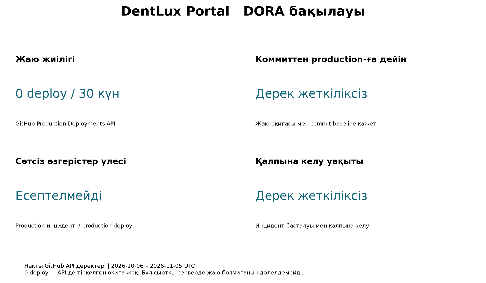

# Лабка 10 Пайплайн DORA және релиз жоспары

АТ ЖОБАЛАРДЫ БАСҚАРУ

Команда: Ізбасхан Әселхан — Project Manager / Frontend / QA; Жандос Арлан — Backend / DevOps; Еділ Шыңтас — DB Architecture.

## 10-ЗЖ. Пайплайн, DORA дашборды және релиз жоспары

DentLux Portal · АТ-жобаларды басқару

| Жоба туралы | Мәлімет |
| --- | --- |
| Репозиторий | https://github.com/akaashia/dentlux-portal |
| Орындаушылар | Ізбасхан Әселхан Жандос Арлан Еділ Шыңтас |
| Есеп күні | 05 қараша 2026 жыл |
| Бақылау кезеңі | 06.10.2026 06:10:32 – 05.11.2026 06:10:32 UTC 30 тәулік; жергілікті уақыт UTC+5 |
| Негізгі дереккөздер | GitHub REST API, репозиторий коды, 10 дәріс және алдыңғы 9 ЗЖ |

Жұмыстың мақсаты

DentLux Portal үшін автоматты тексерулердің күйін бағалау, репозиторий тарихынан төрт DORA метрикасын бақылау және жауаптылары белгіленген релиз бен кері қайтару жоспарын әзірлеу.

Негізгі нәтиже

Репозиторийде GitHub Actions пайплайны бар және API тарихында сәтті іске қосылулар тіркелген. Соңғы 30 күнде 14 аяқталған CI іске қосылуының 5-еуі сәтті, 9-ы сәтсіз. Production deployment жазбалары жоқ. Сондықтан production метрикаларының шектеуі ашық көрсетілді, ал CI сәтсіздігі production ақауы ретінде есептелмеді.

Бастапқы API snapshot кезінде main қорғалмаған еді. Сценарийді іске асыру барысында қорғаныс қосылды, PR №20 ашылды және security, test, publish jobs толық өтті. Негізгі тармаққа біріктіру үшін автордан бөлек қатысушының approve-ы қажет. Орындалу нәтижелері Пайплайн бөлімінде берілген.

## 1-бөлім. Пайплайн

Жоба туралы

DentLux Portal — стоматологиялық клиникаға онлайн жазылу жүйесі. React/Vite интерфейсі Express API-мен жұмыс істейді. Серверлік дерекқор — PostgreSQL, жергілікті демо — SQLite. Бастапқы c9b01c5 baseline-да жазылу, рөлдер, OTP, шифрлау және хабарлама кезегі автоматты тексерулермен қамтылған.

Пайплайн — кодты автоматты түрде тексеретін қадамдар тізбегі.

Жобада бұл процесс былай жүреді:

Код жіберілді → тексерулер орындалды → қосымша құрастырылды → дайын пакет жарияланды.

Пайплайнды баптау

| Кезең | Репозиторийдегі іске асыру | Шарт |
| --- | --- | --- |
| Іске қосу | push және pull_request оқиғалары | GitHub Actions, ubuntu-latest |
| Тәуелділіктер | Node.js 22, npm ci, npm кэші | package-lock.json пайдаланылады |
| Линтер және стиль | npm run lint; npm run format:check | ESLint және Prettier |
| Автотесттер | npm test; TEST_DATABASE_URL арқылы қайта тексеру | SQLite және PostgreSQL 18 |
| Құрастыру | npm run build | Vite dist/ бумасын жасайды |
| Браузерлік тест | npm run test:e2e | Playwright Chromium |
| Осалдықтар | Trivy HIGH/CRITICAL; npm audit | Қауіпті нәтиже job-ты тоқтатады |
| Құпиялар және құрам | gitleaks; SBOM SPDX JSON | security job ішінде |
| Жариялау | Playwright диагностикасы және тексерілген runtime пакеті | Жаңа PR: runtime пакеті және SHA256SUMS жарияланады |

Жергілікті тексеру нәтижесі

| Тексеру | 05 11 2026 нәтижесі |
| --- | --- |
| npm test | 13 passed, 0 failed, 1 skipped. PostgreSQL URL берілмегендіктен бір тест өткізілмеді. |
| npm run build | Сәтті. dist/index.html және CSS/JS файлдары жасалды. |
| npm run lint | Сәтті, қате хабарламасы жоқ. |
| npm run format:check | Бастапқы тексеруде төрт файл бойынша өтпеді. Сценарийді іске асырудан кейін жергілікті формат тексеруі және GitHub CI өтті. |
| Толық CI теңдігі | Жергілікті тексеру GitHub-тағы PostgreSQL, Trivy және E2E нәтижесін алмастырмайды. |

Тексерілген main нұсқасы: 7394bca. Жергілікті тест алғашында loopback желісінің шектеуінен тоқтады; желіге рұқсат берілген қайталама іске қосылуда 13 тест өтті.

Артефактты жариялау

ci.yml жаңартылып, PR №20 тармағына жарияланды. Test job PostgreSQL, E2E және audit өткеннен кейін runtime пакетін сақтайды. Publish job security және test сәтті болғанда сол пакет пен checksum-ды жариялайды. Release job v* тегінде тексерілген осы пакетті пайдаланады және тегтің main тарихында болуын тексереді. GitHub Release production deployment болып саналмайды.

publish job: needs = [security, test]. Test жасаған runtime-SHA пакеті жүктеледі; SHA256SUMS есептеледі; пакет пен checksum dentlux-release-SHA artifact-ына 30 күнге сақталады. Орындауға арналған нақты YAML — Дополнения/ci.yml.

Нақты YAML көпжолды түрде ci.yml қосымшасында сақталған; бұл есептегі түсіндірме орындалатын код емес.

Артефакт аты нақты commit SHA-мен байланысады. Ол Node.js іске қосу пакеті; серверде npm ci --omit=dev және қажетті орта айнымалылары керек. .env, токендер, development.key және пациент деректері пакетке кірмейді. Жарияланған пакет production-ға автоматты жаю болып саналмайды.

Негізгі тармақты қорғау және ревью ережелері

Бастапқы GET /branches/main жауабы protected=false болған. Қазір қорғау қосылды және API арқылы қайта тексерілді: protected=true. protection.json төмендегі ережелермен қолданылды:

1. Өзгерісті тек pull request арқылы біріктіру; кемінде 1 approve.
2. Жаңа коммиттен кейін ескі approve-ды жою; талқылауларды жабуды талап ету.
3. security, test және publish тексерулерін міндеттеу; тармақты main-пен жаңартуды талап ету.
4. Force push пен тармақты жоюға тыйым салу; ережені әкімшіге де қолдану.

PR авторы өз өзгерісін өзі бекітпейді. Әселхан frontend пен QA-ды, Арлан backend/CI-ді, Шыңтас деректер схемасын қарайды; соңғы approve-ды автордан басқа команда мүшесі береді.

GitHub репозиторийіндегі өзгерістер

PR №20: [https://github.com/akaashia/dentlux-portal/pull/20](https://github.com/akaashia/dentlux-portal/pull/20)

Commit: c9b01c540620853632578a5773ee6fe41c8cb9ed

ci.yml: PostgreSQL тесттері, DORA есептеуінің 3 тесті, линтер, формат, build, npm audit, Playwright және security. Runtime пакет қауіпсіздік пен тесттер өткеннен кейін жарияланады. Release job жаңа build жасамайды. .github/workflows/dora.yml апта сайын және қолмен API дерегін жинауға дайын; жоспарлы іске қосылуы main-ге біріктірілгеннен кейін белсенді болады.

Пайплайнның орындалу нәтижесі

PR run: [https://github.com/akaashia/dentlux-portal/actions/runs/41981075829](https://github.com/akaashia/dentlux-portal/actions/runs/41981075829)

Push run: [https://github.com/akaashia/dentlux-portal/actions/runs/41981016199](https://github.com/akaashia/dentlux-portal/actions/runs/41981016199)

security — «Жоба қауіпсіз бе?»

Кодта құпия кілттер мен токендер қалып қоймағанын және кітапханаларда белгілі осалдықтар бар-жоғын тексереді. Мысалы, body-parser осалдығын осы қауіпсіздік тексеруі анықтаған.

test — «Қосымша дұрыс жұмыс істей ме?»

Кодтағы қателерді, форматын және функциялардың жұмысын тексереді. Мысалы, пациенттің жазылуын, бір слотқа екі адам жазылып кетпеуін тексереді. Содан кейін қосымшаны құрастырып, дайын пакет жасайды.

publish — «Тексерілген пакетті сақтау»

Алдыңғы екі жұмыс сәтті өткеннен кейін дайын пакетті GitHub-қа жариялайды. Пакетпен бірге оның өзгермегенін тексеретін бақылау сомасын сақтайды. Бұл қадам сайтты серверге орналастырмайды.

publish — тексерілген пакетті жариялау

Бұл job security және test екеуі де сәтті өткеннен кейін ғана басталады.

Ол:

- test дайындаған пакетті жүктеп алады.

- Пакеттің SHA-256 бақылау сомасын есептейді.

- Пакет пен бақылау сомасын Artifacts бөліміне жариялайды.

- Оларды 30 күнге сақтайды.

| Job | Нәтиже |
| --- | --- |
| security | success: Gitleaks, Trivy және SBOM |
| test | success: формат, DORA, PostgreSQL, build, audit және E2E |
| publish | success: runtime пакет және SHA256SUMS |
| release | skipped: v* тегі жасалған жоқ |

Біріктіру мәртебесі

Main: protected=true; security/test/publish міндетті; strict=true; 1 approve; require_last_push_approval=true; admin-ге де қолданылады. Force push және тармақты жою өшірулі. Бұл күй өзгерістен кейін GitHub API арқылы қайта оқылып расталды.

PR авторы өз PR-ын approve ете алмайды. Write құқығы бар басқа команда мүшесі соңғы өзгерісті қарап бекітуі керек. Тексерулер өткеннен кейін де осы review талабы орындалмайынша merge жасалмайды. Қорғауды айналып өту қолданылған жоқ.

Осы іске асыру production deploy емес. DORA-ның бастапқы 30 күндік snapshot-ы есепте өзгеріссіз сақталды; жаңа CI run-дары алғашқы 14 run статистикасына кері қосылмады. Келесі API жинауында жаңа бақылау терезесі мен snapshot жасалады.

## 2-бөлім. DORA дашборды

GitHub API арқылы деректер жинау

Деректер GitHub REST API v2022-11-28 арқылы 05.11.2026 күні алынды. scripts/collect_dora.py беттеуді per_page=100 арқылы орындайды және жауаптарды github-raw.json файлына сақтайды. Есептеу нәтижесі metrics.json файлына жазылады. Дашборд matplotlib арқылы жасалады; ақылы BI қолданылмайды.

| API ресурсы | Не үшін қолданылды |
| --- | --- |
| /repos/akaashia/dentlux-portal | Ашық репозиторий және негізгі тармақ |
| /commits | default branch тарихы: 20 коммит |
| /pulls?state=all | 3 PR: 1 merged, 1 ашық, 1 біріктірілмей жабылған |
| /actions/runs | CI іске қосылуы, тармақ, оқиға және conclusion |
| /releases | Жарияланған release: 0 |
| /deployments | Deployment жазбалары: 0 |
| /issues?state=all | production-incident белгісімен инциденттер: 0 |
| /branches/main | Бастапқы snapshot: false; іске асырудан кейін: true |

Коммиттер мен PR саны қолжетімді тарихтың жалпы көлемін көрсетеді; CI көрсеткіштері тек таңдалған 30 тәулікке есептеледі. 20 коммитті 30 күнде жасалған коммит саны деп түсіндіруге болмайды.

Репозиторий тарихының нақты деректері

| Run ID және күн | Тармақ | Нәтиже |
| --- | --- | --- |
| 41304563447 · 01.11.2026 | chore/#13-lab9-workflow · pull_request | success |
| 41304561063 · 01.11.2026 | chore/#13-lab9-workflow · push | success |
| 40855408568 · 29.10.2026 | main · push | failure |
| 39774036664 · 22.10.2026 | main · push | success |

Сәтті CI үлесі = 5 / 14 × 100 = 35,7%. Сәтсіз CI үлесі = 9 / 14 × 100 = 64,3%. Бір SHA үшін push пен pull_request жеке іске қосылуы мүмкін; бұл үлгі тәуелсіз 14 релизді білдірмейді. Ең соңғы екі сәтті run жұмыс тармағында, ал main тармағының соңғы run-ы сәтсіз.

Мысал дәлел: https://github.com/akaashia/dentlux-portal/actions/runs/41304563447
Main дәлелі: https://github.com/akaashia/dentlux-portal/actions/runs/40855408568

Төрт DORA метрикасының дашборды

1 сурет. GitHub API-ден алынған нақты деректерге негізделген төрт DORA көрсеткіші. Бақылау терезесі — 30 тәулік.

| Метрика | Нақты бақылау және есеп | Ағымдағы деңгей |
| --- | --- | --- |
| Жаю жиілігі | 0 сәтті production deployment / 30 күн = 0 тіркелген deploy/күн. | API бойынша тіркелген жаю жоқ; өнімділік деңгейін бекітуге дерек жеткіліксіз. |
| Коммиттен production-ға дейін | Медиана(deploy уақыты − сол deploy-да алғаш жеткізілген commit уақыты). Қажетті deploy және ancestry baseline жоқ. | Анықталмайды. |
| Сәтсіз өзгерістер үлесі | Ақау тудырған бірегей production deploy / барлық тиісті production deploy × 100. Бөлім 0: 0/0 анықталмайды. | Анықталмайды; 0% деп жазылмайды. |
| Қалпына келу уақыты | Медиана(restored_at − started_at), сағат. Байланыстырылған қалпына келген инцидент жоқ. | Анықталмайды; 0 сағат деп жазылмайды. |

Команданың ағымдағы деңгейі және шектеулер

Deployment API-де оқиға болмауы сыртқы серверде ешқашан жаю болмағанын дәлелдемейді. Жаю басқа құралмен орындалып, GitHub-та тіркелмеуі мүмкін. Сондықтан командаға Elite, High, Medium немесе Low санатын тағайындауға негіз жоқ. Қысқа әрі толық емес тарих — бақылау нәтижесі.

Дәрістегі төрт метрика сақталды. GitHub Release, PR merge немесе жасыл CI production deployment-тің орнына алынбады. Инцидент журналының толықтығы расталмайынша болашақ CFR мәні де алдын ала бақылау болып қалады.

Бірінші жақсарту Жаю мен инцидентті тіркеу

Мәселе: production deployment және байланыстырылған инцидент жазбалары жоқ. Сондықтан төрт DORA көрсеткішінің үшеуін санмен есептеу мүмкін емес.

Әр нақты production жаюы үшін GitHub Deployment объектісін нақты SHA және environment=production мәндерімен тіркеу керек. Жаю басталғанда in_progress, health-check өткенде success статусы жазылады. Қате шыққан жаюдың production-ға жеткен-жетпегені бөлек анықталады. Staging deployment бұл есепке кірмейді.

Production ақауы үшін production-incident белгісі бар issue ашылып, deployment_id, started_at, restored_at және себеп жазылады. Issue-дің жабылу уақытын автоматты түрде сервистің қалпына келген уақыты деп алу дұрыс емес. Уақыттар ISO 8601 UTC форматында сақталады.

{
  "deployment_id": "нақты GitHub deployment ID",
  "started_at": "нақты ISO 8601 UTC уақыты",
  "restored_at": null
}

Жауапты: Жандос Арлан; журналды тексеруші: Ізбасхан Әселхан. Мерзімі: 13.11.2026. Күтілетін әсер: келесі нақты релиздерде жаюлардың 100%-ы SHA және уақытпен тіркеледі; бұл алдымен өлшеу сапасын жақсартады. Жаңартылған collect_dora.py екі production SHA арасындағы compare API дерегін жинайды. Бірінші deploy, rollback және толық емес салыстыру үлгіге кірмейді. Қазіргі snapshot-та production deploy жоқ болғандықтан N/A көрсетіледі.

Екінші жақсарту Шағын PR және бірдей артефакт

Мәселе: 14 CI run-ның 9-ы сәтсіз, main-нің соңғы run-ы да өтпеген. Жергілікті format:check төрт файлдағы стиль айырмасын анықтады. Бұл нақты кері байланыс, бірақ барлық тарихи қателердің себебі осы болды деп тұжырым жасалмайды.

Prettier айырмаларын түзету, PR-ларды бір функционалдық өзгеріспен шектеу, міндетті test/security тексерулерін қосу және тек сол SHA үшін тексерілген артефактты пайдалану ұсынылады. Үлкен өзгерістер review алдында бөлінеді; асығыс жағдайда тексерулер айналып өтілмейді.

Жауапты: Ізбасхан Әселхан және Жандос Арлан; БД өзгерісіне Еділ Шыңтас қатысады. Мерзімі: 13.11.2026. Күтілетін әсер: келесі кемінде 10 аяқталған CI run бойынша success үлесін ≥80%-ға жеткізу; PR review күтуін ≤1 жұмыс күніне ұстау. Бұл мақсаттар әлі қол жеткізілген нәтиже емес.

Метрикаларға күтілетін әсер

Ұсақ релиздер жаю жиілігін арттыруға және lead time-ды азайтуға жағдай жасайды. Міндетті тексерулер CFR-ды төмендетуге, дайын rollback қалпына келуді қысқартуға бағытталады. Нақты әсер тек өндірістік оқиғалар жиналғаннан кейін салыстырылады; метрикалар жеке адамды бағалау үшін қолданылмайды.

Дашбордты қайта есептеу

Қайта есептеу: python -m pip install matplotlib; кейін python collect_dora.py --offline. Бастапқы snapshot Дополнения/DORA/data ішінде. Командалар бөлек жолмен README-де берілген.

Нәтижелер: assets/lab10-artifacts.zip ішіндегі DORA/data/github-raw.json — API жауаптары және сұрау URL-дері; metrics.json — есептеу; dora-dashboard.png — төрт метрика. Интернетсіз қайта есептеу үшін --offline қолданылады. Жеке репозиторий болса, GITHUB_TOKEN орта айнымалысы қажет; токен есепке не git-ке жазылмайды.

## 3-бөлім. Релиз жоспары

Релиз күнтізбесі және өзгеріс терезелері

Төмендегі күнтізбе — команда бекітуге арналған жоспар. Барлық уақыт Asia/Qyzylorda, UTC+5. Дәрігерлердің нақты кестесі, хостинг пен хабарлама кілттері расталмайынша production релизіне Go берілмейді.

| Кезең | Терезе | Жауапты және нәтиже |
| --- | --- | --- |
| CI мен қорғаныс | 09–13.11.2026 | Арлан: артефакт жариялау; Әселхан: review ережесі және QA. |
| Staging дайындау | 17.11.2026, 18:00–19:00 | Арлан: стенд, secrets, TLS; Шыңтас: БД көшіруін тексеру. |
| Репетиция | 24.11.2026, 18:00–19:00 | Команда: synthetic деректе smoke және rollback жаттығуы. |
| Go немесе No-Go | 25.11.2026, 17:00 | Әселхан: дәлелдер мен клиника келісімі; Арлан/Шыңтас техникалық растауы. |
| Шектеулі пилот релизі | 26.11.2026, 18:30–19:00 | Арлан: жаю; Шыңтас: БД; Әселхан: қабылдау. Клиника бекітсе ғана. |
| Бақылау | 26.11.2026, 19:00–20:00 | Арлан кезекші; Әселхан smoke нәтижесі мен пайдаланушы өтінішін қарайды. |
| Қорытынды | 27.11.2026, 12:00-ге дейін | Әселхан: релиз хаттамасы; Арлан: DORA деректерін жаңарту. |

Релиз саясаты

26.11.2026 — M2 алдындағы шектеулі пилот ұсынысы. Толық соңғы қабылдау M3 — 20.12.2026. Пилоттың scope-ы M2 онлайн жазылумен шектеледі; M3 құжаттары, импорт және оқыту дайын деп саналмайды.

Бұл MVP үшін бір сервердегі басқарылатын ауыстыру жоспарланады. Алдыңғы нұсқа пакеті және оның SHA-сы сақталады. Blue-green немесе canary іске асырылды деп мәлімделмейді. Релиз басталғанға дейін жаңа артефакттың checksum-ы, бұрынғы нұсқа және БД үйлесімділігі тіркеледі.

Жауаптылар

Әселхан — Go/No-Go шешімі, QA және клиникамен келісу. Арлан — артефакт, жаю, мониторинг және rollback орындау. Шыңтас — миграция, резервтік көшірме және деректер тұтастығы. Арлан қолжетімсіз болса, production жаюы кейінге қалады. Клиника мен қолдауға хабарламаны PM релизге дейін келіседі; хабарлама жіберілді деп бұл есепте белгіленбейді.

Релиз чек-листі

☐ Релизге кіретін PR, issue, нұсқа және commit SHA тізімі бекітілді. Иесі — Әселхан.

☐ Нақты релиз SHA үшін test, security және publish тексерулері сәтті. Иесі — Арлан.

☐ ESLint, Prettier, SQLite/PostgreSQL және E2E тексерулері өтті; өткізіліп кеткен міндетті тест жоқ. Иесі — Әселхан.

☐ Trivy HIGH/CRITICAL және құпия сканері бұғаттайтын ақау таппады; SBOM сақталды. Иесі — Арлан.

☐ Release пакеті, SHA және checksum тіркелді; staging пен production үшін бір пакет таңдалды. Иесі — Арлан.

☐ Клиника деректері, TLS, SMS/Telegram кілттері және сервер құпиялары дұрыс берілді. Иесі — Арлан.

☐ Миграция production схемасының анонимдендірілген көшірмесінде өтті, бұрынғы кодпен үйлесімділік тексерілді. Иесі — Шыңтас.

☐ БД backup жасалды және қалпына келтіру репетициясы сәтті аяқталды. Иесі — Шыңтас.

☐ Алдыңғы пакет қолжетімді; rollback реті staging-де тексерілді. Иесі — Арлан.

☐ Мониторинг, алерт жеткізу арнасы және кезекші бекітілді. Иесі — Арлан.

☐ Клиника өзгеріс терезесін мақұлдады, қолдау нұсқаулығы дайын. Иесі — Әселхан.

Жаюдан кейінгі тексерулер

☐ HTTPS және /api/health жауап береді; каталог пен бос слоттар ашылады.

☐ Бақыланатын тест жазылуы, OTP және қызметкердің көруі тексерілді; synthetic жазба саясаты сақталды.

☐ Бір слотқа қатарлас сұраныста бір ғана жазылу жасалады; аудит пен хабарлама кезегі тексерілді.

☐ Қате үлесі мен p95 бастапқы көрсеткішпен салыстырылды; deployment status=success тек тексеруден кейін қойылды.

☐ SHA, UTC уақыт, тексеруші және нәтиже релиз хаттамасына жазылды.

Белгілер бос қалдырылды: бұл орындауға арналған чек-лист. Бос белгі орындалған жұмыс ретінде есептелмейді. Go шешімін Әселхан Арлан мен Шыңтастың дәлелі болғанда ғана тіркейді.

Кері қайтару критерийлері

| Сигнал | Ұсынылған шек | Әрекет |
| --- | --- | --- |
| Қолжетімділік | /api/health 30 секунд аралықпен 3 рет өтпейді | Жаюды тоқтату және rollback шешімі |
| API қателері | 5xx үлесі >2%, 5 минут, кемінде 100 API сұранысы | Арлан талдайды; релизбен байланыс расталса rollback |
| Кідіріс | p95 >800 мс, 5 минут, кемінде 100 тиісті сұраныс | Базалық деңгеймен салыстыру; деградация сақталса rollback |
| Дерек тұтастығы | Кемінде 1 қос брондау немесе жеке дерек ашылуы | Дереу жаңа жазылуды тоқтату, инцидент ашу |
| Трафик аз | 100 сұранысқа жетпеген терезе | Сандық қорытынды жасалмайды; smoke қатесі бөлек бағаланады |

Шектер — осы релизге ұсынылған операциялық ереже. Олар өлшенген production SLA ретінде берілмейді. Мақсат: шешімнен кейін кодты ≤15 минутта қайтару; толық қалпына келу уақыты нақты инциденттен есептеледі.

Кері қайтару чек-листі

☐ Арлан UTC уақытын және deployment_id-ді жазып, production-incident ашты; Әселханға хабарлады.

☐ Жаңа жаю тоқтатылды. Дерек тұтастығына қауіп болса, жаңа жазылу уақытша жабылды.

☐ Шыңтас ағымдағы БД күйін сақтады және бұрынғы кодпен схема үйлесімділігін растады.

☐ Арлан алдын ала тексерілген алдыңғы SHA пакетіне ауыстырып, сервисті қайта іске қосты.

☐ Health, каталог, слот, авторизация және жазылу smoke-тесттері өтті; қателер мен кідіріс тексерілді.

☐ Шыңтас қайталама брондау, қабылдау тізімі және outbox тұтастығын тексерді.

☐ Арлан restored_at уақытын нақты қалпына келу белгісімен тіркеді; Әселхан нәтижені командаға хабарлады.

Дерекқорды қалпына келтіру

Кодты кері қайтару БД backup-ын автоматты түрде қалпына келтіруді білдірмейді. Backup жаңа жазылуларды жоғалтуы мүмкін. Деструктивті миграцияға бөлек жоспар және деректерді салыстыру қажет. Үйлесімсіз схема болса, Шыңтас forward-fix не оқшауланған restore жоспарын ұсынады; соңғы көшірме мен жаңа жазбалар қорғалады. Инциденттен кейін 1 жұмыс күні ішінде себеп пен алдын алу әрекеті талданады.

Тапсырма критерийлерінің орындалуы

| Критерий | Дәлел және күй |
| --- | --- |
| Пайплайн іске қосылады және өтеді | PR №20 үшін жаңа CI run 41981075829 сәтті. security, test және publish өтті. Main-ге біріктіру тәуелсіз review-ды күтеді. |
| Линтер, тест, build, scan | PR №20: lint, format, DORA тесттері, PostgreSQL, build, audit, E2E және security тексерулері өтті. |
| Артефактты жариялау | publish job dentlux-release-SHA артефактын жариялады; пакет пен SHA256SUMS бар. |
| Негізгі тармақты қорғау | API protected=true. 1 approve, strict security/test/publish, admin-ге де қолдану расталды. |
| Нақты деректерден DORA | API snapshot, формулалар және дашборд дайын. Production тарихы жоқ жерлерде N/A көрсетілді. |
| Деңгей және екі жақсарту | DORA дашборды бөлімінде метрикалар, деңгейлер, екі жақсарту және күтілетін әсер берілген. |
| Релиз және rollback | Релиз жоспары бөлімінде терезелер, жауаптылар, релиз және кері қайтару чек-листері берілген; репетиция жоспарланған. |

Қорытынды

Тапсырма талаптарына сәйкес пайплайн толықтырылды: PR №20-да міндетті тексерулер мен артефакт жариялау сәтті өтті, main қорғанысы қосылды. DORA есебінде production дерегі жоқ мәндер N/A түрінде сақталды. Негізгі тармаққа біріктіру тәуелсіз approve-ды күтеді; production жаюы мен rollback репетициясы әлі жоспар күйінде.

Дереккөздер

10 дәріс «Инженерлік тиімділік», 5–8, 16–17, 23–25 және 34–36 слайдтар.

«Әселхан, Арлан, Шынтас лабка9.docx»: команда, бір апталық спринттер және M2 вехасы.

https://github.com/akaashia/dentlux-portal — main 7394bca, ci.yml және package.json.

https://api.github.com/repos/akaashia/dentlux-portal — API snapshot 05.11.2026; толық URL тізімі github-raw.json ішінде.

## 10 қарашадағы қайта тексеру

PR №20 open, merged=false; head c9b01c540620853632578a5773ee6fe41c8cb9ed. Run 41981075829 және 41981016199 success. Main protected=true; security/test/publish required checks public API-де көрінеді. Бұл дәлелдер Дополнения/pull20.json, run20.json және main.json ішінде сақталған. Нақты review саны мен last-push талабы үшін толық branch-protection export әкімшілік қолжетімділікпен қайта тексеріледі; public branch жауабының өзінен барлық параметр расталды деп айтылмайды.

DORA бастапқы 05.11 snapshot-ы — сол күннің бақылауы; оған кейінгі CI оқиғалары артқа қосылмайды. Скрипт пен бастапқы JSON қосымшада берілген. Production deployment жоқ жерде N/A сақталады; командаға DORA деңгейі ойдан тағайындалмайды. Екі жақсарту — deployment/incident тіркеу және шағын PR + тексерілген артефакт — жоспар күйінде.

## Қосымшалар

- [DORA скрипті snapshot графиктер және CI дәлелдері](assets/lab10-artifacts.zip)

[Барлық зертханалық жұмыстар](README.md)
