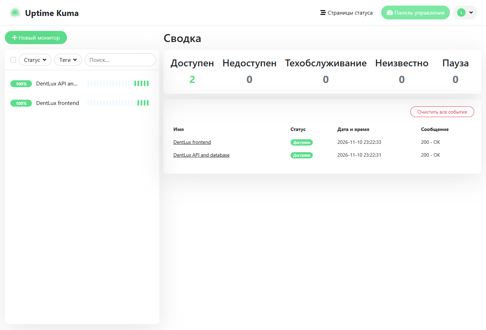

# Лабка 11 Сапа қабылдау және пайдалану

> Дерек мәртебесі: жергілікті автоматты тексерулер орындалды. Басқа команданың UAT сессиясы әлі өткізілмеген; қабылдау хаттамасына қол қойылмаған.

## ЛАБКА 11

DentLux Portal · АТ жобаларын басқару · түзетілген нұсқа 10 қараша 2026

#### Команда

| Қатысушы | Рөлі |
| --- | --- |
| Ізбасхан Әселхан | Project Manager / Frontend / QA |
| Жандос Арлан | Backend / DevOps |
| Еділ Шыңтас | DB Architecture |

Мақсат: DentLux инкрементінің сапасын бағалау, тапсырыс берушінің қабылдауын дайындау және бір пайдалану сценарийін тексеру. Есеп тест жоспарын, UAT хаттамасын, кінәсіз postmortem және runbook құжаттарын біріктіреді.

Нақты тексеру: PostgreSQL-пен 15 тест өтті, Playwright екі сценарийі өтті, деректі азайтуға арналған pytest төрт тексеруі өтті. Docker-де Uptime Kuma іске қосылып, сайт пен API бақыланады. Қайта іске қосу кезінде синтетикалық жазба сақталды.

#### Инкремент және қабылдау мәртебесі

Тексерілген нұсқа — жергілікті өзгерістері бар жұмыс көшірмесі, базалық commit c9b01c540620853632578a5773ee6fe41c8cb9ed. Файлдардың SHA256 тізімі snapshot-manifest.json ішінде. GitHub main сол кезде 7394bca275072c46554095cfab2da05f40104af7 болды. Жергілікті нәтижелер main нәтижесі ретінде көрсетілмейді.

UAT үшін 12 сценарий және толтыруға дайын хаттама әзірленді. Басқа команданың қатысуы мен қолтаңбасы әлі алынған жоқ. Сондықтан автоматты тексерулердің нәтижесі UAT қабылдауы ретінде көрсетілмейді. Ашық ортаға шығару RBAC бойынша DEF-01 жабылғанға дейін бұғатталады.

Негіз: берілген 11-дәріс, әсіресе 7, 9–14, 16–23 және 29–39 слайдтары. Деректер мен уақыт белгілері 10.11.2026 күнгі жергілікті тексерулерден алынған. Уақыт белдеуі UTC+5.

## 11-ЗЖ. 1-бөлік: тестілеу стратегиясы

### 1.1 Тестілеу деңгейлері және автоматтандыру

Негізгі тәуекелдер: бір слотқа қос жазылу, рұқсатсыз пациент дерегін оқу, броньды жылжытқанда деректі жоғалту және хабарламаның қате күйі. Сондықтан жиі әрі арзан логика мен API тексерулері басым; E2E тек негізгі пайдаланушы жолдарын жабады.

| Деңгей | Көлем және құрал | Жиілік және иесі |
| --- | --- | --- |
| Модульдік | Node test: күн, телефон, AES-GCM, конфигурация | Әр PR; Арлан және Шыңтас |
| DB интеграция | PostgreSQL 18: транзакция, unique slot, rollback, immutable audit | Әр PR; Шыңтас |
| API | Node test; Bruno коллекциясы: health, catalog, қате күн | Әр PR; Арлан |
| E2E | Playwright: брондау, панель, kk/ru, mobile, keyboard | Әр PR; Әселхан |
| Деректі азайту | pytest: идентификатор, еркін мәтін және күндерді алмастыру | CSV түрлендіргіші өзгергенде; Шыңтас |
| Жүктеме | k6: каталог пен слотты оқу; жеке шыңдық профиль | Релиз алдында; Арлан |
| Қолмен UAT | 12 бизнес сценарийі, басқа команда тапсырыс беруші рөлінде | Инкремент қабылдауында; Әселхан |

#### Автоматтандыру шекарасы

Қайталанатын брондау ережелері, қателер, шифрлау және негізгі регресс автоматтандырылады. Мәтіннің түсініктілігін, жұмыс процесінің клиникаға ыңғайлылығын және қабылдау шешімін адамдар бағалайды. Coverage пайызы өлшенген жоқ; 100% coverage немесе барлық талап орындалды деген тұжырым жасалмайды.

Әр ақау үшін severity техникалық әсерді, priority бизнес шұғылдығын білдіреді. Әселхан триажды үйлестіреді; Арлан API мен ортаны, Шыңтас DB бүтіндігін тексереді. Команда рөлдері алғашқы бетте толық көрсетілген.

### 1.2 Тест ортасы және сапа шектері

| Орта | Мақсаты | Нақты күйі |
| --- | --- | --- |
| Жеке жұмыс көшірмесі | Негізгі репозиторийді өзгертпей тексеру | lab11-validation; Node 24.22.1; Vite build өтті |
| PostgreSQL Docker | Қатарлас транзакцияны нақты DB-де тексеру | postgres:18-bookworm; 127.0.0.1:55431; жеке lab11 DB |
| SQLite демо | UI, UAT дайындығы және restart жаттығуы | http://127.0.0.1:3111; тек synthetic дерек |
| Мониторинг | Сайт пен DB health HTTP 200 | Uptime Kuma 2.5.9; Docker; 127.0.0.1:33011 |
| Сыртқы SMS | Шынайы жеткізуді тексеру | Кілт/тест контуры жоқ; mock қателері ғана сыналды |

#### Релизге өту шарттары

Әзірлеуге кіру: қабылдау критерийі, иесі, тест дерегі және тәуелділік анықталған. Шығу: ревью, жасыл автоматты тесттер және evidence бар. UAT-қа кіру: бір бекітілген build, оқшауланған дерек, стенд health, қысқа оқыту және басқа команда өкілі келісілген. Қабылдау: барлық міндетті сценарий өтіп, P1/P2 ақауы жабылған және хаттамаға тараптар қол қойған.

#### Функционалдық емес талаптар

Өнімділік мақсаты: 200 қатарлас пайдаланушы, 15 минуттық шың, слот API p95 < 800 мс және сәтсіз сұраныс < 1%. Одан кейін 2 сағаттық қалыпты жүктеме жоспарланады. Нақты орындалған сынақ — 10 VU, 30 секунд, SQLite. Бұл өндірістік мақсатты растауға жеткіліксіз.

Қауіпсіздік: клиникалық панель анонимге 401/403 қайтаруы керек; қазір 200 болғандықтан production gate өтпеді. Қолжетімділік: пернетақта, фокус және 320/360/390/768 px ендері Playwright арқылы тексерілді; толық WCAG аудиті жасалмады. Тілдер: kk және ru. Қалпына келтіру: жеке демо restart < 60 с мақсатымен сыналды; бұл PostgreSQL backup restore немесе өндірістік RTO/RPO емес.

### 1.3 Тест деректерін иесіздендіру

Негізгі әдіс — өндірістік пациент базасын мүлде көшірмей, синтетикалық дерек жасау. Жергілікті бронь Synthetic Lab11 Patient атымен жасалды. Демо режимі SMS-ті сыртқы шлюзге жібермейді. Mock сыртқы жүйе timeout/қатесін тексереді; нақты SMS жеткізілуі тек провайдердің тест контурымен бөлек қабылданады.

| Өріс | Кіріс үлгісі тек ойдан шығарылған | Өңделген нәтиже |
| --- | --- | --- |
| patient_id | fictional-42 | TEST-0001; бастапқы кілт экспортталмайды |
| name | FAKE Original A | Synthetic Patient 0001 |
| phone | Синтетикалық бастапқы телефон | +70000000001; ешқайда жіберілмейді |
| date | 2026-01-10 | 2030-01-07; бастапқы күн сақталмайды |
| iin және notes | FICTIONAL-IIN және FAKE note | Алынып тасталады |
| Қайталама пациент | Екі жолда бір identity | Бір TEST токені; байланыс сақталады |

privacy/anonymize.py тек рұқсат етілген бағандарды шығарады. Email, мекенжай, еркін мәтін және бастапқы идентификатор көшірілмейді. Ауыстыру картасы файлға жазылмайды. Дәрігер мен уақыт квазиидентификатор болуы мүмкін, сондықтан бұл шағын мысал толық анонимдікке кепіл бермейді. Шынайы экспортқа қолжетімділік пен қайта сәйкестендіру тәуекелі бөлек бағаланады.

2030 күндері тек түрлендіруді көрсетуге арналған және қолданбаның 60 күндік брондау шегінен тыс. Оларды тікелей импорттауға болмайды. UI/DB тесттері UTC+5 бойынша ертеңгі жұмыс күнін есептейді; генерацияланған нөмірлер тек SMS өшірілген ортада пайдаланылады.

```text
python -m pytest privacy/test_anonymize.py -q
python privacy/anonymize.py privacy/synthetic-source.csv privacy/minimized.csv
```

Нәтиже: 4 passed. Тесттер бастапқы сәйкестендіргіштер мен еркін мәтіннің жойылуын, қайталама identity сәйкестігін, күннің ауысуын және identity жоқ жолдың қабылданбауын тексерді. Тест деректері жұмыстан кейін жойылады; есепте нақты пациент ақпараты жоқ.

### 1.4 Docker ішіндегі Uptime Kuma

Uptime Kuma 2.5.9 Docker-де нақты іске қосылды. Басқару интерфейсі тек осы ноутбукта http://127.0.0.1:33011 адресінде ашылады. Контейнердің дерегі жеке kuma-data volume ішінде. Image digest evidence/docker-images.txt файлына сақталған.

| Монитор | Нысана | Саясат |
| --- | --- | --- |
| DentLux API and database | host.docker.internal:3111/api/health | 20 с; timeout 5 с; retry 1; HTTP 200 |
| DentLux frontend | host.docker.internal:3111/ | 20 с; timeout 5 с; retry 1; HTTP 200 |



1 сурет — нақты жергілікті бақылау. Екі монитор Up, HTTP 200. Интерфейстегі 100% тек жиналған қысқа тарихқа қатысты; толық 30 күндік SLO орындалғанын білдірмейді. Health сұранысы DB SELECT 1 орындайды. Frontend мониторы HTTP күйін ғана тексереді; HTML мазмұны мен JS asset gate ACT-01 ретінде жоспарланды.

```text
docker compose -p dentlux-lab11 -f monitoring/compose.yaml up -d
docker compose -p dentlux-lab11 -f monitoring/compose.yaml ps
```

Сыртқы Telegram/email хабарламасы қосылған жоқ. Бақылау экраны жұмыс істейді, бірақ кезекшілік пен алерт жеткізу арнасы production алдында келісіліп, тексерілуі керек. Жергілікті admin дерегі архивке қосылмаған; ноутбуктегі outputs/lab11-local-access.txt ішінде.

### 1.5 Орындалған тексерулер

Барлық нәтиже жергілікті өзгертілген snapshot үшін алынған. Бастапқы репозиторийдің пайдаланушы өзгерістері сақталды. Тесттер нақты пациентке немесе өндірістік базаға жүгінген жоқ.

| Тексеру | Нәтиже | Дәлел |
| --- | --- | --- |
| Node және SQLite | 14 passed; 1 PostgreSQL test skipped | evidence/node-tests.log |
| PostgreSQL 18 | 15 passed; 0 failed; 0 skipped | evidence/postgres-tests.log |
| Playwright Chrome | 2 passed; 0 failed; шамамен 10,2 с | evidence/playwright-final.json |
| pytest деректі азайту | 4 passed | evidence/privacy-tests.xml |
| Vite production build | Сәтті | evidence/build.log |
| k6 10 VU 30 с | 600 сұраныс; қате 0%; slots p95 8,62 мс | evidence/summary.json |
| Демо restart | 1.407 с; сол жазба сақталды | evidence/runbook-restart.json |

#### Нақты табылған шектеулер

DEF-01: анонимді GET /api/panel/bookings пациенттің аты мен телефоны бар жауапты HTTP 200 арқылы қайтарады. Бұл жергілікті demo сипаттамасына сай әдейі ашық панель, бірақ №4/7/8-дегі өндірістік қолжетімділікті қорғау талабына сәйкес келмейді. P1 және S1 өндірістік дерекке қатысты белгіленді; бұл тестте тек синтетикалық жазба болды.

CL-01: SMS sent күйі провайдердің HTTP қабылдауын білдіреді. Оның телефонға нақты жеткізілгенімен тең еместігін қабылдау критерийінде бекіту керек. CR-01 жеке кабинет туралы үлгі өзгеріс сұранысы ретінде ғана енгізілді; оны нақты тапсырыс беруші сұрады деген дәлел жоқ.

Bruno коллекциясы үш API сұранысымен дайындалды, бірақ Bruno CLI орындалмады. API мінез-құлқы Node тесттерімен тексерілді. k6 target 200 VU/15 мин, нақты SMS жеткізу, толық WCAG және production restore әлі қабылданбаған.

## 11-ЗЖ. 2-бөлік: UAT

### 2.1 UAT сценарийлері 1 ден 3 ке дейін

#### UAT 01 Пациент қабылдауға жазылады

Алғышарт: Бос жұмыс күні, aida дәрігері, consultation қызметі; демо стенд.

Қадамдар: Қызмет пен дәрігерді таңдап, ертеңгі бос 10:00 слотын ашу; синтетикалық аты мен телефонды енгізіп, келісім беру; растау.

Күтілетін нәтиже: Бір бронь жасалады, анықтама нөмірі және дұрыс күн/уақыт көрсетіледі; панельде сол жазба бар.

Өту критерийі: Бір POST 201; бір booking; UI растау және панельдегі reference сәйкес.

Ішкі тексеру: PASS. Дәлел: Playwright booking journey. Басқа команда UAT нәтижесі: орындалмаған.

#### UAT 02 Пациент қате деректі түзетеді

Алғышарт: Жаңа брондау нысаны, бос слот.

Қадамдар: Телефон орнына invalid енгізу немесе келісім бермеу; растау әрекеті; кейін дұрыс дерек енгізу.

Күтілетін нәтиже: Қате түсіндіріледі; келісімсіз немесе қате телефонмен бронь сақталмайды.

Өту критерийі: Қате енгізуге API 400; жаңа booking жоқ; дұрыс дерекпен жол жалғасады.

Ішкі тексеру: PASS. Дәлел: Node portal validation. Басқа команда UAT нәтижесі: орындалмаған.

#### UAT 03 Екі пациент бір слотты таңдайды

Алғышарт: Екі тәуелсіз сұранысқа бір күн, дәрігер және уақыт.

Қадамдар: Екі брондауды бір мезгілде жіберу; екінші клиентке қайта бос уақыт таңдату.

Күтілетін нәтиже: Тек бір пациент слотты алады; екіншісіне қақтығыс және басқа уақыт ұсынылады.

Өту критерийі: Әр жұпта бір табыс, бір conflict; DB-де active slot біреу.

Ішкі тексеру: PASS. Дәлел: PostgreSQL twenty concurrent pairs; API conflict. Басқа команда UAT нәтижесі: орындалмаған.

### 2.1 UAT сценарийлері 4 тен 6 ға дейін

#### UAT 04 Пациент демалыс күнін көреді

Алғышарт: Күнтізбедегі келесі жексенбі, демо әдепкі кестесі.

Қадамдар: Қазақ интерфейсінде брондау ашып, жексенбіні таңдау; басқа жұмыс күніне ауысу.

Күтілетін нәтиже: Бос уақыт жоқ деген хабар көрінеді; бос емес күнге жазылу ұсынылмайды.

Өту критерийі: Жексенбіде slots бос; UI мәтіні бар; басқа күнді таңдауға болады.

Ішкі тексеру: PASS. Дәлел: Playwright Kazakh/mobile test. Басқа команда UAT нәтижесі: орындалмаған.

#### UAT 05 Тіркеуші келуді белгілеп қайтарады

Алғышарт: Бір synthetic booking scheduled күйінде.

Қадамдар: Ортақ панельде күнді ашу; Келді күйін таңдау; Өзгерісті қайтару әрекетін орындау.

Күтілетін нәтиже: Күй arrived болады, қайтарғанда scheduled сақталады.

Өту критерийі: Toast бар; UI және API мәндері сәйкес; audit оқиғасы тіркеледі.

Ішкі тексеру: PASS. Дәлел: Playwright status undo; Node panel test. Басқа команда UAT нәтижесі: орындалмаған.

#### UAT 06 Тіркеуші қабылдауды жылжытады

Алғышарт: Жазба 10:00-де; 11:00 бос; соңғы updatedAt белгілі.

Қадамдар: 11:00-ге жылжыту; ескі updatedAt-пен екінші өзгеріс жіберу; панельді жаңарту.

Күтілетін нәтиже: Жаңа уақыт сақталады, ескірген сұраныс өзгерісті үстінен жазбайды.

Өту критерийі: Жылжыту 200; stale update 409; жазба 11:00-де біреу.

Ішкі тексеру: PASS. Дәлел: Playwright reschedule; Node stale protection. Басқа команда UAT нәтижесі: орындалмаған.

### 2.1 UAT сценарийлері 7 ден 9 ға дейін

#### UAT 07 Пациент еске салудан бас тартады

Алғышарт: Бронь жасалған, notify true; demo/mock арнасы.

Қадамдар: Растау экранында хабарламаны өшіру; кезектегі әлі жіберілмеген хабарды тексеру.

Күтілетін нәтиже: Notify false; pending/sending хабарлары cancelled; бронь жойылмайды.

Өту критерийі: UI хабар бар; booking сақталады; кезектегі хабар қайталанбайды.

Ішкі тексеру: PASS. Дәлел: Playwright opt-out; notifications test. Басқа команда UAT нәтижесі: орындалмаған.

#### UAT 08 Пациент қабылдауды күнтізбеге сақтайды

Алғышарт: Сәтті бронь мен анықтама нөмірі.

Қадамдар: Күнтізбеге қосу батырмасын басу; жүктелген файлды қарау.

Күтілетін нәтиже: Бронь reference атауымен .ics жүктеледі.

Өту критерийі: Файл атауы &lt;reference&gt;.ics; UAT орындаушысы күн/уақыт пен UTC+5 сәйкестігін календарьда тексереді.

Ішкі тексеру: PARTIAL. Дәлел: Playwright download filename only; calendar import pending. Басқа команда UAT нәтижесі: орындалмаған.

#### UAT 09 Пациент қазақша телефоннан жазылады

Алғышарт: 390×844 viewport; kk тілі; кейін 320/360/768 px.

Қадамдар: ҚАЗ таңдау; брондау диалогын ашу; пернетақта Escape арқылы жабу; тар ендерді қарау.

Күтілетін нәтиже: Қазақ мәтіні көрінеді, көлденең overflow жоқ, фокус ашқан батырмаға қайтады.

Өту критерийі: Playwright viewport және focus assertions өтеді; мағынасы мен контраст қолмен бағаланады.

Ішкі тексеру: PASS. Дәлел: Playwright localization/mobile/keyboard. Басқа команда UAT нәтижесі: орындалмаған.

### 2.1 UAT сценарийлері 10 нан 12 ге дейін

#### UAT 10 Тіркеуші өзгерістің ізін қарайды

Алғышарт: Жазба күйі өзгертілген және жылжытылған.

Қадамдар: Панельдегі Аудит бөлімін ашу; booking reference/ID бойынша оқиғаларды салыстыру.

Күтілетін нәтиже: Өзгеріс әрекеті мен уақыты бар; контакт еркін log мәтініне шығарылмайды.

Өту критерийі: Audit API жазбалары бар; UI бөлім қатесіз ашылады; DB audit өзгертуге тыйым салады.

Ішкі тексеру: PASS. Дәлел: Node immutable audit; Playwright Audit section. Басқа команда UAT нәтижесі: орындалмаған.

#### UAT 11 Клиника дерегі рұқсатсыз оқылмайды

Алғышарт: Таза браузер/HTTP клиент; тіркеуші сессиясы жоқ.

Қадамдар: /api/panel/bookings?date=2026-11-11 сұрау; кейін рұқсат етілген қызметкер жолын тексеру.

Күтілетін нәтиже: Анонимге 401/403 және пациент дерегі жоқ; рұқсатты рөлге ғана күндік тізім.

Өту критерийі: Өндірістік талап бойынша anonymous deny міндетті; demo HTTP 200 осы критерийден өтпейді.

Ішкі тексеру: FAIL. Дәлел: Actual anonymous panel probe; DEF-01. Басқа команда UAT нәтижесі: орындалмаған.

#### UAT 12 SMS провайдері істен шыққанда бронь сақталады

Алғышарт: Тек mock SMS: сыртқы желіге телефон жіберілмейді.

Қадамдар: Провайдер қатесін енгізу; processOutbox-ты үш әрекетке дейін жүргізу; queue және audit қарау.

Күтілетін нәтиже: Бронь қалады; үш әрекеттен кейін failed және staff alert audit бар; raw provider жауабы сақталмайды.

Өту критерийі: Үш retry; failed attempts=3; notification.failed audit; log-та телефон жоқ.

Ішкі тексеру: PASS. Дәлел: Node provider failure test; real SMS delivery pending. Басқа команда UAT нәтижесі: орындалмаған.

### 2.2 Қабылдау хаттамасы

Хаттама UAT-11-DentLux. Күйі: дайындалған, сыртқы қабылдау өткізілмеген. Нысана — жергілікті өзгертілген snapshot және оның SHA256 manifest-і. Қабылдау күні басқа командамен келісілгеннен кейін жазылады. Қатысушының аты немесе қолтаңбасы ойдан толтырылмайды.

| Тарап | Өкіл және жауапкершілік |
| --- | --- |
| Орындаушы команда | Ізбасхан Әселхан — үйлестіру және QA; Жандос Арлан — орта және API; Еділ Шыңтас — DB |
| Тапсырыс беруші рөліндегі басқа команда | Тағайындалмаған; нақты қатысушы, рөлі, күні және қолтаңбасы сессияда енгізіледі |

| Сценарий | Ішкі тексеру | Басқа команда UAT |
| --- | --- | --- |
| UAT-01 | PASS | Орындалмаған |
| UAT-02 | PASS | Орындалмаған |
| UAT-03 | PASS | Орындалмаған |
| UAT-04 | PASS | Орындалмаған |
| UAT-05 | PASS | Орындалмаған |
| UAT-06 | PASS | Орындалмаған |
| UAT-07 | PASS | Орындалмаған |
| UAT-08 | PARTIAL | Орындалмаған |
| UAT-09 | PASS | Орындалмаған |
| UAT-10 | PASS | Орындалмаған |
| UAT-11 | FAIL | Орындалмаған |
| UAT-12 | PASS | Орындалмаған |

Ішкі нәтиже: 10 PASS, 1 PARTIAL және 1 FAIL. Бұл 10 қабылданған сценарий дегенді білдірмейді. UAT-08-де .ics атауы ғана автоматты тексерілген; календарьға импорт пен уақытты адам тексереді. UAT-11 өндірістік қорғау талабынан өтпейді.

Қабылдау шешімі: әзірге қабылданбады. Демоны өткізуге дайын; production Go берілмейді. Сессия тәртібі: 10 минут оқыту, 45 минут өздігінен сценарий орындау, 15 минут триаж; Әселхан бақылап жазады, басқа команда пайдаланушы әрекетін өзі орындайды. Орындалған нәтиже, evidence, ескерту ID және қолтаңба осы хаттамаға енгізіледі.

Орындаушы қолы ____________________    Тапсырыс беруші рөліндегі өкіл ____________________
Күні мен уақыты ____________________    Қорытынды шешім ____________________

### 3 Ескертулерді трекерде тіркеу және жіктеу

Артефакттағы tracker/index.html — жұмыс істейтін жергілікті трекер. Күй өзгерістері осы браузердің localStorage сақтауында қалады; JSON экспорт батырмасы арқылы файлға жүктеледі. backlog.json және backlog.csv алғашқы тізімді береді. Бұл жазбалар GitHub Issues-ке жарияланды дегенді білдірмейді.

| ID және түрі | Басымдық және маңыздылық | Түсіндіру |
| --- | --- | --- |
| DEF-01 Ақау | P1 / S1 production үшін | Анонимді панель контакт береді; нақты жергілікті probe бар |
| CL-01 Нақтылау | P2 / N/A | SMS sent және delivered ұғымын келісу керек |
| CR-01 Өзгеріс сұранысы | P3 / N/A | Жеке кабинет үлгісі; нақты клиент сұранысы емес |
| ACT-01–03 Әрекеттер | P2 / N/A | Postmortem тапсырмалары; иесі, мерзімі және қабылдау шарты енгізілген |

#### Күнделікті триаж тәртібі

Әселхан жаңа ескертуді келісілген критериймен салыстырады. Ауытқу ақау болады; екіұшты талап нақтылауға жіберіледі; жаңа мүмкіндік change request ретінде бағаланады. Шыңтас дерекке әсерін, Арлан түзету мен тексеру жолын бағалайды. Өзгеріс сұранысы мерзім/құн әсері бекітілмей scope-қа кірмейді.

| Priority | Жоспарлы ден қою | Түзету не уақытша шешім |
| --- | --- | --- |
| P1 | 15 минут | Сол күні қауіпсіз уақытша шешім |
| P2 | 2 жұмыс сағаты | 2 жұмыс күні |
| P3 | 1 жұмыс күні | Жақын келісілген релиз |
| P4 | Келісілген кезек | Міндеттемесіз |

Бұл мерзімдер оқу жобасына ұсынылған қызмет тәртібі, қол қойылған SLA емес. Қабылдау кезінде тіркелетін жаңа UAT ескертулері шынайы орындаушы, evidence және priority-мен бөлек қосылады. Severity түрі жаңа мүмкіндік пен нақтылауға қолданылмайды.

## 11-ЗЖ. 3-бөлік: postmortem және runbook

### 4.1 Инциденттің хронологиясы және әсері

INC-L11-01. Нақты бақыланған ақау: жасырын .work каталогындағы стенд API health-ке жауап берді, бірақ басты бет JSON INTERNAL_ERROR және HTTP 500 қайтарды. Бұл production инциденті емес, 10.11.2026 күнгі тексеру ортасының ақауы. Шынайы пациенттерге әсері болған жоқ.

| Уақыт UTC+5 | Бақыланған оқиға | Дәлел |
| --- | --- | --- |
| 23:13:09 | Алғашқы E2E іске қосылды; health тексерісі стендті өткізді | playwright-initial.json startTime |
| 23:14:04 | 2 тест сәтсіз аяқталды; бетте INTERNAL_ERROR | initial unexpected=2; error context |
| Екі жүгірту арасында | Root бөлек сұралды: 500; сервер NotFoundError тіркеді. Көшірме жасырын каталогтан тыс ауыстырылды | Диагностикалық сұраныс және code review; нақты секунд жазылмаған |
| 23:15:34 | Сол қолданба кодымен E2E қайта басталды | playwright-final.json startTime |
| 23:15:45 | Екі E2E өтті; кейін root 200 HTML расталды | final expected=2; runbook-restart.json |

#### Әсер және ықпал еткен факторлар

Тек оқшауланған тест көшірмесінің UI тексеруі бұғатталды. Екі бастапқы сценарий өтпеді; бронь API-ының health күйі frontend дайындығын білдірмеді. Бастапқы тесттің ұзақтығы шамамен 55,4 секунд. Нақты пайдаланушы саны нөл, өндірістік дерек өзгермеді.

Express 5 sendFile әдепкі dotfiles ignore саясаты абсолют жолдағы .work сияқты сегментті де жасырады. Файл табылмаған жағдайда қолданба error handler оны INTERNAL_ERROR 500 ретінде қайтарды. Ортаны жасырын каталогқа орналастыру API smoke үшін жарамды көрінді; health gate frontend пен asset дайындығын тексермегендіктен толық E2E кеш анықтады. Бұл қорғаныс пен орта келісімінің олқылығы, адамның кінәсі туралы қорытынды емес.

### 4.2 Ықпал еткен факторлар және үш әрекет

#### Не жұмыс істеді және не жеткіліксіз болды

E2E тесттері нақты пайдаланушы жолын жалғастырмай, басты бет жоқ екенін көрсетті. Қате жауабы мен server NotFoundError диагнозды тарылтты. Негізгі қолданба кодын өзгертпей, жұмыс көшірмесін lab11-validation каталогына ауыстырғаннан кейін 2/2 тест өтті. Оқшауланған орта production-ға әсерді болдырмады.

Health endpoint тек DB байланысын растады; frontend-тің іске қосылу дайындығын өлшемеді. Алғашқы лог қате класын ғана берді; файл беру контексі болмады. Әзірге root пен asset тексеруі CI-ға енгізілмеген, сондықтан осы ақау класы автоматты түрде ерте тоқтатылмайды.

| ID | Нақты әрекет және қабылдау шарты | Иесі | Мерзім |
| --- | --- | --- | --- |
| ACT-01 | CI smoke: / HTML 200 және build JS/CSS 200; қате content type болса gate қызарады | Ізбасхан Әселхан | 12.11.2026 |
| ACT-02 | Көрінетін E2E workspace жолын бекіту; Windows-та жасырын сегментсіз қайталанатын іске қосу нұсқаулығы | Жандос Арлан | 13.11.2026 |
| ACT-03 | Жеке SQLite демо restart жаттығуын қайталау; бірдей booking сақталуын және секундпен қалпына келуді жазу | Еділ Шыңтас | 16.11.2026 |

Үш тапсырма жергілікті трекерге Open күйінде енгізілді; мерзімдер — ұсынылған жоспар. Нақты команда оларды орындады немесе қабылдады деген белгі қойылған жоқ. Әселхан мерзімінде evidence пен критерийді тексергеннен кейін ғана Done қояды. Қайталанса, осы үш әрекеттің орындалуы алдымен қаралады.

Production инциденті үшін рөлдер алдын ала келісілетін ұсыныс: Әселхан үйлестіру мен статус хабарын басқарады; Арлан сервисті қалпына келтіреді; Шыңтас дерек бүтіндігін тексереді. Күй 30 минут сайын жаңартылады, себеп расталмайынша қалпына келу уақыты уәде етілмейді. Бұл есепте нақты инцидент хабарламасы басқа адамдарға жіберілген жоқ.

### 5.1 Runbook демо сервисті қайта іске қосу

Сценарий: жеке синтетикалық SQLite стендінің процесін қайта іске қосып, бұрын жасалған бронь сақталғанын тексеру. Қолдану шегі: тек өзіміз бастаған демо процесс; production мен PostgreSQL контейнерін тоқтатпайды. Иесі — Жандос Арлан, деректі тексеруші — Еділ Шыңтас.

#### 1 Алғышарт және дайындық

Көрінетін каталогтағы жобаның көшірмесі, Node 22.13+ және тәуелділіктер бар. Жұмыс мысалы осы ноутбукта lab11-validation ішінде орындалды. Порт 3111 бос болуы керек; дайын жұмыс істеп тұрған стенд болса скрипт оны тоқтатпай, қате береді. Нақты пациент дерегі және сыртқы SMS кілті қолданылмайды.

```text
cd "C:\Users\Assel Kim\Documents\ChatGPT\ИТ управление\lab11-validation"
npm ci
npm run build
```

#### 2 Оқшауланған қайта іске қосу жаттығуы

Қосымшадағы runbook-restart.mjs файлын осы жоба көшірмесінің түбіріне орналастырып, node арқылы іске қосу. Скрипт бос 3111 портын тексереді, тек өзі жасаған child PID-ті тоқтатады, жеке demo-data ішінде SQLite сақтайды және сол параметрлермен қайта бастайды. Кілт сол private каталогта сақталады; оны архивке қоспайды.

```text
node runbook-restart.mjs
```

Күтілетін нәтиже: root.status=200, root.contentType ішінде text/html, bookingPreserved=true. recoverySeconds секундпен беріледі. Скрипт synthetic броньды өзі жасайды және id/reference сәйкестігін тексереді. Порт бос болмаса басқа пайдаланушы процесін тоқтатуға болмайды; жаттығу үшін бөлек портты келісу немесе бұрынғы жеке демоны штаттық жолмен тоқтату қажет.

#### 3 Сервисті сыртынан растау

```text
curl.exe --fail http://127.0.0.1:3111/api/health
curl.exe --fail -I http://127.0.0.1:3111/
```

Health жауабы status ok, database sqlite, demo true болуы керек. Басты бет HTTP 200 және HTML қайтарады. Uptime Kuma-да екі монитор Up болғанын кемінде екі 20 секундтық тексеру бойы бақылау. Health жалғыз өзі frontend дайын екенін дәлелдемейді.

### 5.2 Runbook нәтижесі және қабылдау дәлелдері

#### 4 Көмектеспесе орындалатын әрекет

Скрипт қате берсе алдымен evidence пен жеке demo-data/server.log файлын сақтау. PORT бос еместігін, ағымдағы каталогта dist/index.html барын, DEMO_MODE=true және HOST=127.0.0.1 екенін тексеру. Кілтті, SQLite файлын не WAL-ды өшіруге болмайды. Кілт жоғалса жаңа кілт жасау бұрынғы шифрланған деректі оқуды қалпына келтірмейді. Өзгерісті тоқтатып, Арланға орта және Шыңтасқа DB диагностикасын тапсыру.

Қалпына келтіру: сол SQLite файлы мен сол development.key арқылы соңғы жұмыс істеген demo build-ті іске қосу. Егер booking id/reference сәйкес келмесе, стендті қабылданды деп жаппау және қайта seed арқылы ақауды жасырып жібермеу. Production-ға осы нұсқаулықпен өзгеріс енгізілмейді; PostgreSQL restore жеке жаттығуды қажет етеді.

#### Нақты орындалған жаттығу

| Өлшем | Нәтиже |
| --- | --- |
| Тоқтату уақыты UTC+5 | 10.11.2026 23:18:11.403 |
| Қайта health уақыты UTC+5 | 10.11.2026 23:18:12.810 |
| Өлшенген уақыт | 1.407 секунд |
| Тұрақтылық | Бір synthetic booking id/reference сақталды |
| Дәлел | evidence/runbook-restart.json |

Осы бір өлшем толық өндірістік RTO немесе нөл RPO дәлелі емес. Тексерілгені — сәтті сақталған бір жазбаның процесс қайта басталғаннан кейін қалуы және demo health қайта келуі. Алдын ала тоқтатылған кезде іске аспаған транзакциялар бөлек сыналмады.

#### Пайдаланылған дереккөздер

Берілген 11-дәріс: тест стратегиясы 9–14, UAT 16–23, postmortem 29–32 және runbook 34, зертханалық критерийлер 37–39 слайдтары. Жергілікті code review: backend/app.mjs, config.mjs, db.mjs, notifications.mjs және tests. Төмендегі ресми құжаттар 10.11.2026 қаралды.

[DentLux GitHub репозиторийі](https://github.com/akaashia/dentlux-portal)

[Uptime Kuma ресми орнату нұсқаулығы](https://github.com/louislam/uptime-kuma/wiki/How-to-Install)

[Grafana k6 threshold құжаттамасы](https://grafana.com/docs/k6/latest/using-k6/thresholds/)

[Express 5 жасырын файлдар мен sendFile өзгерісі](https://expressjs.com/en/guide/migrating-5/#res.sendfile-options)

## Қосымшалар

- [Тест дәлелдері UAT CSV жергілікті трекер және runbook](assets/lab11-artifacts.zip)

[Барлық зертханалық жұмыстар](README.md)
