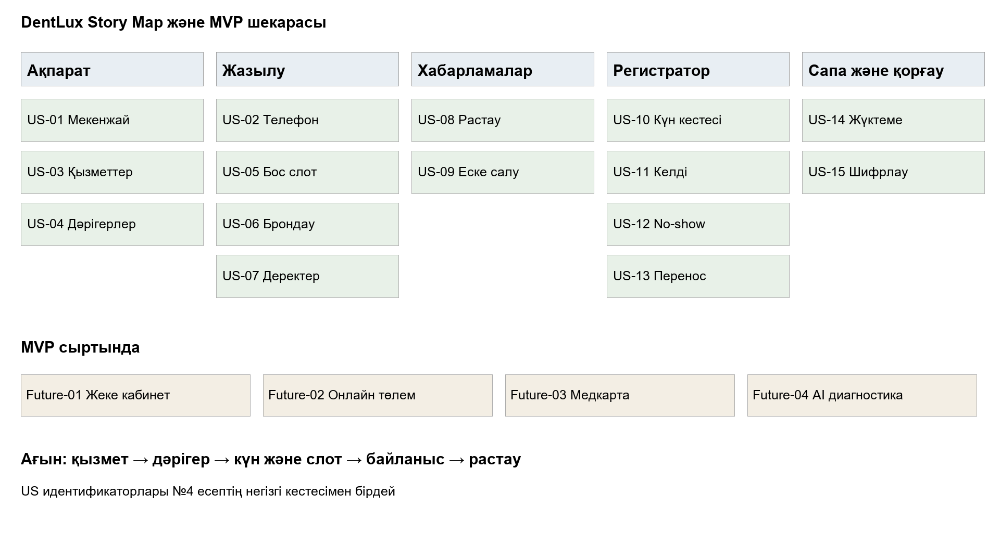

# Лабка 4 Талаптар және мүдделі тараптар

Лабка №4 (4-3Ж) — DentLux жобасы

Команда: Ізбасхан Әселхан — Project Manager / Frontend / QA; Жандос Арлан — Backend / DevOps; Еділ Шыңтас — DB Architecture.

## БӨЛІК 1

Команда құрамы

| Рөл | Аты-жөні | Жауапкершілік |
| --- | --- | --- |
| Project Manager / Frontend / QA | Ізбасхан Әселхан | Жобаны басқару, интерфейс, сапаны бақылау, бизнес-кейс, сұхбаттар және ФЕТ спецификациясы |
| Backend / DevOps | Жандос Арлан | Серверлік архитектура, API, Docker, CI/CD, Prometheus/Grafana мониторингі |
| DB Architectureure | Еділ Шыңтас | Дерекқор архитектурасы, PostgreSQL схемалары, транзакциялар қауіпсіздігі, аудит журналдары және деректерді миграциялау |

1-БӨЛІК: Мүдделі тараптар, Коммуникация жоспары, Сұхбаттар

### 1.1 Мүдделі тараптар матрицасы (4 квадрант)

| Категория | Мүдделі тараптар | Ықпалы & Мүддесі | Негіздеме / Стратегия |
| --- | --- | --- | --- |
| «Тығыз жұмыс» (Manage Closely) | Директор / Жоба тапсырыс берушісі, Бас администратор (Регистрация басшысы), Жетекші стоматолог-дәрігерлер | Жоғары ықпал / Жоғары мүдде | Жобаның стратегиялық бағытын, бюджетін және күнделікті жұмыс процесін тікелей анықтайды. Демонстрациялар мен басымдықтарды талқылауға міндетті түрде қатысады. |
| «Көңілін табу» (Keep Satisfied) | Компания басшылығы / Қаржы бөлімі, Заңгерлер, Ақпараттық қауіпсіздікке (АҚ) жауапты тұлға, Сатып алу бөлімі | Жоғары ықпал / Төмен мүдде | Қаржылай қолдау көрсетеді, медициналық қызмет көрсету лицензиясы мен пациенттердің дербес деректерін қорғау заңдылығын қадағалайды, тендер мерзімдері мен келісімшарттарды басқарады. Күнделікті детальдарға араласпайды, тек қорытынды есеп алады. |
| «Хабардар ету» (Keep Informed) | Пациенттер (Клиенттер), Қолдау қызметі / Call-center операторлары, Клиниканың орта медициналық персоналы | Төмен ықпал / Жоғары мүдде | Жүйенің соңғы тұтынушылары. Олардың қабылдауға жазылу тәжірибесі жүйенің тиімділігін көрсетеді. Жаңа релиздер мен нұсқаулықтар беріліп тұрады. |
| «Бақылау» (Monitor) | Сыртқы техникалық мамандар (SMS / Hosting провайдерлері), Интеграция жеткізушілері | Төмен ықпал / Төмен мүдде | Жобаға тікелей әсер етпейді, бірақ техникалық инфрақұрылымның тұрақтылығы үшін сыртқы фактор ретінде қадағаланады. |

### 1.2 Коммуникация жоспары (5 баған)

| Кім | Не алады | Қаншалықты жиі | Арна | Иесі |
| --- | --- | --- | --- | --- |
| Директор | Жоба статусы, тәуекелдер, шешімдер | 2 аптада 1 рет | Кездесу (Offline / Zoom) | PM (Ізбасхан Әселхан) |
| Әкімші | Демо, өзгерістер, басымдықтар | Апта сайын | Кездесу / чат | PM (Ізбасхан Әселхан) |
| Дәрігерлер | Жүйедегі өзгерістер | Апта сайын | Демо / чат | Аналитик / Команда |
| Пациенттер | Жазылу және өзгерістер туралы ақпарат | Қажет болғанда | Сайт / Telegram-бот | Әкімшілік / Команда |
| IT | Техникалық мәселелер, релиздер | Релиз алдында / қажет кезде | Jira / чат | Техлид (Жандос Арлан) |
| Заңгерлер | Келісуге сұраныстар, шарттар жобасы | Оқиға бойынша / Қажет кезінде | Корпоративтік пошта / Jira | PM (Ізбасхан Әселхан) |
| АҚ маманы | Қауіпсіздік аудиттері, деректерді қорғау есебі | Ай сайын / Инцидент кезінде | Jira / Қорғалған чат | Техлид (Жандос Арлан) |
| Сатып алу | Тендер мерзімдері, жабдық/сервис шығындары | Кезеңдік (Тоқсанына 1 рет) | Кеңсе кездесуі / Пошта | PM (Ізбасхан Әселхан) |
| DB Architectureure | Дерекқор схемалары, миграциялар, аудит журналдары | Релиз алдында / Қажет кезінде | Jira / Техникалық чат | DB Architecture (Еділ Шыңтас) |

### 1.3 Сұхбат №1: Стоматология клиникасының әкімшісімен (НАҚТЫ ӨТКІЗІЛГЕН)

- Өткізілген күні: 12.04.2026 ж.

- Ұзақтығы: 35 минут

- Формат: Жүзбе-жүз (пр. Мәңгілік Ел, 26, Bas Dent кеңсесі)

- Қатысушылар: Айгүл Смағұлова (Бас әкімші), Ізбасхан Әселхан (PM)

Сұрақ 1: «Соңғы рет келесі күнге пациентті қабылдауға қалай жаздыңыз? Қадамдарын толық айтып бере аласыз ба?»

- Жауап (цитата): «Күні бойы телефон шырыылдап тұрады. Біреу хабарласса, үстел үстіндегі қағаз журналды ашып, бос уақытты қарап, қарындашпен атын жазамын. Кейде телефонмен сөйлесіп тұрып басқа пациенттің келіп қалғаны алаңдатады, сол кезде бір слотқа екі адамды қате жазып қойған күндер де болды».

- Анықталған мәселе: Қағаз журналмен жұмыс істеу кезінде адам факторынан болатын қателер (double-booking) жиі кездеседі.

- Не расталды: Автоматты түрде бос уақытты көрсетіп тұратын электронды күнтізбеге нақты қажеттілік бар екені расталды.

- Не жоққа шықты: Әкімшілер барлық ақпаратты тек Excel арқылы жүргізеді деген болжам жоққа шықты (көбінесе қағаз журнал қолданылады).

Сұрақ 2: «Өткен аптада пациент жазылу уақытын ауыстыруды немесе болдырмауды сұраған кезде дәл не істедіңіз?»

- Жауап (цитата): «Пациент қоңырау шалып уақытын ауыстырғысы келсе, журналдан оның атын өшіріп, өшірген жерді сызып, жаңа уақытты басқа бос жерге қайта жазамын. Егер ол мүлде келмейтін болса, уақыт босқа қалады, бірақ оны басқа біреуге жедел ұсынып үлгермейміз».

- Анықталған мәселе: Жазылуды өзгерту немесе басқару процесінің баяулығы және уақыттың босқа кетуі (no-show салдары).

- Не расталды: Пациенттің өзіне онлайн түрде жазылуды басқару мүмкіндігі әкімшінің жұмысын значительді түрде жеңілдететіні расталды (бірақ бұл жобаның келесі релизіне қалдырылды).

- Не жоққа шықты: Әкімшілердің клиенттерге уақытылы хабарласып үлгеретіні туралы болжам жоққа шықты.

Сұрақ 3: «Соңғы рет пациентке бос уақытты іздеген кезде қанша уақытыңыз кетті?»

- Жауап (цитата): «Кейбір пациенттер "маған тек жұмыстан кейін, 18:00-ден кейін немесе тек фрезерлік кабинетке жақын дәрігер керек" дейді. Журналды парақтап, әр дәрігердің кестесін бір-бірлеп тексергенше 3-5 минут кетіп жатады, ал сыртта телефон шырылдап тұрады».

- Анықталған мәселе: Бос слоттарды қолмен іздеуге көп уақыт кетеді және бұл кезек күтіп тұрған басқа клиенттерге кедергі жасайды.

- Не расталды: Дәрігерлер мен қызметтер бойынша фильтрі бар автоматты іздеу жүйесінің өте маңызды екені расталды.

- Не жоққа шықты: ---

Сұрақ 4: «Клиент келмей қалған (no-show) жағдай соңғы рет қашан болды және сол кезде не істедіңіз?»

- Жауап (цитата): «Дүйсенбі күні бір пациент алдын ала жазылып, хабарласпай келмей қалды. Дәрігер 20 минут қарап отырып, бос қалды. Біз оған дейін таңертең хабарласып ескертуді ұмытып кетіппіз, өйткені қоңырау шалатын уақыт болмады».

- Анықталған мәселе: Еске салғыштардың жоқтығынан болатын уақыт шығыны.

- Не расталды: Автоматты түрде SMS немесе Telegram арқылы еске салу хабарламаларын жіберу қажеттілігі толық расталды.

- Не жоққа шықты: ---

Жалпы тұжырымдар (Сұхбат №1):

- Расталған болжамдар: Қағаз журналдың тиімсіздігі, бір слотқа қате жазылып қою қаупі және автоматты еске салғыштың қажеттілігі.

- Жоққа шыққан болжамдар: Клиника бұрыннан толық цифрландырылған деген болжам жоққа шықты.

- Жаңа анықталған мәселелер: Телефон қоңырауларының көптігінен әкімшілердің негізгі жұмысқа үлгермей қалуы.

### 1.4 Сұхбат №2: Стоматология қызметін тұрақты пайдаланатын пациентпен (НАҚТЫ ӨТКІЗІЛГЕН)

- Өткізілген күні: 14.04.2026 ж.

- Ұзақтығы: 25 минут

- Формат: Онлайн (Telegram видеоқоңырау)

- Қатысушылар: Ербол Жұмабаев (Пациент, Bas Dent тұрақты клиенті), Ізбасхан Әселхан (PM)

Сұрақ 1: «Соңғы рет стоматологқа бару үшін қабылдауға қалай жазылдыңыз? Процесті есіңізге түсіре аласыз ба?»

- Жауап (цитата): «Өткен айда тісім ауырып, клиникаға телефон соқтым. Бірақ линия бос емес болып, 3-4 рет қайта хабарласуға тура келді. Әкімші бос уақыттарды тізбелеп оқып шықты, мен өз жұмысыма ыңғайлы уақытты таңдау үшін ойланып қалдым, содан қай уақыт бар екенін қайта сұрауға тура келді».

- Анықталған мәселе: Телефон арқылы жазылу кезіндегі линияның бос болмауы және бос уақытты ауызша қабылдаудың қолайсыздығы.

- Не расталды: Пациенттерге дәрігерлердің бос уақытын өз көзімен көріп, сайт арқылы тікелей таңдау мүмкіндігі аса қажет екені расталды.

- Не жоққа шықты: Пациенттер тек телефон арқылы жазылуды ыңғайлы деп есептейді деген болжам жоққа шықты.

Сұрақ 2: «Егер бұрын қабылдау уақытын ауыстыруға тура келсе, бұл процесті қалай жасадыңыз?»

- Жауап (цитата): «Жұмыстан шыға алмай қалып, қабылдауға бара алмайтынымды түсінгенде, клиникаға қайта телефон соғып ескерттім. Кейде телефонға ешкім жауап бермесе, уайымдап қаламын».

- Анықталған мәселе: Уақытты өзгерту немесе болдырмау кезіндегі кері байланыстың қиындығы.

- Не расталды: Жүйе арқылы броньды басқару немесе клиникамен жылдам байланысу қажеттілігі.

Сұрақ 3: «Қабылдау күнін немесе уақытын ұмытып қалған жағдай соңғы рет қашан болды?»

- Жауап (цитата): «Үш ай бұрын жазылған күнімді шатастырып, бір сағатқа кешігіп келдім. Себебі клиника тарапынан еске салған хабарлама келмеген еді, өзім де блокнотқа жазып қоюды ұмытыппын».

- Анықталған мәселе: Келу уақытын ұмытып қалу (no-show қаупі).

- Не расталды: Пациентке автоматты түрде келе жатқан уақытын ескертетін хабарламаның (SMS/Telegram) маңыздылығы.

Сұрақ 4: «Қызмет құнын немесе дәрігерлердің бос уақытын білу үшін қандай әдісті қолдандыңыз?»

- Жауап (цитата): «Бағасын білу үшін Instagram парақшасына кіріп көрдім, бірақ сайтта нақты прайс-лист болмағандықтан, бәрін толық түсіне алмадым. Дәрігерлердің кім екенін де сайттан толық көре алмадым».

- Анықталған мәселе: Сайтта қызмет құндары мен дәрігерлер туралы толық ақпараттың жоқтығы.

- Не расталды: Онлайн платформада қызметтер тізімі, бағасы және дәрігерлердің ақпараты анық көрсетілуі тиіс екендігі расталды.

Жалпы тұжырымдар (Сұхбат №2):

- Расталған болжамдар: Телефон линиясының жүктелуі, бос уақытты визуалды түрде көру қажеттілігі және еске салғыштардың маңыздылығы.

- Жоққа шыққан болжамдар: Пациенттерге клиниканың әлеуметтік желілері жеткілікті деген пікір жоққа шықты.

- Жаңа анықталған мәселелер: Бағалар мен дәрігерлердің тәжірибесі туралы ақпараттың ашық болуы басты талаптардың бірі.

## 2-БӨЛІК: Story Map және Бэклог

### 2.1 Story Map (мәтіндік/визуалдық сипаттама)

### 2.2 MVP тілімшесі

MVP-ге КІРЕДІ (Таза брондау тілімшесі):

- Филиалды таңдау (пр. Мәңгілік Ел, 26)

- Қызметті таңдау және бағасын көру

- Дәрігерді таңдау

- Бос уақытты көру және таңдау

- Пациенттің деректерін енгізу (Аты-жөні, телефон)

- Жазылуды рәсімдеу және растау

- Telegram/SMS арқылы хабарлама алу

- Әкімші панелі арқылы жазбаларды көру және статус қою

MVP-ге ӘДЕЙІ КІРМЕЙДІ (Келесі релизге қалдырылады):

- Жеке кабинет

- Жазылуды өзгерту немесе өз бетінше болдырмау

- Онлайн төлем / эквайринг

- Медициналық карта және файлдар (рентген)

- Бонус жүйесі мен жеңілдіктер

- AI-диагностика

### 2.3 Тарихшалар (15 дана — INVEST стандарты)

| ID | Тарихша (User Story) | Эпик | SP | Приоритет | Given-When-Then қабылдау критерийлері (Acceptance Criteria) |
| --- | --- | --- | --- | --- | --- |
| US-01 | Пациент ретінде, дұрыс жерге барғаныма көз жеткізу үшін клиниканың филиалы мен мекенжайын (Мәңгілік Ел, 26) көргім келеді. | Onboarding | 2 | P1 | Given: Пациент басты бетті ашады. When: Сайт жүктеледі. Then: Мекенжай мен байланыс телефондары көрсетіледі. Теріс сценарий: Мекенжай жүктелмесе, қате туралы хабарлама шығады. |
| US-02 | Пациент ретінде, жүйеге кіру үшін телефон нөмірімді енгізгім келеді. | Onboarding | 3 | P0 | Given: Брондау беті ашық. When: 10 таңбалы телефон енгізіледі. Then: SMS код жіберу түймесі белсенді болады. Теріс сценарий: Қате форматы енгізілсе, ескерту шығады. |
| US-03 | Пациент ретінде, қажетті ем түрін таңдау үшін қызметтер каталогы мен бағасын көргім келеді. | Booking | 3 | P1 | Given: Қызметтер тізімі ашық. When: Санат таңдалады. Then: Қызмет атауы мен бағасы теңгемен көрінеді. Теріс сценарий: Каталог бос болса, "Қызметтер жүктелуде" хабары шығады. |
| US-04 | Пациент ретінде, маманды таңдау үшін дәрігерлердің тізімі мен тәжірибесін көргім келеді. | Booking | 3 | P2 | Given: "Дәрігерлер" бөлімі ашық. When: Дәрігер аты басылады. Then: Мамандығы мен жұмыс өтілі шығады. Теріс сценарий: Дәрігер болмаса, бос күй көрсетіледі. |
| US-05 | Пациент ретінде, ыңғайлы уақытты табу үшін дәрігердің бос слоттарын көргім келеді. | Booking | 8 | P0 | Given: Дәрігер мен күн таңдалды. When: Күнтізбе ашылады. Then: Бос уақыттар (мысалы, 10:00, 12:00) көрінеді. Теріс сценарий: Барлық слот бос болмаса, "Бос уақыт жоқ" делінеді. |
| US-06 | Пациент ретінде, орын бекіту үшін таңдалған слотқа жазылғым келеді. | Booking | 5 | P0 | Given: Слот пен уақыт таңдалды. When: "Брондау" түймесі басылады. Then: Бронь сақталып, сәттілік терезесі шығады. Теріс сценарий: Слотты басқа біреу қағып кетсе, қате шығады. |
| US-07 | Пациент ретінде, растау үшін байланыс деректерімді (Аты-жөні, телефоны) енгізгім келеді. | Booking | 3 | P0 | Given: Брондау формасы ашық. When: Аты-жөні мен телефоны толтырылады. Then: Растау батырмасы белсенді болады. Теріс сценарий: Өріс бос қалса, қате көрсетіледі. |
| US-08 | Пациент ретінде, қабылдауды ұмытпау үшін Telegram арқылы растау хабарламасын алғым келеді. | Notifications | 5 | P0 | Given: Брондау сәтті аяқталды. When: Жүйе броньды тіркейді. Then: Telegram арқылы растау мәтіні келеді. Теріс сценарий: Бот жұмыс істемесе, логике қате жазылады. |
| US-09 | Пациент ретінде, уақытында келу үшін қабылдауға 2 сағат қалғанда еске салғыш алғым келеді. | Notifications | 3 | P1 | Given: Қабылдауға 2 сағат қалды. When: Cron қызметі уақытты тексереді. Then: Еске салғыш хабарлама жіберіледі. Теріс сценарий: Хабарлама кетпесе, әкімшіге алерт келеді. |
| US-10 | Әкімші ретінде, күнделікті жұмысты көру үшін бүгінгі пациенттердің кестесін көргім келеді. | Admin Dashboard | 5 | P0 | Given: Әкімші жүйеге кірді. When: "Күнтізбе" панелі ашылады. Then: Барлық броньдар хронологиялық тәртіппен тұрады. Теріс сценарий: Байланыс үзілсе, деректер кештен алынады. |
| US-11 | Әкімші ретінде, келген пациентті белгілеу үшін статусын "Келді" етіп өзгерткім келеді. | Admin Dashboard | 2 | P1 | Given: Пациент клиникаға келді. When: Әкімші статус ауыстырады. Then: Базадағы статус жаңартылып, түсі өзгереді. Теріс сценарий: Қате басқылса, өзгерісті кері қайтаруға болады. |
| US-12 | Әкімші ретінде, келмеген пациентті есепке алу үшін "No-show" статусын қойғым келеді. | Admin Dashboard | 2 | P1 | Given: Пациент келмеді. When: "No-show" басылады. Then: Есеп беру модулінде ескеріледі. Теріс сценарий: Дерек сақталмаса, қайталау сұралады. |
| US-13 | Әкімші ретінде, пациенттің сұрауы бойынша жазылуды басқа күнге жылжытқым келеді. | Admin Dashboard | 3 | P2 | Given: Ескі бронь тұр. When: Жаңа бос уақытқа ауыстырылады. Then: Дерекқор жаңарып, пациентке хабар келеді. Теріс сценарий: Жаңа уақыт бос болмаса, жылжытылмайды. |
| US-14 | DevOps / PM ретінде, жүйенің тұрақтылығын тексеру үшін жүктеме сынағын өткізгім келеді. | DevOps / NFR | 8 | P0 | Given: Load testing скрипті дайын. When: 200 бір мезгілдегі сұраныс жіберіледі. Then: p95 жауап беру уақыты < 800 мс болады. Теріс сценарий: 800 мс асса, тест сәтсіз болады. |
| US-15 | Заңгер / АҚ маманы ретінде, пациенттердің дербес деректерін шифрланған түрде сақтағым келеді. | Security / NFR | 5 | P0 | Given: Пациент деректері енгізілді. When: Деректер базаға жазылады. Then: AES-256 арқылы шифрланып сақталады. Теріс сценарий: Шифрлау қатесі болса, базаға жазылмайды. |

## 3-БӨЛІК: ФЕТ Спецификациясы (12+ талап)

| № | Санат | Талап | Өлшеулі критерий | Тексеру әдісі |
| --- | --- | --- | --- | --- |
| 1 | Өнімділік | Онлайн брондау бетінің жауап беру жылдамдығы | p95 < 800 мс кезінде 200 бір мезгілдегі пайдаланушыны көтереді | JMeter жүктеме тесті |
| 2 | Қолжетімділік | Жүйенің жұмыс уақытындағы қолжетімділігі | Күнделікті жұмыс уақытында (08:00–20:00) 99,5% қолжетімділік | Uptime monitoring (Prometheus) |
| 3 | Масштабталу | Жүйенің жүктеме артуына төтеп беруі | Архитектураны өзгертпей, жүктеменің 3 есе өсуін (600 пайдаланушы) көтеру | Стресс-тестинг |
| 4 | Қауіпсіздік | Пайдаланушы рөлдері мен құқықтарын шектеу | Жүйеде нақты 5 рөл (Пациент, Әкімші, Дәрігер, Заңгер, Админ) жұмыс істейді | RBAC тестілеу және аудит |
| 5 | Аудит | Маңызды әрекеттер журналын жүргізу | Барлық бронь жасау және өзгерту логтары 3 жыл бойы сақталады, іздеу < 5 сек | Логтарды тексеру сұрауы |
| 6 | Резервтеу | Деректерді қалпына келтіру мүмкіндігі | RPO = 1 сағат, RTO = 4 сағат | Резервтік көшірмеден қалпына келтіру тесті |
| 7 | Интеграциялар | Telegram және SMS шлюздерімен байланыс | API жауап беру уақыты < 1.5 сек, қате кезінде 3 рет қайталау (retry) | API интеграциялық тесттері |
| 8 | Локализация | Интерфейс тілдерінің қолжетімділігі | Бекітілген экрандар мен қате хабарлары тізіміндегі барлық мәтін kk және ru тілдерінде; аударылмаған кілт саны 0. Тексеру тізімі мен QA нәтижесі тіркеледі. | Лингвистикалық QA тест |
| 9 | Орта қолжетімділігі | Веб-интерфейстің қолданылу ыңғайлылығы | Пернетақта арқылы толық навигация, контраст WCAG бойынша 4.5:1 | Accessibility audit (Lighthouse) |
| 10 | Дербес деректер | Пациенттердің дербес деректерін сақтау | Деректер тек Қазақстан аумағындағы (KZ дата-орталығында) серверде сақталады | Сервер орналасқан жерін тексеру |
| 11 | Деректерді көшіру | Ескі деректерді жаңа базаға көшіру | Ескі қағаз/Excel журналдардан белсенді жазбалардың 100%-ы көшіріледі | ETL салыстыру есебі |
| 12 | Пайдалану | Жүйені мониторинг арқылы сүйемелдеу | Жауап беру уақыты p95 > 1 сек болғанда инженерге автоматты алерт келеді | Grafana алерт тесті |
| 13 | Дерекқор архитектурасы | PostgreSQL схемалары мен транзакциялар қауіпсіздігі | Тесттік PostgreSQL стендінде бір слотқа 20 жұп қатарлас сұраныс: әр жұпта бір ғана success, дубль 0, өңделмеген deadlock 0; транзакция қатесінде rollback расталады. Барлық болашақ жүктемеде deadlock болмайды деген кепілдік берілмейді. | DB транзакциялық тестілер |
| 14 | Аудит журналдары | Дерекқор деңгейіндегі аудит журналдарын жүргізу | Барлық өзгерістер (INSERT/UPDATE/DELETE) логталады, сақталу мерзімі 3 жыл | DB audit log тексеру |
| 15 | Деректерді миграциялау | Деректерді қауіпсіз миграциялау | Синтетикалық 100 белсенді жазбаны көшіру тестінде input = committed = target; айырма 0. Қате енгізілген пакет толық rollback болады. Нақты журнал үшін бөлек салыстыру актісі қажет. | Migration rollback тесті |

ҚОРЫТЫНДЫ

Бұл есепте мүдделі тараптар, сұхбат жазбалары, Story Map, MVP және талаптар берілген. Трекерге көшіру, сұхбаттың бастапқы дәлелі және қабылдау тесттері бөлек расталады; толық орындалды деген мәлімдеме жасалмайды.

- Мүдделі тараптар ықпалы мен мүддесі бойынша толық квадранттарға бөлініп, Сатып алу, Заңгер және АҚ мамандары қосылды.

- 5 бағаннан тұратын нақты Коммуникация жоспары құрылды (DB Architectureure бағаны қосылды).

- Клиника әкімшісімен және пациентпен жүргізілген нақты сұхбаттар рәсімделіп, расталған және жоққа шыққан болжамдар анықталды.

- Тек брондау тілімшесіне негізделген MVP шекаралары айқындалып, INVEST стандартына сай 15 User Story жасалды.

- Жүйенің сапасын қатаң бақылау үшін өлшенетін 12+ ФЕТ талабы бекітілді (DB Architectureure бойынша 3 қосымша талап енгізілді).

Команда үлесі (жаңартылған)

| Аты-жөні | Рөл | Не істеді |
| --- | --- | --- |
| Ізбасхан Әселхан | Project Manager / Frontend / QA | Жобаны басқару, интерфейс, сапаны бақылау, бизнес-кейс, сұхбаттар және ФЕТ спецификациясы |
| Жандос Арлан | Backend / DevOps | Серверлік архитектура, API, Docker, CI/CD, Prometheus/Grafana мониторингі |
| Еділ Шыңтас | DB Architectureure | Дерекқор архитектурасы, PostgreSQL схемалары, транзакциялар қауіпсіздігі, аудит журналдары және деректерді миграциялау |

Ескерту: Еділ Шыңтас қосылғаннан кейін ФЕТ спецификациясына 3 қосымша талап (№13, №14, №15) енгізілді, олар дерекқор архитектурасы, аудит журналдары және миграциялауға қатысты. Бұл талаптардың барлығы өлшеулі және тексеру әдістері көрсетілген.

## Тарихшалардың сәйкестігі және дәлелдер

US-01–US-15 идентификаторлары негізгі кестемен бірдей. US-15 — дербес деректерді шифрлау, MVP құрамында. Жеке кабинет, төлем және медициналық карта Future-01–Future-03 ретінде жеке белгіленеді; US-15 қайта қолданылмайды. US-13 — регистратордың переносты орындауы; пациенттің өз бетімен өзгертуі MVP-ден тыс.

Трекер: https://github.com/users/akaashia/projects/8/views/1 . Қолда бар public Issues №1–10 бастапқы тізімі осы 15 US-ке бірдей емес. Дополнения/lab4_backlog.csv — ID, эпик, баға, белгі, қабылдау критерийі бар көшіруге дайын тізім; ол импорт орындалды деген дәлел емес.

12 және 14 сәуір 2026 күнгі сұхбаттар бастапқы есептен сақталды. Олар күзгі жобаға дейін жиналған зерттеу ретінде қаралады; респондент келісімі мен түпнұсқа жазба берілмегендіктен тәуелсіз расталған факт деп көрсетілмейді. Қатысушының жеке байланысы ашық репозиторийге жарияланбайды.

## Қосымшалар

- [lab4_backlog.csv](assets/lab4-lab4_backlog.csv)
- [story-map.md](assets/lab4-story-map.md)

[Барлық зертханалық жұмыстар](README.md)
