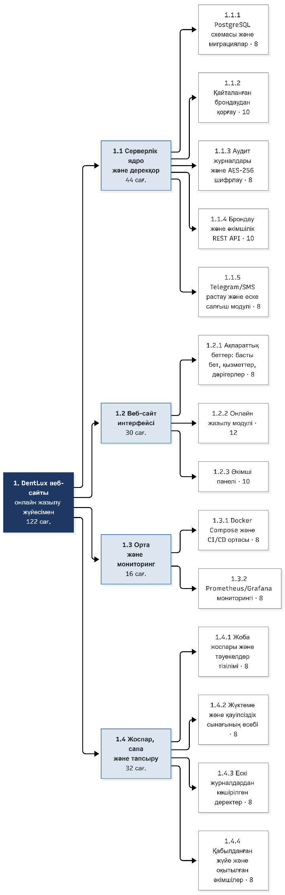
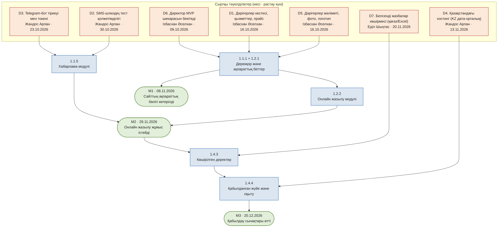
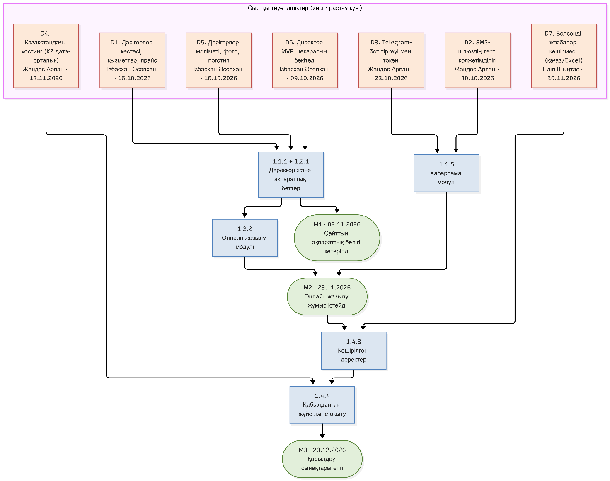

# Лабка 5 Жеткізуді жоспарлау

Лабка №5 (5-ЗЖ) – DentLux жобасы

Команда: Ізбасхан Әселхан — Project Manager / Frontend / QA; Жандос Арлан — Backend / DevOps; Еділ Шыңтас — DB Architecture.

Жеткізуді жоспарлау: WBS, релиз жоспары, тәуелділіктер, командалар топологиясы, RACI және capacity

Жоба: DentLux – «Bas Dent» стоматологиялық клиникасының веб-сайты және онлайн жазылу жүйесі (пр. Мәңгілік Ел, 26).

Репозиторий: https://github.com/akaashia/dentlux-portal/tree/main/docs

Пән: АТ-жобаларды басқару · 5-апта · 2026 күз

#### Команда құрамы

| Рөл | Аты-жөні | Жауапкершілік |
| --- | --- | --- |
| Project Manager / Frontend / QA | Ізбасхан Әселхан | Жобаны басқару, веб-сайт интерфейсі, сапаны бақылау, бизнес-кейс, сұхбаттар және ФЕТ спецификациясы |
| Backend / DevOps | Жандос Арлан | Серверлік архитектура, API, Docker, CI/CD, Prometheus/Grafana мониторингі |
| DB Architecture | Еділ Шыңтас | Дерекқор архитектурасы, PostgreSQL схемалары, транзакциялар қауіпсіздігі, аудит журналдары және деректерді миграциялау |

Жоба аясы туралы ескерту. DentLux – ең алдымен веб-сайт: пациент сайт арқылы филиал, қызмет, дәрігер мен уақытты таңдап жазылады, әкімші сайттың әкімші панелінен жазбаларды басқарады. Telegram/SMS – сайттағы жазылуды растайтын және еске салатын қосымша арна. Бұл құжат 4-ЗЖ-дағы MVP шекарасына сәйкес құрылған: жеке кабинет, онлайн төлем, медициналық карта/рентген, бонус жүйесі, AI-диагностика және мобильді қосымша WBS-ке кірмейді.

## 5-ЗЖ. 1-БӨЛІК: WBS және WBS сөздігі

### 1. Жобаның WBS-і (3 деңгейге дейін)

Деңгейлер: 1-деңгей – жоба; 2-деңгей – нәтижелер тобы; 3-деңгей – жұмыс пакеттері. Әр пакеттің дәл бір ата-анасы бар. WBS-те ретті де, күндерді де көрсетпейміз – олар 2-бөлімдегі релиз жоспарында. Бағалар еңбексыйымдылық (адам-сағат) ретінде берілген.

| Код | Элемент (нәтиже) | Нәтиже түсіндірмесі | Сағат |
| --- | --- | --- | --- |
| 1 | DentLux веб-сайты (онлайн жазылу жүйесімен) | Клиниканың жұмыс істейтін, қабылданған сайты | 122 |
| 1.1 | Серверлік ядро және дерекқор | Жұмыс істейтін API мен қорғалған дерекқор | 44 |
| 1.1.1 | PostgreSQL схемасы және миграциялар |  | 8 |
| 1.1.2 | Қайталанған брондаудан қорғау (транзакциялық логика) |  | 10 |
| 1.1.3 | Аудит журналдары және дербес деректерді шифрлау (AES-256) |  | 8 |
| 1.1.4 | Брондау және әкімшілік REST API (OpenAPI бойынша) |  | 10 |
| 1.1.5 | Telegram/SMS растау және еске салғыш модулі |  | 8 |
| 1.2 | Веб-сайт интерфейсі | Пациент пен әкімші көретін сайт беттері | 30 |
| 1.2.1 | Ақпараттық беттер: басты бет, филиал, қызметтер мен бағалар, дәрігерлер |  | 8 |
| 1.2.2 | Онлайн жазылу модулі (слот таңдау, дерек енгізу, растау) |  | 12 |
| 1.2.3 | Әкімші панелі (кесте, «Келді»/«No-show», жазылуды жылжыту) |  | 10 |
| 1.3 | Орта және мониторинг | Бір пәрменмен көтерілетін және бақыланатын орта | 16 |
| 1.3.1 | Docker Compose және CI/CD ортасы |  | 8 |
| 1.3.2 | Prometheus/Grafana мониторингі және алерттер |  | 8 |
| 1.4 | Жоспар, сапа және тапсыру | Тексерілген, көшірілген және қабылданған жүйе | 32 |
| 1.4.1 | Жоба жоспары және тәуекелдер тізілімі |  | 8 |
| 1.4.2 | Жүктеме және қауіпсіздік сынағының есебі |  | 8 |
| 1.4.3 | Ескі журналдардан көшірілген деректер |  | 8 |
| 1.4.4 | Қабылданған жүйе және оқытылған әкімшілер (нұсқаулықпен) |  | 8 |

#### 100 пайыз ережесімен тексеру: балалардың қосындысы ата-анаға тең

| Ата-ана | Балаларының қосындысы (сағат) | Ата-ана (сағат) | Сәйкес |
| --- | --- | --- | --- |
| 1.1 Серверлік ядро және дерекқор | 8 + 10 + 8 + 10 + 8 | 44 | ✓ |
| 1.2 Веб-сайт интерфейсі | 8 + 12 + 10 | 30 | ✓ |
| 1.3 Орта және мониторинг | 8 + 8 | 16 | ✓ |
| 1.4 Жоспар, сапа және тапсыру | 8 + 8 + 8 + 8 | 32 | ✓ |
| 1 DentLux веб-сайты | 44 + 30 + 16 + 32 | 122 | ✓ |

Қорытынды: ешбір тармақ екі рет есептелмеген және артық жұмыс жоқ. Кез келген пакет 8/80 ережесіне сай (8 сағаттан кем емес, 80 сағаттан артық емес). Барлық элементтер – нәтиже (зат есім: «қабылданған жүйе», «көшірілген деректер»), әрекет емес («қабылдау», «көшіру» емес).

WBS-ке кірмейтіндер (MVP-ден тыс, 4-ЗЖ бойынша): жеке кабинет және жазылуды пациенттің өзі өзгерту/болдырмау, онлайн төлем, медициналық карта және рентген файлдары, бонус жүйесі, AI-диагностика, мобильді native қосымша.

Үйлестіру еңбегі. Кездесулер, код-ревью және талдаулар жеке пакет емес – олар 3-бөлімдегі capacity есебінде 15% үйлестіру ретінде шегеріледі.

### 2. WBS сөздігі (5 жұмыс пакеті)

Сөздікке түсініксіздігі, тәуекелі немесе сыртқы тәуелділігі көбірек 5 пакет алынды: транзакциялық қорғау, хабарлама модулі, онлайн жазылу модулі, жүктеме сынағы және деректерді көшіру. «Жауапты» – пакетті орындаушы (R); есеп беретін тұлға (A) RACI матрицасында көрсетілген.

| Жұмыс пакеті 1.1.2 – Қайталанған брондаудан қорғау (транзакциялық логика) | Жұмыс пакеті 1.1.2 – Қайталанған брондаудан қорғау (транзакциялық логика) |
| --- | --- |
| Не кіреді | Слотты тексеру және бекіту логикасы; PostgreSQL деңгейіндегі бірегейлік шектеуі (UNIQUE дәрігер + күн + уақыт) және транзакциядағы SELECT … FOR UPDATE; қақтығыс кезінде түсінікті қате коды; параллель сұраныстарға арналған автотест. |
| Не кірмейді | Жазылу экрандарының дизайны (1.2.2); хабарлама жіберу (1.1.5); онлайн төлем. |
| Нәтиже | Бір слотқа екі пациент жазыла алмайтын серверлік механизм. |
| Қабылдау критерийі | Бір слотқа бір мезгілде 2 сұраныс жіберілгенде (тест 20 рет қайталанады) тек біріншісі сәтті болады, екіншісі «Слот бос емес» қатесін алады; базада қайталанған жазба 0; deadlock 0 (ФЕТ №13). |
| Жауапты | Еділ Шыңтас (DB Architecture) |
| Бағалау | 10 сағат |
| Тәуелділіктер (алдыңғылары) | 1.1.1 (схема дайын); 1.1.4-пен API келісімшарты (OpenAPI) алдын ала келісіледі. |
| Жорамалдар / сыртқы тәуелділік | Жорамал: слот ұзақтығы бекітілген (30 минут) және клиника кестесі бір дәрігерге бір кабинет деп есептейді. Сыртқы: D1 – дәрігерлер кестесі. |

| Жұмыс пакеті 1.1.5 – Telegram/SMS растау және еске салғыш модулі | Жұмыс пакеті 1.1.5 – Telegram/SMS растау және еске салғыш модулі |
| --- | --- |
| Не кіреді | Жазылу сәтті болғанда растау хабарламасы (US-08); қабылдауға 2 сағат қалғанда еске салғыш (cron, US-09); сәтсіз жіберуді 3 рет қайталау (retry); сәтсіздікте әкімшіге алерт. |
| Не кірмейді | Жеке кабинет және пациенттің хабарлама арқылы жазылуды өзгертуі; чат-бот сценарийлері; хабарлама мәтіндерін әкімшінің өңдеуі. |
| Нәтиже | Жазылу кезінде растау, қабылдауға дейін еске салу жіберетін жұмыс істейтін модуль. |
| Қабылдау критерийі | Тест пациентке жазылудан кейін 1 минут ішінде растау келеді; 2 сағат қалғанда еске салғыш келеді; арна істен шықса, 3 қайталаудан кейін әкімші панеліне алерт түседі; API жауабы < 1,5 сек (ФЕТ №7). |
| Жауапты | Жандос Арлан (Backend/DevOps) |
| Бағалау | 8 сағат |
| Тәуелділіктер (алдыңғылары) | 1.1.1; 1.1.4 (оқиға «бронь жасалды»). |
| Жорамалдар / сыртқы тәуелділік | Сыртқы: D3 – Telegram-бот токені (23.10.2026), D2 – SMS-шлюздің тест қолжетімділігі (30.10.2026). Б жоспары: mock-провайдер және тек Telegram арнасы. |

| Жұмыс пакеті 1.2.2 – Онлайн жазылу модулі (сайттың негізгі бөлігі) | Жұмыс пакеті 1.2.2 – Онлайн жазылу модулі (сайттың негізгі бөлігі) |
| --- | --- |
| Не кіреді | Сайттағы жазылу ағыны: қызмет → дәрігер → күн мен бос слот → аты-жөні/телефон → растау (US-02, 05, 06, 07); форма валидациясы; қателер мен «Бос уақыт жоқ» күйлері; қазақ/орыс тілдері (ФЕТ №8); мобильді экранға бейімділік. |
| Не кірмейді | Онлайн төлем; жеке кабинет; жазылуды пациенттің өзі болдырмауы; әкімші панелі (1.2.3). |
| Нәтиже | Пациент сайт арқылы жазылуды тұтас ресімдей алатын жұмыс істейтін модуль. |
| Қабылдау критерийі | Тест пациент жазылу ағынын 3 минуттан аз уақытта аяқтайды; жазылу базада сақталады және сәттілік экраны шығады; басқа біреу слотты алып қойса, түсінікті қате көрсетіледі; бос өріс пен қате телефон форматы ескертіледі. |
| Жауапты | Ізбасхан Әселхан (Frontend Lead) |
| Бағалау | 12 сағат |
| Тәуелділіктер (алдыңғылары) | 1.2.1 (беттер мен каталог); 1.1.2 және 1.1.4 (брондау API мен қорғау). |
| Жорамалдар / сыртқы тәуелділік | Жорамал: API келісімшарты (OpenAPI) 1-инкременттің соңына дейін бекітіледі, интерфейс заглушкаға қарсы жасала береді. Сыртқы: D1 (кесте), D5 (дәрігерлер мәліметі). |

| Жұмыс пакеті 1.4.2 – Жүктеме және қауіпсіздік сынағының есебі | Жұмыс пакеті 1.4.2 – Жүктеме және қауіпсіздік сынағының есебі |
| --- | --- |
| Не кіреді | JMeter/k6 сценарийі (жазылу ағыны); 200 бір мезгілдегі пайдаланушы кезіндегі p95 өлшеу (US-14, ФЕТ №1); 3 есе өсімге стресс-тест (ФЕТ №3); RBAC рөлдерін және дербес деректердің шифрлануын тексеру (ФЕТ №4, US-15); нәтиже есебі. |
| Не кірмейді | Толық пенетрация-тестілеу; сыртқы аудит; өндірістік желіні баптау. |
| Нәтиже | Өнімділік пен қауіпсіздік көрсеткіштері жазылған сынақ есебі. |
| Қабылдау критерийі | 200 бір мезгілдегі пайдаланушыда p95 < 800 мс; 600 пайдаланушыда жүйе құламайды; шифрланбаған дербес дерек табылмайды; алынған нәтижелер есепте кестемен берілген. Критерий орындалмаса, есеп «сәтсіз» деп жабылып, түзету бэклогқа түседі. |
| Жауапты | Жандос Арлан (DevOps); есеп беретін (A) – Ізбасхан Әселхан (QA) |
| Бағалау | 8 сағат |
| Тәуелділіктер (алдыңғылары) | 1.1.2, 1.1.3, 1.1.4, 1.2.2 (сынаққа жететін ағын бар); 1.3.1 (сынақ ортасы). |
| Жорамалдар / сыртқы тәуелділік | Жорамал: сынақ локалды Docker-ортада өткізіледі. Сыртқы: D4 – KZ хостинг (қолжетімді болса, сынақ сол жерде қайталанады). |

| Жұмыс пакеті 1.4.3 – Ескі журналдардан көшірілген деректер | Жұмыс пакеті 1.4.3 – Ескі журналдардан көшірілген деректер |
| --- | --- |
| Не кіреді | Қағаз/Excel журналдардағы белсенді (болашақ) жазбаларды жинау және стандарттау; импорт скрипті; көшірілген мен бастапқы жазбаларды салыстыру; кері қайтару (rollback) жоспары (ФЕТ №11, №15). |
| Не кірмейді | Архивтік (өткен) жазбалар; пациенттің медициналық картасы; деректерді қолмен түзету қызметі. |
| Нәтиже | Барлық белсенді жазбалары жаңа базада тұрған жүйе. |
| Қабылдау критерийі | Белсенді жазбалардың 100%-ы көшірілді; салыстыру есебінде айырма 0; импорттан кейін M3-ке дейінгі сынақ параллель аптасында деректер алшақтығы 0; егер сынақ аяқталмаса, соңғы қабылдау M3-те жабылмайды; кері қайтару тесттен өтті. |
| Жауапты | Еділ Шыңтас (DB Architecture) |
| Бағалау | 8 сағат |
| Тәуелділіктер (алдыңғылары) | 1.1.1, 1.1.3; веха M2 (онлайн жазылу жұмыс істейді). |
| Жорамалдар / сыртқы тәуелділік | Жорамал: белсенді жазбалар саны шағын (бір аптаның-айдың болашақ жазбалары). Сыртқы: D7 – клиника бере алатын белсенді жазбалар көшірмесі (20.11.2026). Б жоспары: жазбаларды әкімші панелі арқылы қолмен енгізу. |

## 5-ЗЖ. 2-БӨЛІК: Релиздер және тәуелділіктер

### 3. Семестрге релиз жоспары (3 инкремент)

Жоба 12 апта жүреді (05.10.2026 – 27.12.2026). Релиз күндері бекітіледі, ал мазмұны – жоқ: үлгермесек, күн емес, функция жылжиды (ең алдымен P2 басымдықты US-04 мен US-13). Инкременттер ішкі жүйелер бойынша емес, пайдаланушы сценарийі бойынша кесілген. 21–27 желтоқсан — соңғы тексеру терезесі. 31 сағат резерв бір аптаға жиналмайды: инкременттерге 21,2, 5,9 және 3,9 сағат болып бөлінеді.

| Кезең | Мерзімі | Апталар | Жоспарлы жүктеме | Релиз / веха |
| --- | --- | --- | --- | --- |
| Инкремент 1 | 05.10 – 08.11.2026 | 1–5 | 40 сағат | M1 – 08.11.2026 |
| Инкремент 2 | 09.11 – 29.11.2026 | 6–8 | 40 сағат | M2 – 29.11.2026 |
| Инкремент 3 | 30.11 – 20.12.2026 | 9–11 | 42 сағат | M3 – 20.12.2026 |
| Резерв | 21.12 – 27.12.2026 | 12 | – | Қорғауға дайындық, қалған түзетулер |

| Инкремент 1 – «Пациент сайттан ақпаратты көреді» | Инкремент 1 – «Пациент сайттан ақпаратты көреді» |
| --- | --- |
| Мақсаты | Пациент сайтты ашып, клиниканың филиалын, қызметтері мен бағаларын және дәрігерлерін көре алады; жүйе бір пәрменмен көтеріледі, дерекқор қорғалған. |
| Мазмұны | US-01, US-03, US-04, US-15 (шифрлау). Пакеттер: 1.1.1, 1.1.3, 1.2.1, 1.3.1, 1.4.1 (40 сағат). |
| Веха | M1 (08.11.2026): «Сайттың ақпараттық бөлігі мен дерекқор демо-ортада көтерілді». |
| Дайындық критерийі | docker compose up бір пәрменмен барлық сервисті қатесіз көтереді; миграциялар қатесіз өтеді; басты бет, қызметтер мен бағалар, дәрігерлер беттері ашылады; деректер AES-256 арқылы шифрланған; OpenAPI келісімшарты бекітілді; D1, D5, D6 расталды. |

| Инкремент 2 – «Пациент сайт арқылы жазылады» | Инкремент 2 – «Пациент сайт арқылы жазылады» |
| --- | --- |
| Мақсаты | Пациент сайтта дәрігер мен бос уақытты таңдап жазылуды тұтас ресімдейді, растауды Telegram/SMS арқылы алады; екі пациент бір слотқа жазыла алмайды. |
| Мазмұны | US-02, US-05, US-06, US-07, US-08, US-09. Пакеттер: 1.1.2, 1.1.4, 1.1.5, 1.2.2 (40 сағат). |
| Веха | M2 (29.11.2026): «Онлайн жазылу процесі соңына дейін жұмыс істейді». |
| Дайындық критерийі | Сценарий «қызмет → дәрігер → слот → дерек → растау» 3 минуттан аз; параллель 2 сұраныста дубль 0 (20 қайталау); тест пациентке растау хабарламасы келеді; еске салғыш 2 сағат бұрын жіберіледі; D2, D3 расталды. |

| Инкремент 3 – «Әкімші басқарады, жүйе қабылдауға дайын» | Инкремент 3 – «Әкімші басқарады, жүйе қабылдауға дайын» |
| --- | --- |
| Мақсаты | Әкімші сайттың панелінде күнделікті кестені көріп, пациент статусын белгілейді және жазылуды жылжытады; жүйе көшірілген деректермен, мониторингпен және сынақ есебімен тапсыруға дайын. |
| Мазмұны | US-10, US-11, US-12, US-13, US-14. Пакеттер: 1.2.3, 1.3.2, 1.4.2, 1.4.3, 1.4.4 (42 сағат). |
| Веха | M3 (20.12.2026): «Қабылдау сынақтары өтті, жүйе қорғауға дайын». |
| Дайындық критерийі | p95 < 800 мс (200 пайдаланушы); белсенді жазбалардың 100%-ы көшірілді; Grafana-да алерт p95 > 1 сек кезінде жұмыс істейді; әкімші оқытылды және нұсқаулық берілді; клиника әкімшісі (А. Смағұлова) қабылдау актісін растады; D4, D7 расталды. |

#### Вехалар (күй ретінде тұжырымдалған)

| Веха | Күні | Күй | Дайындық критерийі (қысқаша) |
| --- | --- | --- | --- |
| E0 | 09.10.2026 | Сыртқы веха: «Директор MVP шекарасын бекітті» | Жеке кабинет, төлем және т.б. келесі релизге қалатыны жазбаша расталды (D6) |
| M1 | 08.11.2026 | Сайттың ақпараттық бөлігі мен дерекқор демо-ортада көтерілді | Бір пәрменмен іске қосылады; ақпараттық беттер ашылады; шифрлау тесті өтті |
| M2 | 29.11.2026 | Онлайн жазылу процесі соңына дейін жұмыс істейді | 3 минуттан аз; дубль 0; растау хабарламасы келеді |
| M3 | 20.12.2026 | Қабылдау сынақтары өтті, жүйе қорғауға дайын | p95 < 800 мс; 100% көшірілді; қабылдау актісі расталды |

Жеткізу (deploy) мен пайдаланушыларға қосуды (release) бөлек қарастырамыз: аяқталмаған модуль (мысалы, жазылуды жылжыту, US-13) feature flag артында кодқа кіреді, бірақ клиника әкімшісіне M3-ке дейін қосылмайды. Сынақ параллель апта (қағаз журнал + сайт) — 14–20.12.2026, M3 критерийі үшін. M3-тен кейінгі 21–27.12 — қосымша бақылау; ескі журналды тоқтату күні – 27.12.2026, жауапты – Ізбасхан Әселхан. Кері қайту критерийі: ауысудың алғашқы аптасында жазылудың 2%-дан көбі қатемен аяқталса, әкімші қағаз журналға оралады.

### 4. Тәуелділіктер картасы

Карта Mermaid-пен құрылды (бастапқы код төменде). Қызыл – сыртқы тәуелділіктер (иесі мен растау күнімен), көк – жұмыс пакеттері, жасыл – вехалар.

1-сурет. DentLux сыртқы тәуелділіктері, жұмыс пакеттері және вехалары

#### Сыртқы тәуелділіктер тізілімі

Иесі – тәуелділікті бақылап, расталуын қадағалайтын команда мүшесі; «кімнен күтеміз» – шешімді не затты беретін сыртқы тарап. Расталмаған тәуелділік тәуекелдер тізіліміне көшеді.

| № | Тәуелділік | Кімнен күтеміз | Иесі | Растау күні | Әсер ететін пакет / веха | Б жоспары |
| --- | --- | --- | --- | --- | --- | --- |
| D1 | Дәрігерлердің жұмыс кестесі, қызметтер тізімі мен прайс-лист | Bas Dent бас әкімшісі А. Смағұлова | Ізбасхан Әселхан | 16.10.2026 | 1.2.1, 1.2.2 · M1 | Демо-деректер: слоттар 09:00–18:00 |
| D2 | SMS-шлюздің тест API кілті | SMS-провайдер | Жандос Арлан | 30.10.2026 | 1.1.5 · M2 | Mock-провайдер, тек Telegram |
| D3 | Telegram-бот тіркеуі және токен (клиника атынан) | Клиника директоры (тапсырыс беруші) | Жандос Арлан | 23.10.2026 | 1.1.5 · M2 | Сынақ бот команданың аккаунтында |
| D4 | Қазақстандағы хостинг (KZ дата-орталық, ФЕТ №10) | Хостинг-провайдер | Жандос Арлан | 13.11.2026 | 1.4.4 · M3 | Локалды Docker-демо; хостингке көшу – келесі кезең |
| D5 | Дәрігерлер туралы мәлімет, фото, логотип | Клиника әкімшісі | Ізбасхан Әселхан | 16.10.2026 | 1.2.1 · M1 | Фотосыз карточкалар, мәтіндік профиль |
| D6 | MVP шекарасын бекіту (сыртқы веха E0) | Клиника директоры | Ізбасхан Әселхан | 09.10.2026 | 1.1.1, 1.2.1 · M1 | Шекара 4-ЗЖ-дағыдай қалады, жазбаша хабарланады |
| D7 | Белсенді жазбалар көшірмесі (қағаз/Excel журнал) | Клиника әкімшісі | Еділ Шыңтас | 20.11.2026 | 1.4.3 · M3 | Әкімші панелі арқылы қолмен енгізу |

Тәуелділіктер әр статус-кездесуде (апта сайын) қайта қаралады. D2 мен D3 – ең қауіпті: екеуі де кідірсе, M2 хабарлама бөлігінсіз (mock арқылы) жабылады, нақты арна – M3-ке дейін қосылады.

#### Mermaid бастапқы коды

graph TB

subgraph EXT["Сыртқы тәуелділіктер (иесі · растау күні)"]

direction LR

D6["D6. Директор MVP шекарасын бекітеді Ізбасхан Әселхан · 09.10.2026"]

D1["D1. Дәрігерлер кестесі, қызметтер, прайс Ізбасхан Әселхан · 16.10.2026"]

D5["D5. Дәрігерлер мәліметі, фото, логотип Ізбасхан Әселхан · 16.10.2026"]

D3["D3. Telegram-бот тіркеуі мен токені Жандос Арлан · 23.10.2026"]

D2["D2. SMS-шлюздің тест қолжетімділігі Жандос Арлан · 30.10.2026"]

D7["D7. Белсенді жазбалар көшірмесі (қағаз/Excel) Еділ Шыңтас · 20.11.2026"]

D4["D4. Қазақстандағы хостинг (KZ дата-орталық) Жандос Арлан · 13.11.2026"]

end

A["1.1.1 + 1.2.1 Дерекқор және ақпараттық беттер"]

B["1.1.5 Хабарлама модулі"]

C["1.2.2 Онлайн жазылу модулі"]

D["1.4.3 Көшірілген деректер"]

E["1.4.4 Қабылданған жүйе және оқыту"]

M1(["M1 · 08.11.2026 Сайттың ақпараттық бөлігі көтерілді"])

M2(["M2 · 29.11.2026 Онлайн жазылу жұмыс істейді"])

M3(["M3 · 20.12.2026 Қабылдау сынақтары өтті"])

D6 --> A

D1 --> A

D5 --> A

A --> M1

A --> C

D3 --> B

D2 --> B

B --> M2

C --> M2

M2 --> D

D7 --> D

D --> E

D4 --> E

E --> M3

classDef ext fill:#FDE9D9,stroke:#C0504D,stroke-width:1.5px,color:#222

classDef wp fill:#DCE6F1,stroke:#4F81BD,stroke-width:1.5px,color:#222

classDef ms fill:#E2EFDA,stroke:#548235,stroke-width:1.5px,color:#222

class D1,D2,D3,D4,D5,D6,D7 ext

class A,B,C,D,E wp

class M1,M2,M3 ms

## 5-ЗЖ. 3-БӨЛІК: Команда және capacity

### 5. Командалар топологиясы

Таңдау: бір Stream-aligned (ағынға бағытталған) команда.

Негіздеме:

- Бір өнім, бір ағын. Үш адам бір өнімді – DentLux сайтын – жеткізеді: интерфейс, сервер мен дерекқор бір өзгеріс ағынына жатады. Рөлдер (Frontend, Backend/DevOps, DB) – команда ішіндегі мамандану, үш бөлек команда емес.

- Конвей заңы. Қабаттар бойынша үш команда (frontend / backend / DB) әр функцияға (мысалы, жазылу) үш рет келісім алуды талап етер еді. Біз алдымен қалаған архитектураны таңдадық – модульді монолит (React-сайт + API + PostgreSQL), содан кейін оның астына бір команданы қойдық. Командааралық тәуелділік жоқ, тек сыртқы тәуелділіктер қалады (D1–D7).

- Когнитивтік жүктеме. Команда бір өнімнің 5 технологиясын (React, API, PostgreSQL, Docker/CI/CD, Prometheus/Grafana) ұстайды – үш адамға шектен тыс емес. Рутинаны Platform командасына бермей, өзіне-өзі қызмет көрсететін құралдарға көшірдік: Docker Compose және GitHub Actions бір пәрменмен орта көтереді.

- Басқа түрлер неге қажет емес. Platform – бөлек команда үшін көлем шағын. Enabling – уақытша тәлімгер қажет емес, құзырет команда ішінде бар. Complicated-subsystem – күрделі сирек сараптама талап ететін бөлік жоқ (шифрлау – стандартты AES-256).

- Сыртқы әрекеттесу. Клиникамен (тапсырыс беруші) – collaboration режимі: апта сайынғы демо және кері байланыс; SMS/Telegram және хостинг провайдерлерімен – X-as-a-Service режимі: дайын API бойынша, ортақ ұсыныссыз.

### 6. RACI матрицасы (курстың негізгі артефакттары бойынша)

R – Responsible (орындайды), A – Accountable (жауап береді, әр жолда тек бір A), C – Consulted (кеңес береді), I – Informed (хабардар етіледі). A/R – жауап беретін және өзі орындайтын.

| Артефакт | Ізбасхан Әселхан (PM/Frontend/QA) | Жандос Арлан (Backend/DevOps) | Еділ Шыңтас (DB Architecture) |
| --- | --- | --- | --- |
| Жоба жарғысы және бизнес-кейс (TCO/ROI) | A/R | C | C |
| Мүдделі тараптар матрицасы, коммуникация жоспары, сұхбаттар | A/R | C | I |
| Story Map, бэклог және MVP шекарасы | A/R | C | C |
| ФЕТ спецификациясы | A/R | R | R |
| WBS және WBS сөздігі | A/R | C | C |
| Релиз жоспары және вехалар | A/R | C | C |
| Тәуелділіктер картасы және тәуекелдер тізілімі | A/R | R | C |
| Capacity есебі | A/R | C | C |
| Дерекқор схемасы, миграциялар және аудит журналдары | C | C | A/R |
| Серверлік API және хабарлама модулі | C | A/R | C |
| Веб-сайт интерфейсі (ақпараттық беттер, жазылу, әкімші панелі) | A/R | C | C |
| Docker, CI/CD және мониторинг | I | A/R | C |
| Жүктеме/қауіпсіздік сынағы және қабылдау | A | R | C |

Тексеру: әр жолда дәл бір A бар және кемінде бір R бар (A/R екі рөлді қосады); бір адамда шамадан тыс A жоқ – PM-нің A-лары құжаттар мен сапаға, техникалық A-лар мамандарға бөлінген.

### 7. Семестрге команданың нақты capacity-і

Есеп дәрістің 30-слайдындағы үлгі бойынша жасалды: сессия мен мерекелер жалпы сағаттан шегеріледі, 15% үйлестіру қалған көлемнен алынады (дәріс үлгісінде 15% × 240 = 36, 288 емес).

| Көрсеткіш | Формула | Мәні |
| --- | --- | --- |
| Команда | 3 адам | 3 адам |
| Семестрдегі жобаға арналған апта | – | 12 апта |
| Аптасына бір адамға жобаға сағат | – | 6 сағат |
| Жалпы capacity | 3 × 12 × 6 | 216 сағат |
| Минус сессия және мерекелер (2 апта) | 2 апта × 3 адам × 6 сағат | −36 сағат |
| Қалдық | 216 − 36 | 180 сағат |
| Минус үйлестіру және ауысу (15%) | 15% × 180 | −27 сағат |
| Нақты capacity | 180 − 27 | 153 сағат |

Сессия мен мерекелер: 25 қазан – Республика күні, 16 желтоқсан – Тәуелсіздік күні, желтоқсанның соңғы апталарындағы сессия. Қолдау және техқарыз үшін бөлек резерв қосымша: 1.4.1 пакетіндегі тәуекелдер тізілімі арқылы бақыланады.

#### Жұмыс көлемін capacity-мен салыстыру

| Көрсеткіш | Сағат | Capacity-ден үлесі | Ескертпе |
| --- | --- | --- | --- |
| Инкремент 1 | 40 | 26,1% | US-01, 03, 04, 15 |
| Инкремент 2 | 40 | 26,1% | US-02, 05–09 |
| Инкремент 3 | 42 | 27,5% | US-10–14 |
| Үш инкремент барлығы | 122 | 79,7% | Дәріс бағдары: 70–80% |
| Резерв (қор) | 31 | 20,3% | Барлық инкрементке бөлінген 21,2 + 5,9 + 3,9 сағ. |
| Нақты capacity | 153 | 100% |  |

Критерийді тексеру: үш инкременттің көлемі 122 сағат; ол нақты capacity-ден (153 сағат) екі есе аспайды (шек – 306 сағат) және «100 пайыз жүктеме» қатесінен аулақ: жүктеме ≈ 79,7%, инкременттерге бөлінген 31 сағат ауру, шұғыл түзету және сессия ауытқуларына арналған.

#### Жүктеменің мамандар арасында бөлінуі

| Орындаушы | Жоспарлы жүктеме | Жеке capacity (51 сағ.) | Жүктеме |
| --- | --- | --- | --- |
| Ізбасхан Әселхан | 38 сағат | 51 сағат | 74,5% |
| Жандос Арлан | 42 сағат | 51 сағат | 82,4% |
| Еділ Шыңтас | 42 сағат | 51 сағат | 82,4% |

## ҚОРЫТЫНДЫ

5-ЗЖ артефактісі (WBS + релиз жоспары + тәуелділіктер диаграммасы + RACI + capacity есебі) дәріс талаптарына сай дайындалды:

- WBS 3 деңгейге дейін құрылды (14 жұмыс пакеті, 122 сағат); 100 пайыз ережесі кестемен тексерілді; элементтер нәтиже түрінде тұжырымдалған.

- WBS сөздігі 5 пакетке жасалды: не кіреді/кірмейді, нәтиже, қабылдау критерийі, жауапты, бағалау, тәуелділіктер.

- Семестрге 3 инкремент жоспарланды; әрқайсысында мақсат, мазмұн, веха және дайындық критерийі бар.

- Mermaid тәуелділіктер картасында 7 сыртқы тәуелділік көрсетілген; әрқайсысының иесі, растау күні және Б жоспары бар.

- Stream-aligned команда таңдалып, негізделді; RACI-да әр жолда бір A бар.

- Нақты capacity = 153 сағат; жоспарлы жүктеме 122 сағат (≈ 79,7%) – критерийден әлдеқайда төмен.

#### Команда үлесі

| Аты-жөні | Не істеді (5-ЗЖ) |
| --- | --- |
| Ізбасхан Әселхан | WBS және сөздік құрылымы, релиз жоспары мен вехалар, RACI, capacity есебі, жиынтық құжат |
| Жандос Арлан | Сыртқы тәуелділіктер картасы (D2, D3, D4), DevOps және API пакеттерінің бағасы, жүктеме сынағы критерийі |
| Еділ Шыңтас | Дерекқор пакеттерінің бағасы, транзакциялық қорғау және деректерді көшіру сипаттамасы, D7 |

## Capacity және жауапкершілік бойынша нақтылау

31 сағат reserve = 153 − 122. Ол 21,2 + 5,9 + 3,9 сағат болып инкременттер ішінде бос қалады; соңғы аптадағы толық командалық capacity ең көбі 15,3 сағат, сондықтан бүкіл reserve сол аптаға қойылмайды. Нақты қолжетімді күндер спринтте қайта есептеледі.

Арлан мен Шыңтас: 42/51 = 82,4%, Әселхан: 38/51 = 74,5%. 70–80% — командалық жоспарлау бағдары, жеке міндетті шек емес; нақты 51 сағаттан асу жоқ. Бұл аз reserve тәуекелі: осы екі маманға жаңа scope қосылмайды, кешігу болса пакет бөлінеді немесе кейінгі релизге өтеді.

1.2.1 пакеті бірлесіп орындалады: Әселхан — frontend және QA, Шыңтас — каталог деректері мен интеграция. Excel-де жауапты R — пакетті үйлестіруші; ол Шыңтас frontend рөлін толық алды дегенді білдірмейді. RACI бойынша интерфейске есеп беретін тұлға — Әселхан.

## Резервті күнтізбеге орналастыру

Жоспарлау жорамалы: 2 апталық жалпы шегерімнің бір апта эквиваленті 1-инкрементте, бір апта 21–27.12 сессия терезесінде есептеледі. Бұл нақты оқу кестесі емес, түзетілетін capacity baseline; емтихан күндері белгілі болғанда қайта бөлінеді. 16 желтоқсандағы ықтимал азаю 3-инкременттің reserve-інде тексеріледі.

| Кезең | Нетто апта | Capacity сағ | Жұмыс сағ | Резерв сағ |
| --- | --- | --- | --- | --- |
| 1 инкремент | 4 | 61,2 | 40 | 21,2 |
| 2 инкремент | 3 | 45,9 | 40 | 5,9 |
| 3 инкремент | 3 | 45,9 | 42 | 3,9 |
| 21–27.12 сессия | 0 | 0 | 0 | 0 |
| Барлығы | 10 | 153 | 122 | 31 |

## Қосымшалар

- [Формулалары бар Excel моделі](assets/lab5-calculations.xlsx)

[Барлық зертханалық жұмыстар](README.md)
