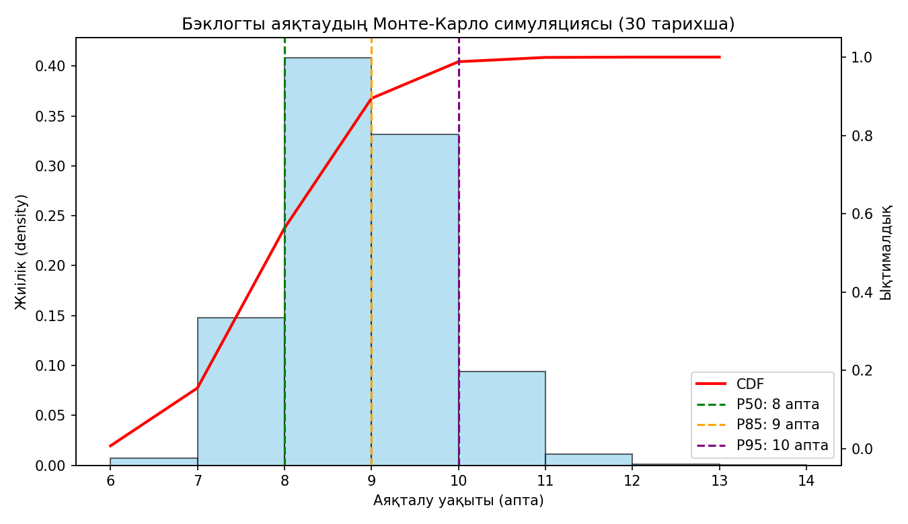
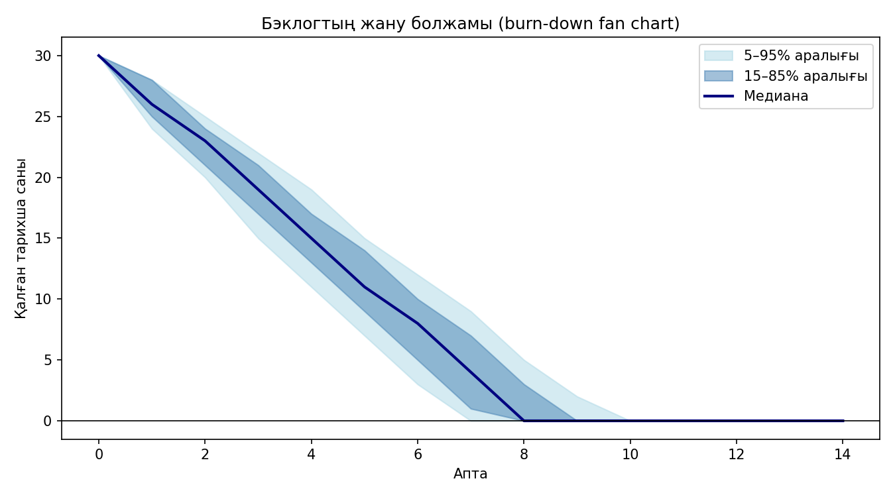
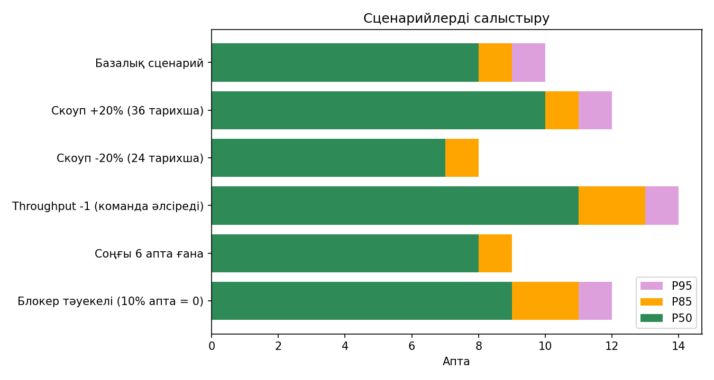
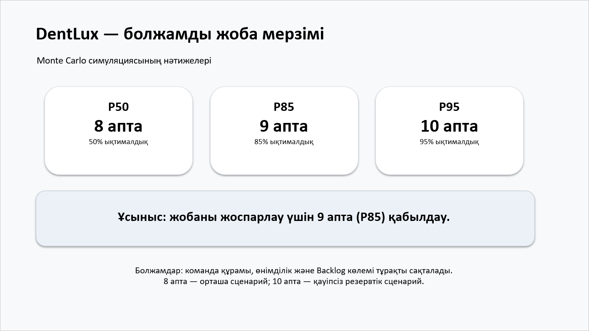

# Лабка 6 Монте Карло және жоспарлау покері

## 6 ЗЖ Монте Карло симуляциясы және жоспарлау покері

DentLux Portal · АТ жобаларын басқару · түзетілген нұсқа

Ізбасхан Әселхан — Project Manager / Frontend / QA

Жандос Арлан — Backend / DevOps

Еділ Шыңтас — DB Architecture

## 1. Жұмыстың мақсаты

Жұмыстың мақсаты – командалық жобаның аяқталу мерзімін бір ғана «нақты күн» түрінде емес, ықтималдық диапазоны түрінде болжауды үйрену. Ол үшін тарихи throughput деректері бойынша Монте-Карло симуляциясы жүргізіліп, нәтиже story points негізіндегі детерминистік бағамен салыстырылады, сондай-ақ жоспарлау покері арқылы бағалаудағы пікір алшақтығының себептері талданады.

### Міндеттер

- Тарихи throughput деректерін жинау;

- Python тілінде Монте-Карло симуляциясын (10 000 жүгірту) жазу, гистограмма мен CDF салу, P50/P70/P85/P95 перцентильдерін есептеу;

- Симуляция нәтижесін детерминистік бағамен салыстыру;

- Бэклогтың 10 тарихшасында жоспарлау покерін өткізу;

- Тапсырыс берушіге арналған қорытынды (1 слайд) дайындау.

## 2. Теориялық негіз

Throughput – белгілі бір уақыт аралығында (апта немесе спринт) жабылған жұмыс элементтерінің (тарихшалардың) саны. Ол story points-қа қарағанда нақты орындалған жұмысты көрсетеді және бағалау субъективтілігіне тәуелсіз.

Монте-Карло симуляциясы – кездейсоқ таңдауды көп рет қайталау арқылы нәтиженің ықтималдық үлестірімін алу әдісі. Бұл жұмыста әр симуляцияда бэклог біткенше тарихи деректерден аптасына жабылатын тарихша саны кездейсоқ таңдалады, ал барлық жүгірту нәтижесінен аяқталу уақытының үлестірімі құрылады.

Перцентиль (Pxx) – жобаның xx% жағдайда сол мерзімде немесе одан ертерек аяқталатынын білдіреді. Мысалы, P85 = 9 апта дегеніміз – жобаның 85% ықтималдықпен 9 аптада немесе ертерек бітуі.

## 3. 1-бөлік: Симуляция

### 3.1. Тарихи throughput деректері

Бастапқы есептегі 12 апталық қатар сақталды: [3,4,2,5,4,3,6,2,4,5,3,4]. Нақты export не оқытушы dataset-і берілмеген. Сондықтан бұл — оқу сценарийінің деректері; DentLux-тың дәлелденген 12 апталық тарихы ретінде ұсынылмайды.

| Апта | 1 | 2 | 3 | 4 | 5 | 6 | 7 | 8 | 9 | 10 | 11 | 12 |
| --- | --- | --- | --- | --- | --- | --- | --- | --- | --- | --- | --- | --- |
| Тарихша | 3 | 4 | 2 | 5 | 4 | 3 | 6 | 2 | 4 | 5 | 3 | 4 |

Қорытынды: барлығы 45 тарихша жабылған, орташа throughput = 45 / 12 = 3,75 тарихша/апта. Бэклогта қалған жұмыс көлемі – 30 тарихша.

Throughput-тың толық статистикасы:

| Көрсеткіш | Мәні | Түсіндірме |
| --- | --- | --- |
| Апталар саны | 12 | Тарихи таңдама көлемі |
| Жалпы жабылған тарихша | 45 | 3+4+2+5+4+3+6+2+4+5+3+4 |
| Орташа (mean) | 3,75 | 45 / 12 — детерминистік есепте қолданылады |
| Медиана | 4,0 | Ортаңғы мән |
| Стандартты ауытқу | 1,22 | Апталар арасындағы шашырау |
| Минимум / максимум | 2 / 6 | Ең нашар және ең жақсы апта |
| Вариация коэффициенті (CV) | 32% | std / mean — құбылмалылық деңгейі |

Throughput аптадан аптаға 2-ден 6-ға дейін өзгереді, ал вариация коэффициенті шамамен 32% құрайды. Бұл — өнімділік тұрақты емес және тек орташа мәнге сүйену жеткіліксіз деген сөз: нақ осы құбылмалылықты Монте-Карло симуляциясы есепке алады.

Жорамалдар (assumptions):

- Апталар бір-біріне тәуелсіз: бір аптадағы нәтиже келесіге әсер етпейді.

- Тарихи деректер болашақты көрсетеді: команда құрамы мен жұмыс тәсілі өзгермейді.

- Тарихшалар шамамен бірдей өлшемде (right-sized), сондықтан «тарихша саны» жұмыс көлемін бағалауға жарайды.

- Бэклог көлемі тұрақты — 30 тарихша, жаңа талап қосылмайды.

- Жұмыс 05.10.2026 күні басталады, апта = 7 күн (болжамды күндер осыдан есептелген).

### 3.2. Әдістің мәні және алгоритм

Монте-Карло әдісі — белгісіз нәтижені кездейсоқ таңдауды көп рет қайталау арқылы бағалау тәсілі. Жоба мерзімін болжауда әр «жүгіртуде» бір ықтимал болашақ сценарий ойнатылады: бэклог біткенше әр аптада тарихи деректерден кездейсоқ бір throughput мәні алынады. 10 000 жүгіртуден аяқталу мерзімінің үлестірімі шығады, ал одан ықтималдықтар мен перцентильдер есептеледі.

Математикалық түрде бір жүгірту мына шамаға тең: T = min{ k : X₁ + X₂ + ... + Xₖ ≥ N }, мұнда N = 30 — бэклог көлемі, Xᵢ — i-ші аптадағы жабылған тарихша саны (тарихи тізімнен қайта қойып таңдалады), T — бэклог біткен апта нөмірі.

Алгоритм қадамдары:

- Тарихи throughput тізімін (12 апта) және бэклог көлемін (N = 30) енгіземіз.

- Жүгірту басында completed = 0, weeks = 0.

- Әр апта үшін тізімнен кездейсоқ бір мәнді таңдап, completed-ке қосамыз, weeks-ті 1-ге арттырамыз.

- completed ≥ N болғанда weeks мәнін нәтижелер тізіміне жазамыз.

- 1–4 қадамдарды 10 000 рет қайталаймыз.

- Алынған 10 000 мәннен гистограмма, CDF, перцентильдер (P50, P70, P85, P95) және «k аптада бітеміз бе?» ықтималдығын есептейміз.

### 3.3. Қолданылған формулалар

Белгілеулер: N = 30 — бэклог көлемі; Xᵢ — i-ші аптадағы жабылған тарихша саны (throughput); n = 10 000 — симуляция саны; k — апта нөмірі; T — бір симуляцияда бэклог біткен апта; mₖ — T ≤ k болған симуляциялар саны.

| № | Көрсеткіш | Формула | Нәтиже |
| --- | --- | --- | --- |
| 1 | Орташа throughput | x̄ = (ΣXᵢ) / 12 | 45 / 12 = 3,75 |
| 2 | Медиана | сұрыпталған қатардың ортаңғы мәні | 4 |
| 3 | Стандартты ауытқу | s = √( Σ(Xᵢ − x̄)² / (12 − 1) ) | 1,22 |
| 4 | Вариация коэффициенті | CV = s / x̄ | ≈ 32% |
| 5 | Детерминистік баға | T_det = N / x̄ | 30 / 3,75 = 8 апта |
| 6 | Бір симуляция | T = min{ k : X₁ + X₂ + … + Xₖ ≥ N } | Xᵢ тарихтан кездейсоқ таңдалады |
| 7 | Ықтималдық (эмпирикалық CDF) | P(T ≤ k) = mₖ / n | P(T ≤ 9) = 8900 / 10000 = 89% |
| 8 | Перцентиль | Pp = min{ k : P(T ≤ k) ≥ p / 100 } | P50 = 8, P85 = 9, P95 = 10 |
| 9 | Болжамды күн | Күн = бастау күні + k·7 күн − 1 күн | 05.10.2026 + 9 апта − 1 күн = 06.12.2026 |
| 10 | Burn-down (қалдық) | Rⱼ = max( N − (X₁ + … + Xⱼ), 0 ) | P5, P15, P50, P85, P95 бойынша |
| 11 | Сценарийлер | N' = 1,2·N және 0,8·N; X'ᵢ = max(Xᵢ − 1, 0); X'ᵢ = Xᵢ·B | B = 0 (ықт. 0,10) немесе 1 (ықт. 0,90) |
| 12 | Bootstrap | 12 мәннен қайталап таңдау × 300; 90% аралық = [P5 ; P95] (P85 мәндерінен) | 8–11 апта |

Түсініктеме: 6-формулада әр Xᵢ тарихи 12 мәннен қайта қойып таңдалады, әрқайсысының таңдалу ықтималдығы 1/12 (қайталанатын мәндер жиірек түседі). 8-формулада перцентиль бүтін аптаға жоғары қарай дөңгелектенеді (консервативті бағалау). 11-формуладағы B — «блокер аптасы» индикаторы: ол аптада throughput нөлге тең болады.

### 3.4. Python-дағы симуляция коды (Google Colab)

Симуляция Google Colab ортасында орындалды. Код төменде берілген:

```text
import matplotlib.pyplot as plt
import numpy as np
historical_throughput = [3, 4, 2, 5, 4, 3, 6, 2, 4, 5, 3, 4]
backlog_size = 30
num_simulations = 10000
np.random.seed(42)
weeks_to_complete = []
for _ in range(num_simulations):
    completed = 0
    weeks = 0
    while completed < backlog_size:
        completed += np.random.choice(historical_throughput)
        weeks += 1
    weeks_to_complete.append(weeks)
p50 = np.percentile(weeks_to_complete, 50)
p70 = np.percentile(weeks_to_complete, 70)
p85 = np.percentile(weeks_to_complete, 85)
p95 = np.percentile(weeks_to_complete, 95)
print(p50, p70, p85, p95)
# Гистограмма + CDF + перцентиль сызықтары
fig, ax1 = plt.subplots(figsize=(10, 6))
bins = range(min(weeks_to_complete), max(weeks_to_complete) + 2)
ax1.hist(weeks_to_complete, bins=bins, density=True,
         alpha=0.6, color="skyblue", edgecolor="black")
ax2 = ax1.twinx()
values, base = np.histogram(weeks_to_complete, bins=bins)
ax2.plot(base[:-1], np.cumsum(values) / num_simulations, color="red")
for p, c in ((p50, "green"), (p85, "orange"), (p95, "purple")):
    ax2.axvline(p, color=c, linestyle="--")
plt.show()
```

Толық нұсқа және функциялар құрылымы. Жоғарыда симуляцияның қысқа нұсқасы берілген. Толық код функцияларға бөлінген, сондықтан параметрлерді (деректер, бэклог көлемі, симуляция саны, мерзім) тек CONFIG блогында өзгерту жеткілікті. Толық код — «Қосымша А» бөлімінде.

| Функция / блок | Міндеті |
| --- | --- |
| CONFIG | Барлық параметрлер: тарихи деректер, бэклог, симуляция саны, seed, бастау күні, перцентильдер, тексерілетін мерзім |
| describe_history() | Деректер статистикасы: орташа, медиана, std, min/max, вариация коэффициенті |
| simulate() | Симуляция ядросы: бір матрицада 10 000 × max_weeks кездейсоқ мән таңдайды, cumsum және argmax арқылы бэклог біткен аптаны табады (цикл жоқ, сондықтан тез); блокер аптасының ықтималдығын қосуға болады |
| burndown_paths() | Бэклогтың апта сайын азаю траекториялары (fan chart үшін) |
| percentile_table() | P50/P70/P85/P95 және болжамды күндер кестесі (бүтін апта, method="higher" — консервативті) |
| prob_within() | Жоба k аптада немесе ертерек біту ықтималдығы |
| run_scenarios() | 6 «what-if» сценарий: скоуп ±20%, throughput −1, соңғы 6 апта, блокер тәуекелі |
| bootstrap_p85() | P85-тің өзі қаншалық тұрақты екенін бағалау (12 апталық аз деректі ескеріп) |
| plot_*() | 3 график: гистограмма+CDF, burn-down fan chart, сценарийлер салыстыруы |
| main() | Барлығын ретімен орындап, нәтижені экранға, CSV және JSON файлдарға шығарады |

Colab-та іске қосу: colab.research.google.com сайтында жаңа ноутбук ашып, кодты ұяшыққа қойып, Runtime → Run all түймесін басамыз. Кодтың соңында main() шақырылады, нәтиже кестелер мен графиктер түрінде шығады.

### 3.5. Нәтижелер

10 000 симуляциядан кейін келесі перцентильдер алынды:

| Перцентиль | Аяқталу мерзімі | Түсіндірме |
| --- | --- | --- |
| P50 | 8,0 апта | 50% ықтималдық (оптимистік) |
| P70 | 9,0 апта | 70% ықтималдық |
| P85 | 9,0 апта | 85% сенімділік (негізгі міндеттеме) |
| P95 | 10,0 апта | 95% ықтималдық (пессимистік, жоспарлау шегі, максимум емес) |



1-сурет. Аяқталу уақытының гистограммасы және кумулятивтік қисық (CDF)

Графиктегі көк бағандар әр аптада аяқталу жиілігін, қызыл қисық кумулятивтік ықтималдықты көрсетеді. Тік үзік сызықтар P50, P85 және P95 мәндерін белгілейді.

Болжамды аяқталу күндері. Жұмыс 05.10.2026 күні басталады деп алып (апта = 7 күн), перцентильдер бойынша күндер мынадай:

| Перцентиль | Апта | Болжамды аяқталу күні |
| --- | --- | --- |
| P50 | 8 | 29.11.2026 |
| P70 | 9 | 06.12.2026 |
| P85 | 9 | 06.12.2026 |
| P95 | 10 | 13.12.2026 |

Симуляциядағы аяқталу апталарының орташа мәні — 8,40 апта. Төменде әр апта бойынша ықтималдық үлестірімі көрсетілген:

| Апта | Дәл осы аптада бітеді | Осы аптаға дейін бітеді (кумулятивті) |
| --- | --- | --- |
| 6 | 0.7% | 0.7% |
| 7 | 14.6% | 15.3% |
| 8 | 41.2% | 56.5% |
| 9 | 32.5% | 89.0% |
| 10 | 9.7% | 98.8% |
| 11 | 1.2% | 99.9% |
| 12 | 0.1% | 100.0% |

Кестеден көрінгендей, жоба 7 аптада бітуі өте сирек (≈15%), 8 аптада бітуі — 56%, ал 9 аптаға дейін бітуі — 89%. Сондықтан P85 = 9 апта, ал 10 аптаға дейін бітеді деп сенімділікпен (≈99%) айтуға болады. Үлестірім 8–9 апта аймағында шоғырланған және оң жаққа қарай «құйрығы» бар: кешігу ықтималдығы ертерек бітуден жоғары, сондықтан тек оптимистік бағаны уәде ету қауіпті.

### 3.6. Бэклогтың жану болжамы (burn-down fan chart)



2-сурет. Қалған тарихша санының болжамды динамикасы

Сызық — медиана траекториясы, ал қою және ашық аймақтар 15–85% және 5–95% сенімділік аралықтарын көрсетеді. Аймақ уақыт өткен сайын кеңейеді: болашаққа алысырақ болжам белгісізірек. Нөл сызығын жоғарғы шекара қиған апта — ең нашар сценарийдегі аяқталу мерзімі.

### 3.7. Сезімталдық талдауы (what-if сценарийлер)

Болжам жорамалдарға тәуелді болғандықтан, олар өзгерсе нәтиже қалай өзгеретінін тексердік. Әр сценарий үшін 10 000 симуляция жүргізілді:

| Сценарий | P50 | P85 | P95 | P(≤9 апта) |
| --- | --- | --- | --- | --- |
| Базалық сценарий | 8 | 9 | 10 | 89% |
| Скоуп +20% (36 тарихша) | 10 | 11 | 12 | 31% |
| Скоуп -20% (24 тарихша) | 7 | 8 | 8 | 100% |
| Throughput -1 (команда әлсіреді) | 11 | 13 | 14 | 8% |
| Соңғы 6 апта ғана | 8 | 9 | 9 | 95% |
| Блокер тәуекелі (10% апта = 0) | 9 | 11 | 12 | 59% |



3-сурет. Сценарийлер бойынша P50 / P85 / P95 салыстыруы

Қорытындылар:

- Скоуп +20% (36 тарихша): P85 = 11 апта, 9 аптада бітуі тек 31% — бэклог көлемі мерзімге ең күшті әсер ететін фактор.

- Throughput −1: команда өнімділігі аптасына бір тарихшаға төмендесе, P85 = 13 апта, 9 аптаға үлгеру ықтималдығы 8% ғана.

- Блокер тәуекелі: әр 10-шы апта «нөлдік» болса, P85 = 11 апта — сыртқы API күту, ауру сияқты тоқтаулар мерзімді 2 аптаға ұзартады.

- Скоуп −20% (24 тарихша): P85 = 8 апта, 9 аптаға үлгеру ықтималдығы ≈100% — scope reduction ең тиімді басқару құралы.

- Соңғы 6 апта: P85 өзгермейді (9 апта), демек соңғы кезеңдегі өнімділік бүкіл тарихпен сәйкес.

### 3.8. Болжамның сенімділігі (bootstrap)

Тарихи таңдама тек 12 аптадан тұрады, сондықтан P85-тің өзі аздап өзгеруі мүмкін. Мұны бағалау үшін 12 аптаны қайта қойып таңдап (bootstrap) 300 жаңа «тарих» жасадық, әрқайсысына симуляция жүргіздік. P85 үшін 90% сенімділік аралығы — 8–11 апта (медиана 9 апта). Яғни 9 апта — ақылға қонымды негізгі міндеттеме, бірақ деректер аз болғандықтан 11 аптаға дейінгі ауытқуды жоққа шығаруға болмайды. Шешім: әр спринт сайын жаңа throughput қосып, болжамды қайта есептеу керек.

### 3.9. 1-бөлік бойынша қорытынды

Симуляция нәтижесінде жобаның аяқталуы: P50 = 8, P70 = 9, P85 = 9, P95 = 10 апта. Сезімталдық талдауы мерзімге ең көп әсер ететін факторларды анықтады: бэклог көлемі, команда өнімділігі және блокерлер. Тапсырыс берушіге болжамды ықтималдық диапазоны ретінде (P85 бойынша 9 апта) беру ұсынылады.

## 4. 2-бөлік: Салыстыру және жоспарлау покері

### 4.1. Симуляция мен детерминистік бағаны салыстыру

Детерминистік баға: 30 тарихша / 3,75 тарихша/апта = 8 апта. Бұл тек бір сан береді және оның орындалу ықтималдығы шамамен 50% (симуляциядағы P50-ге сәйкес).

Алшақтықтың себебі: нақты жұмыста өнімділік тұрақты болмайды. Code review кідірісі, блокерлер, ауру, сыртқы API-ды күту сияқты тәуекелдер аптадан аптаға throughput-ты өзгертеді. Детерминистік есеп орташа мәнді тұрақты деп қабылдайды, ал Монте-Карло симуляциясы осы құбылмалылықты (variance) ескереді. Сондықтан 85% сенімділікке жету үшін +1 апта буфер қажет: P85 = 9 апта.

| Әдіс | Нәтиже | Ықтималдық |
| --- | --- | --- |
| Детерминистік (тарихша саны / throughput) | 8 апта | ≈ 50% |
| Монте-Карло P85 | 9 апта | 85% |
| Монте-Карло P95 | 10 апта | 95% |

### 4.2. Жоспарлау покері (10 тарихша)

Бэклогтан 10 тарихша таңдалып, команда Fibonacci шкаласымен (1, 2, 3, 5, 8, 13) жоспарлау покерін өткізді. Кесте бастапқы есептегі бағаларды сақтайды; сессияның күні мен жеке дауыс хаттамасы берілмеген, сондықтан нақты өткен оқиға ретінде тәуелсіз расталмаған:

| № | Тарихша (user story) | Мин. баға | Макс. баға | Келісілген баға |
| --- | --- | --- | --- | --- |
| US-01 | Филиалдың мекенжайын көру | 1 | 3 | 2 |
| US-02 | Телефон арқылы жүйеге кіру | 3 | 5 | 5 |
| US-03 | Қызметтер мен бағаларды көру | 3 | 3 | 3 |
| US-04 | Дәрігерлер тізімін көру | 3 | 5 | 5 |
| US-05 | Бос уақыттарды көру | 8 | 13 | 13 |
| US-06 | Қабылдауға жазылу | 5 | 8 | 8 |
| US-07 | Пациенттің байланыс мәліметтерін енгізу | 3 | 3 | 3 |
| US-08 | Telegram арқылы растау | 5 | 8 | 8 |
| US-09 | Еске салу хабарламасын алу | 3 | 5 | 5 |
| US-10 | Админнің күндік кестесін көру | 5 | 8 | 8 |

### 4.3. Пікірлердің шашырау себептері

Бағалау кезінде кейбір тарихшаларда карточкалар әртүрлі болды (мысалы, 3 SP және 13 SP). Негізгі себеп – әзірлеушілердің инфрақұрылымдық күрделілікті және дерекқор миграциясын әртүрлі түсінуі, сондай-ақ архитектуралық белгісіздік пен тәжірибе айырмашылығы.

### 4.4. Талқылауда табылған жайттар

- Ұмытылған жұмыстар: автотесттер жазу (QA automation), қателерді өңдеу (error handling), деректер миграциясы.

- Жасырын тәуелділіктер: Frontend интерфейсі Backend API дайын болмайынша толық бітпейді; сыртқы интеграциялық API рұқсаттары.

- Дайындықты әртүрлі түсіну (Definition of Done): кейбір мүшелер code review мен staging/серверге деплойды бағаға қоспай кеткен.

## 5. 3-бөлік: Тапсырыс берушіге қорытынды

Тапсырыс берушіге «нақты бір күн» айту дұрыс емес, сондықтан жауап ықтималдық түрінде беріледі:

| Сценарий | Мерзім | Мағынасы |
| --- | --- | --- |
| P50 (оптимистік) | 8 апта | 50% тәуекел бар |
| P85 (негізгі міндеттеме) | 9 апта | Болжам жорамалдары орындалғандағы жоспарлау шегі |
| P95 (пессимистік) | 10 апта | Жоғары жоспарлау шегі, максимум емес |



4-сурет. Тапсырыс берушіге арналған қорытынды

Қорытынды: DentLux Portal 85% ықтималдықпен 9 аптада дайын болады (P50 = 8 апта, P95 = 10 апта).

Жорамалдар (Assumptions): команда құрамы мен апталық өнімділік өзгермейді; бэклог көлемі (30 тарихша) тұрақты.

Болжамды не өзгерте алады: бэклогқа жаңа функционал қосылса мерзім P95 шегіне (10 аптаға) дейін созылуы мүмкін; функционал көлемі қысқартылса (scope reduction) жоба шамамен 8 аптада бітеді.

## 6. Қорытынды

Жұмыс барысында тарихи throughput деректері бойынша Монте-Карло симуляциясы жүргізіліп, жобаның аяқталу мерзімі ықтималдық диапазоны ретінде алынды: P50 = 8, P85 = 9, P95 = 10 апта. Детерминистік баға (8 апта) тек 50% ықтималдықты береді, сондықтан тапсырыс берушіге P85 бойынша 9 аптаны осы жорамалдардағы жоспарлау шегі ретінде қолдануға болады. Жоспарлау покері ұмытылған жұмыстарды, жасырын тәуелділіктерді және DoD-ны әртүрлі түсінуді анықтауға көмектесті. Ықтималдық тілімен болжау жобаның тәуекелдерін ашық көрсетіп, тапсырыс берушімен сенімді келіссөз жүргізуге мүмкіндік береді.

## 7. Қосымша: файлдар

- GitHub репозиторийі: https://github.com/akaashia/dentlux-portal (қалта: docs/lab6)

- Notebook: Дополнения/lab6_simulation.ipynb. Іске қосылған нәтижелер мен графиктер notebook ішінде сақталған; интернеттегі Colab сілтемесі ойдан қосылмайды.

## Қосымша А. Толық Python коды (Google Colab)

```text
"""
6-ЗЖ. DentLux Portal: Монте-Карло симуляциясы арқылы жоба мерзімін болжау.
Google Colab-та тікелей іске қосуға болады (барлық кітапхана дайын).
"""
import json
from datetime import date, timedelta
import numpy as np
import pandas as pd
import matplotlib.pyplot as plt
# ============ 1. ПАРАМЕТРЛЕР (тек осы жерді өзгертесіз) ============
CONFIG = {
    "history": [3, 4, 2, 5, 4, 3, 6, 2, 4, 5, 3, 4],  # апта сайынғы throughput
    "backlog": 30,               # бэклогтағы тарихша саны
    "n_sims": 10_000,            # симуляция саны
    "seed": 42,                  # нәтиже қайталануы үшін
    "start_date": date(2026, 10, 5),
    "percentiles": [50, 70, 85, 95],
    "commit_pct": 85,            # тапсырыс берушіге уәде ететін деңгей
    "target_weeks": 9,           # тексеретін мерзім: "9 аптада бітеміз бе?"
}
# ============ 2. ДЕРЕКТЕРДІ СИПАТТАУ ============
def describe_history(h):
    h = np.array(h)
    return {
        "weeks": len(h), "total": int(h.sum()), "mean": float(h.mean()),
        "median": float(np.median(h)), "std": float(h.std(ddof=1)),
        "min": int(h.min()), "max": int(h.max()),
        "cv": float(h.std(ddof=1) / h.mean()),   # вариация коэффициенті
    }
# ============ 3. СИМУЛЯЦИЯ ЯДРОСЫ ============
def simulate(history, backlog, n_sims, rng, zero_week_prob=0.0, max_weeks=200):
    """Әр жүгіртуде бэклог біткенше апта сайын тарихтан кездейсоқ мән алады.
    zero_week_prob - 'блокер аптасы' ықтималдығы (сол аптада throughput = 0)."""
    draws = rng.choice(history, size=(n_sims, max_weeks))
    if zero_week_prob > 0:
        draws = draws * (rng.random((n_sims, max_weeks)) >= zero_week_prob)
    cum = draws.cumsum(axis=1)
    return (cum >= backlog).argmax(axis=1) + 1        # аяқталған апта нөмірі
def burndown_paths(history, backlog, n_sims, rng, horizon=14):
    draws = rng.choice(history, size=(n_sims, horizon))
    return np.maximum(backlog - draws.cumsum(axis=1), 0)
# ============ 4. ТАЛДАУ ФУНКЦИЯЛАРЫ ============
def percentile_table(weeks, pcts, start):
    rows = []
    for p in pcts:
        w = int(np.percentile(weeks, p, method="higher"))   # консервативті
        rows.append({"Перцентиль": f"P{p}", "Апта": w,
                     "Болжамды күн": (start + timedelta(weeks=w) - timedelta(days=1)).strftime("%d.%m.%Y")})
    return pd.DataFrame(rows)
def prob_within(weeks, k):
    """Жоба k аптада немесе ертерек біту ықтималдығы."""
    return float((weeks <= k).mean())
def run_scenarios(cfg, rng):
    h, b, n = cfg["history"], cfg["backlog"], cfg["n_sims"]
    scenarios = {
        "Базалық сценарий":              dict(history=h, backlog=b),
        "Скоуп +20% (36 тарихша)":       dict(history=h, backlog=int(b * 1.2)),
        "Скоуп -20% (24 тарихша)":       dict(history=h, backlog=int(b * 0.8)),
        "Throughput -1 (команда әлсіреді)": dict(history=[max(x - 1, 0) for x in h], backlog=b),
        "Соңғы 6 апта ғана":             dict(history=h[-6:], backlog=b),
        "Блокер тәуекелі (10% апта = 0)": dict(history=h, backlog=b, zero_week_prob=0.10),
    }
    out = []
    for name, kw in scenarios.items():
        w = simulate(kw["history"], kw["backlog"], n, rng, kw.get("zero_week_prob", 0.0))
        out.append({"Сценарий": name,
                    "P50": int(np.percentile(w, 50, method="higher")),
                    "P85": int(np.percentile(w, 85, method="higher")),
                    "P95": int(np.percentile(w, 95, method="higher")),
                    f"P(≤{cfg['target_weeks']} апта)": f"{prob_within(w, cfg['target_weeks']):.0%}"})
    return pd.DataFrame(out)
def bootstrap_p85(cfg, n_boot=300, sims=3000):
    """Тарихи деректер аз (12 апта), сондықтан P85-тің өзі қаншалық тұрақты?"""
    rng = np.random.default_rng(cfg["seed"] + 1)
    h = np.array(cfg["history"])
    vals = []
    for _ in range(n_boot):
        sample = rng.choice(h, size=len(h), replace=True)
        w = simulate(sample, cfg["backlog"], sims, rng)
        vals.append(np.percentile(w, cfg["commit_pct"], method="higher"))
    return np.percentile(vals, [5, 50, 95]), np.array(vals)
# ============ 5. ГРАФИКТЕР ============
try:
    get_ipython()            # Colab / Jupyter ішінде графиктер ұяшықтың астында шығады
    SHOW = True
except NameError:
    SHOW = False
def _show():
    if SHOW:
        plt.show()
    plt.close()
def plot_hist_cdf(weeks, pcts_w, n, backlog, path):
    fig, ax1 = plt.subplots(figsize=(9, 5.2))
    bins = range(weeks.min(), weeks.max() + 2)
    ax1.hist(weeks, bins=bins, density=True, alpha=0.6, color="skyblue", edgecolor="black")
    ax1.set_xlabel("Аяқталу уақыты (апта)"); ax1.set_ylabel("Жиілік (density)")
    ax2 = ax1.twinx()
    v, b = np.histogram(weeks, bins=bins)
    ax2.plot(b[:-1], np.cumsum(v) / n, color="red", lw=2, label="CDF")
    for p, c in zip((50, 85, 95), ("green", "orange", "purple")):
        ax2.axvline(pcts_w[p], color=c, ls="--", label=f"P{p}: {pcts_w[p]} апта")
    ax2.set_ylabel("Ықтималдық"); ax2.set_ylim(0, 1.05)
    plt.title(f"Бэклогты аяқтаудың Монте-Карло симуляциясы ({backlog} тарихша)")
    fig.tight_layout(); plt.legend(loc="lower right")
    plt.savefig(path, dpi=150); _show()
def plot_burndown(paths, backlog, path):
    x = np.arange(0, paths.shape[1] + 1)
    full = np.hstack([np.full((paths.shape[0], 1), backlog), paths])
    q = {p: np.percentile(full, p, axis=0) for p in (5, 15, 50, 85, 95)}
    fig, ax = plt.subplots(figsize=(9, 5))
    ax.fill_between(x, q[5], q[95], color="lightblue", alpha=0.5, label="5–95% аралығы")
    ax.fill_between(x, q[15], q[85], color="steelblue", alpha=0.5, label="15–85% аралығы")
    ax.plot(x, q[50], color="navy", lw=2, label="Медиана")
    ax.axhline(0, color="black", lw=0.8)
    ax.set_xlabel("Апта"); ax.set_ylabel("Қалған тарихша саны")
    ax.set_title("Бэклогтың жану болжамы (burn-down fan chart)")
    ax.legend(); fig.tight_layout(); plt.savefig(path, dpi=150); _show()
def plot_scenarios(df, path):
    fig, ax = plt.subplots(figsize=(9, 4.8))
    y = np.arange(len(df))
    ax.barh(y, df["P95"], color="plum", label="P95")
    ax.barh(y, df["P85"], color="orange", label="P85")
    ax.barh(y, df["P50"], color="seagreen", label="P50")
    ax.set_yticks(y); ax.set_yticklabels(df["Сценарий"]); ax.invert_yaxis()
    ax.set_xlabel("Апта"); ax.set_title("Сценарийлерді салыстыру")
    ax.legend(loc="lower right"); fig.tight_layout(); plt.savefig(path, dpi=150); _show()
# ============ 6. НЕГІЗГІ ІСКЕ ҚОСУ ============
def main(cfg=CONFIG, out_dir="."):
    rng = np.random.default_rng(cfg["seed"])
    h, b, n = cfg["history"], cfg["backlog"], cfg["n_sims"]
    stats = describe_history(h)
    det = b / stats["mean"]
    print("Throughput статистикасы:", stats)
    print(f"Детерминистік баға: {b}/{stats['mean']:.2f} = {det:.1f} апта\n")
    weeks = simulate(h, b, n, rng)
    table = percentile_table(weeks, cfg["percentiles"], cfg["start_date"])
    print(table.to_string(index=False))
    pw = {p: int(np.percentile(weeks, p, method="higher")) for p in (50, 70, 85, 95)}
    p_target = prob_within(weeks, cfg["target_weeks"])
    print(f"\nP(≤{cfg['target_weeks']} апта) = {p_target:.1%}")
    print("Апта бойынша ықтималдық:",
          {int(k): f"{(weeks <= k).mean():.0%}" for k in range(weeks.min(), weeks.max() + 1)})
    plot_hist_cdf(weeks, pw, n, b, f"{out_dir}/fig1_hist_cdf.png")
    plot_burndown(burndown_paths(h, b, n, rng), b, f"{out_dir}/fig2_burndown.png")
    sc = run_scenarios(cfg, rng)
    print("\n", sc.to_string(index=False))
    plot_scenarios(sc, f"{out_dir}/fig3_scenarios.png")
    ci, _ = bootstrap_p85(cfg)
    print(f"\nP85 bootstrap 90% аралығы: {ci[0]:.0f}–{ci[2]:.0f} апта (медиана {ci[1]:.0f})")
    table.to_csv(f"{out_dir}/percentiles.csv", index=False)
    sc.to_csv(f"{out_dir}/scenarios.csv", index=False)
    freq = {int(k): float((weeks == k).mean()) for k in range(weeks.min(), weeks.max() + 1)}
    json.dump({"stats": stats, "det": det, "table": table.to_dict("records"),
               "p_target": p_target, "scen": sc.to_dict("records"),
               "ci": ci.tolist(), "freq": freq, "pw": pw,
               "mean_sim": float(weeks.mean())},
              open(f"{out_dir}/results.json", "w"), ensure_ascii=False, indent=1)
if __name__ == "__main__":
    main()
```

## Story points бойынша детерминистік салыстыру

Талаптағы SP салыстыруы үшін бір scope және бірлік қолданылады. Покердің 10 тарихшасының келісілген бағасы: 2+5+3+5+13+8+3+8+5+8 = 60 SP. Тарихи velocity SP/апта берілмеген. Сондықтан 60 SP / v SP/апта формуласы бар, бірақ v-ны 3,75 тарихша/аптамен алмастыруға болмайды.

Сезімталдық мысалы ғана: егер v = 7,5 SP/апта деп алсақ, 60/7,5 = 8 апта. Бұл өлшенген velocity емес. 30 тарихшалық Monte Carlo бэклогымен тікелей салыстыру үшін қалған 20 тарихшаның бағасы және бірдей scope қажет; ондай дерек жоқ. 30/3,75 = 8 апта бұрынғы throughput салыстыруы ретінде сақталды, SP талабын орындады деп белгіленбейді.

P85 = 9 апта — дискретті үлестірімнің 85-перцентилі; дәл осы кодта 9 аптаға дейін аяқталу үлесі 89,03%. P95 = 10 апта ең ұзақ мерзім емес. Шекаралар тек осы сценарий мен жорамалдарға қатысты.

## Қосымшалар

- [Орындалған notebook Python CSV және графиктер](assets/lab6-artifacts.zip)

[Барлық зертханалық жұмыстар](README.md)
