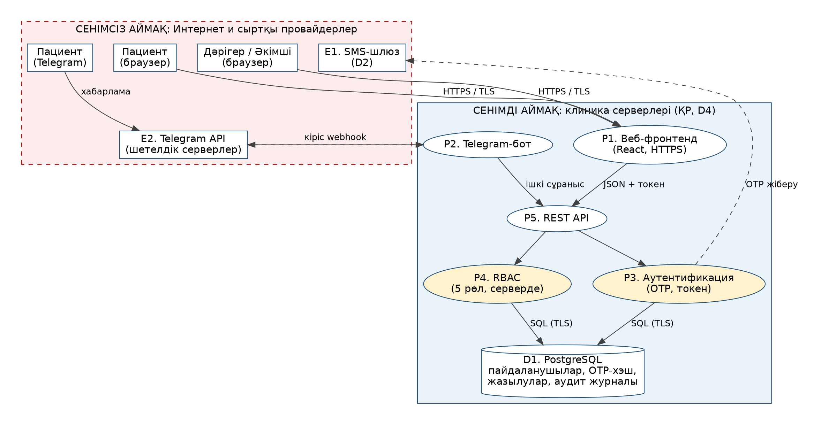

# Лабка 7 Тәуекелдер және қауіп үлгісі

ЗЕРТХАНАЛЫҚ ЖҰМЫС № 7

Команда: Ізбасхан Әселхан — Project Manager / Frontend / QA; Жандос Арлан — Backend / DevOps; Еділ Шыңтас — DB Architecture.

Тәуекелдер, қауіп үлгісі және сәйкестік

DentLux Portal — стоматологиялық клиникаға онлайн жазылу жүйесі

| Жоба | DentLux Portal (github.com/akaashia/dentlux-portal) |
| --- | --- |
| Команда | Ізбасхан Әселхан — Project Manager / Frontend / QA Жандос Арлан — Backend / DevOps Еділ Шыңтас — DB Architecture |
| Күні | 14.10.2026 |
| Құрамы | 7.1 бөлімі: pre-mortem және RAID-журнал 7.2 бөлімі: STRIDE қауіп үлгісі және репозиторий сканері 7.3 бөлімі: дербес деректер, ЖИ сәйкестігі және 3 шара шара, бэклог тапсырмалары Қосымша А: не қалай жасалғаны (генерация картасы) |

## 7.1 Pre-mortem және RAID-журнал

### 7.1.1. Pre-mortem сессиясы

Сценарий: «Жоба 20.12.2026-да M3 қабылдау сынағынан өтпей, сәтсіз аяқталды. Неге?» Әр қатысушы 5–7 себеп айтады, содан кейін бәрі санатқа бөлінеді. Сессия шамамен 40 минут. Төмендегі 23 тәуекелдің 20-сы pre-mortem-нен, ал соңғы 3-і қауіп үлгілеуінен (7.2 бөлімі) қосылған.

| ID | Сәтсіздік себебі (pre-mortem) | Санат |
| --- | --- | --- |
| R-01 | D1 (дәрігерлер кестесі, прайс-лист) уақытында берілмеді | Тәуелділік |
| R-02 | SMS-шлюздің тест API кілті кешікті | Тәуелділік |
| R-03 | Telegram-бот токені кешікті | Тәуелділік |
| R-04 | Екі пациент бір слотқа бір уақытта жазылды (double booking) | Техникалық |
| R-05 | Техлид қысқа мерзімге қолжетімсіз болды, DevOps тоқтады | Адам |
| R-06 | Клиника MVP шекарасын үнемі өзгертті (scope creep) | Скоуп |
| R-07 | Пациент деректері шифрланбай сақталды | ДДЗ / құқықтық |
| R-08 | Өндірістік деректер тест ортасына түсіп кетті | Қауіпсіздік |
| R-09 | Telegram-хабарламада пациент деректері кетті | ДДЗ |
| R-10 | Хостинг KZ дата-орталығында емес | Сыртқы / құқықтық |
| R-11 | OTP-ны ботпен жаппай теруге болады (brute force), SMS шығыны өсті | Қауіпсіздік |
| R-12 | Рөлдер серверде тексерілмеді (RBAC), дәрігер басқаның деректерін көреді | Қауіпсіздік |
| R-13 | Құпия (токен, пароль) репозиторий немесе логқа түсті | Қауіпсіздік |
| R-14 | Тәуелді кітапханаларда осалдық, CI-де сканер жоқ | Техникалық |
| R-15 | 200 пайдаланушыда p95 > 800 мс | Техникалық |
| R-16 | Ескі журналдан деректер толық көшірілмеді | Деректер |
| R-17 | Жазылу UX-і пациенттермен тексерілмеді, интерфейс түсініксіз | Өнім |
| R-18 | OpenAPI контрактісі өзгерді, фронтенд пен бот тоқтады | Техникалық |
| R-19 | Сессия мен мерекелер уақытты жеп қойды | Жоспарлау |
| R-20 | Логтарда телефон нөмірі сақталып, сыртқы мониторингке кетті | ДДЗ |
| R-21 | Сессия токені ұзақ жарамды болып, ұрланды (қауіп үлгісінен) | Қауіпсіздік |
| R-22 | Telegram chat-ты телефонсыз байланыстыруға болады (қауіп үлгісінен) | Қауіпсіздік |
| R-23 | Әдепкі әкімші аккаунты өндіріске қалды (қауіп үлгісінен) | Қауіпсіздік |

### 7.1.2. RAID-журналы (толық)

Ықтималдық пен ықпал — команданың болжамы. Ықпал миллион теңгемен берілген. EMV = ықтималдық × ықпал. Қайта қарау — әр 2 аптада статус-кездесуде, сонымен қатар триггер іске қосылған кезде. Кесте келесі бетте, жатық бағытта.

- R — Risks (тәуекелдер): болуы мүмкін оқиғалар, олар болса жобаға әсер етеді.

- A — Assumptions (болжамдар): тексерілмеген, бірақ дұрыс деп қабылданған жорамалдар. Мысалы, «команда құрамы өзгермейді».

- I — Issues (проблемалар): қазір болып жатқан мәселелер, оларды шешу керек.

- D — Dependencies (тәуелділіктер): басқалардан күтетін нәрселер. Мысалы, «клиника D1 кестесін береді».

| ID | Тәуекел (егер… онда…) | Санат | Ықт. | Ықп., млн тг | EMV, млн тг | Иесі | Стратегия және алдын ала шара | Триггер | Ден қою жоспары (іске асса) | Қайта қарау |
| --- | --- | --- | --- | --- | --- | --- | --- | --- | --- | --- |
| R-01 | Егер D1 (дәрігерлер кестесі, прайс-лист) 16.10-ға дейін берілмесе, онда M1 бір аптаға ығысады | Тәуелділік | 40 % | 0,8 | 0,32 | Әселхан | Азайту: клиникаға 16.10 күні нақты сұраныс; демо-деректер дайындау | 16.10 дейін D1 растау жоқ | Демо-деректермен (слот 09:00–18:00) M1 көрсету; нақты кесте M2-ге дейін | 16.10.2026 |
| R-02 | Егер SMS-шлюздің тест API кілті 30.10-ға дейін алынбаса, онда M2-де растау SMS-і жұмыс істемейді | Тәуелділік | 50 % | 1,2 | 0,60 | Арлан | Азайту: SMS-провайдерге 23.10-ға дейін сұраныс | 30.10 кілт жоқ | Mock-провайдер; растау тек Telegram арқылы; SMS M3-ке дейін кейінге | 30.10.2026 |
| R-03 | Егер Telegram-бот токені 23.10-ға дейін берілмесе, онда M2-нің бот бөлігі кешігеді | Тәуелділік | 30 % | 0,5 | 0,15 | Арлан | Азайту: токенді директордан 16.10 сұрату | 23.10 токен жоқ | Команданың сынақ аккаунтындағы бот; токен келгенде ауыстыру | 23.10.2026 |
| R-04 | Егер екі пациент бір слотқа бір уақытта жазылса (транзакция қорғалмаса), онда клиника қате брондауды шығындайды | Техникалық | 25 % | 3,0 | 0,75 | Шыңтас | Азайту: DB деңгейінде UNIQUE шектеуі + транзакциялық блоктау; 200 пайдаланушы жүктеме тесті | Жүктеме тестінде дубль > 0 | Брондауды аудит журналына жазу; қате жазбаны қолмен шешу; түзету тесті M2-ге дейін | 27.11.2026 |
| R-05 | Егер техлид Жандос Арлан 2 жұмыс аптасынан артық қолжетімсіз болса, онда DevOps мен backend тоқтайды | Адам | 20 % | 2,0 | 0,40 | Әселхан | Азайту: ортақ runbook; жұптық жұмыс; Шыңтас DB бөлігінде қосалқы | Арлан 2 күннен артық жауап бермесе | Шыңтас backend-тің шұғыл тапсырмасын алады; Әселхан deploy runbook-ын орындайды | 30.10.2026 |
| R-06 | Егер клиника директоры MVP шекарасын (E0) жазбаша бекітпесе немесе жеке кабинет/төлемді талап етсе, онда скоуп 20 %-ға өседі | Скоуп | 35 % | 2,5 | 0,88 | Әселхан | Азайту: E0 жазбаша растау; өзгерістер тек ADR арқылы | Апта сайынғы демода 2+ жаңа талап; D6 (09.10) растауы жоқ | Жаңа талап келесі релизге көшіріледі; директормен қол қойылған шекара | 23.10.2026 |
| R-07 | Егер пациент деректері (аты-жөні, телефон, жазылу тарихы) AES-256-сыз сақталса, онда жобаның шифрлау талабы орындалмайды және сәйкестік тәуекелі туындайды | ДДЗ / құқықтық | 30 % | 4,0 | 1,20 | Шыңтас | Азайту: DB шифрлауы; деректерді минимизациялау; заңгер тексеруі | M1 шифрлау тесті өтпесе | Релиз feature flag-пен тоқтатылады; деректерді енгізу бұғатталады; заңгерге ескерту | 23.10.2026 |
| R-08 | Егер өндірістік деректер көшірмесі (D7 журналы) тест ортасына түссе, онда пациенттердің деректері тестке ағып кетеді | Қауіпсіздік | 20 % | 5,0 | 1,00 | Шыңтас | Азайту: тест ортасында тек синтетикалық деректер; D7 импорты тек өндірісте | Тест ортасында нақты аты-жөні немесе телефон табылса | Ортаны дереу оқшаулау; ДДЗ инцидент хаттамасы; тест деректерін алмастыру | 30.10.2026 |
| R-09 | Егер Telegram-хабарламада аты-жөні, дәрігер аты және медициналық мәлімет болса, онда бұл деректер ҚР шегінен тыс серверлер арқылы өтеді | ДДЗ | 50 % | 2,0 | 1,00 | Әселхан | Азайту: хабарлама шаблоны — тек күн, уақыт, клиника және сілтеме | Заңгер хабарлама мәтінін ДДЗ-шеңберінен тыс деп тапса | Шаблонды дереу өзгерту; ақпаратты тек сілтеме арқылы беру | 30.10.2026 |
| R-10 | Егер KZ дата-орталығымен хостинг келісімі 13.11-ге дейін жасалмаса, онда дербес деректер шетелде сақталады | Сыртқы / құқықтық | 25 % | 3,5 | 0,88 | Арлан | Азайту: ҚР-дағы 3 провайдерге сұраныс; шартқа локализация талабы | 06.11 дейін келісімшарт жоқ | Локалды Docker-демо; екінші провайдер; хостингке көшу M3-тен кейінге | 06.11.2026 |
| R-11 | Егер OTP кодтарын ботпен жаппай теруге болса, онда басқа адамның брондауы бұзылады және SMS шығыны артады | Қауіпсіздік | 35 % | 1,5 | 0,53 | Арлан | Азайту: rate limit; OTP мерзімі 5 мин; 3 әрекеттен кейін блок | Бір IP-дан 1 минутта 5+ сұраныс | IP блоктау; OTP жіберуді уақытша тоқтату; SMS лимитін қою | 06.11.2026 |
| R-12 | Егер сервер рөлдерді (пациент, дәрігер, әкімші, заңгер, админ) тексермесе, онда дәрігер басқа пациенттің деректерін көреді | Қауіпсіздік | 25 % | 3,0 | 0,75 | Әселхан | Азайту: серверде рөл тексеруі; RBAC тест жинағы (ФЕТ №4); аудит журналы | RBAC тестінде рөл өтпесе | Шығарылымды тоқтату; рөл логикасын түзету; аудитты қайта тексеру | 13.11.2026 |
| R-13 | Егер Telegram-бот токені немесе DB паролі репозиторийде немесе логта болса, онда жүйеге кіру ашылады | Қауіпсіздік | 15 % | 1,0 | 0,15 | Арлан | Азайту: құпиялар қоймасы/ENV; gitleaks CI-да | gitleaks ескертуі немесе логта құпия | Құпияны дереу ротациялау; ескі мәнді жою; коммит тарихын тазалау | 23.10.2026 |
| R-14 | Егер тәуелді кітапханаларда HIGH/CRITICAL осалдық болса, онда ол өндіріске байқалмай түседі (CI, Trivy, SBOM қазір жоқ) | Техникалық | 40 % | 1,5 | 0,60 | Арлан | Азайту: CI-да Trivy + gitleaks + Syft SBOM; нұсқаларды бекіту | CI-да HIGH/CRITICAL табылуы | Пакетті жаңарту немесе нұсқаны бекіту; 48 сағат ішінде түзету | 27.10.2026 |
| R-15 | Егер 200 бір мезгілдегі пайдаланушыда p95 > 800 мс болса, онда M3 қабылдау сынағы өтпейді | Техникалық | 30 % | 2,0 | 0,60 | Арлан | Азайту: индекстер, кэш; k6 сынағы M2 алдында | M2 тестінде p95 > 800 мс | Оңтайландыру тапсырмаларын бөлу; M3 мерзімін директормен келісу | 29.11.2026 |
| R-16 | Егер ескі қағаз/Excel журналдан (D7) деректер толық көшірілмесе, онда белсенді жазбалар жоғалады | Деректер | 40 % | 1,5 | 0,60 | Шыңтас | Азайту: ETL салыстыру есебі; migration rollback тесті | 20.11 салыстыруда айырма > 0 | Әкімші панелі арқылы қолмен толықтыру; D7 мерзімін қайта қарау | 20.11.2026 |
| R-17 | Егер жазылу UX-і 3 нақты пациентте тексерілмесе, онда интерфейс түсініксіз шығып, пациенттер қоңырауға қайтады | Өнім | 35 % | 1,5 | 0,53 | Әселхан | Азайту: апта сайын 3 пациент тесті | M2 алдында тест қатысушылары < 3 | Тест нәтижесі бойынша UX итерациясы келесі спринтке | 06.11.2026 |
| R-18 | Егер OpenAPI контрактісі өзгерсе, онда фронтенд пен Telegram-бот тоқтайды | Техникалық | 30 % | 1,0 | 0,30 | Арлан | Азайту: өзгерісті ADR арқылы ресімдеу; contract-тест | Контракт тестінде сәйкессіздік | Фронтендке мок-деректер; өзгерісті ADR-мен жабу | 30.10.2026 |
| R-19 | Егер сессия (25.10, 16.12, емтихан кезеңі) уақыты есепке алынбаса, онда спринт көлемі орындалмайды | Жоспарлау | 60 % | 0,6 | 0,36 | Әселхан | Қабылдау: 15 % резерв | Спринт 1-де орындалу < 70 % | Кесім: келесі спринтке көшіру; резервті қолдану | 30.10.2026 |
| R-20 | Егер Prometheus/Grafana логтарында телефон нөмірі сақталса, онда ДДЗ сыртқа шығады | ДДЗ | 40 % | 2,0 | 0,80 | Арлан | Азайту: логтарда маскалау; мониторингті KZ-ға орналастыру | Лог үлгісінде телефон немесе аты табылса | Логтарды тазалау; маскалауды енгізу; мониторинг серверін ауыстыру | 13.11.2026 |
| R-21 | Егер сессия токені 24 сағаттан артық жарамды болып, ұрланса, онда басқа адамның аккаунтына кіруге болады (қауіп үлгісі) | Қауіпсіздік | 30 % | 1,5 | 0,45 | Арлан | Азайту: токен ≤ 30 мин + refresh; HttpOnly cookie; шығу функциясы | Конфигурацияда токен мерзімі > 24 сағ | Барлық сессияларды жабу; парольді/OTP-ны ауыстыру | 13.11.2026 |
| R-22 | Егер Telegram-бот басқа адамның chat_id-ін телефонсыз байланыстыра алса, онда ол басқа пациенттің брондауын көреді (қауіп үлгісі) | Қауіпсіздік | 25 % | 2,0 | 0,50 | Арлан | Азайту: байланыстыру тек SMS-OTP арқылы | Растамасыз байланыстыру мүмкін болса (тест) | Байланыстыруды өшіру; барлық байланыстарды қайта растау | 30.10.2026 |
| R-23 | Егер әкімші құқығы бар әдепкі аккаунт (seed) өндіріске қалса, онда құқық көтеру оңай болады (қауіп үлгісі) | Қауіпсіздік | 20 % | 3,0 | 0,60 | Арлан | Азайту: seed-тен әкімшіні алып тастау; деплой чек-листі | Деплой алдындағы тексеруде әдепкі пароль табылса | Аккаунтты өшіру; құпия сөзді ротациялау | 13.11.2026 |

### 7.1.3. Топ-5 тәуекелдің толық жазбасы

Топ-5 — EMV бойынша ең үлкен бес тәуекел. R-06 мен R-10 тең (0,88), ID бойынша орналастырылды.

### R-07 · Пациент деректері шифрланбай сақталды

| Тәуекел | Егер пациент деректері (аты-жөні, телефон, жазылу тарихы) AES-256-сыз сақталса, онда жобаның шифрлау талабы орындалмайды және сәйкестік тәуекелі туындайды |
| --- | --- |
| Санаты | ДДЗ / құқықтық |
| Ықтималдық / ықпал | 30 % / 4,0 млн тг |
| EMV | 1,20 млн тг |
| Иесі | Шыңтас |
| Стратегия және алдын ала шара | Азайту: DB шифрлауы; деректерді минимизациялау; заңгер тексеруі |
| Триггер | M1 шифрлау тесті өтпесе |
| Ден қою жоспары | Релиз feature flag-пен тоқтатылады; деректерді енгізу бұғатталады; заңгерге ескерту |
| Қайта қарау | 23.10.2026 |
| Неге топ-5-те | Деректерде медициналық қабылдау фактісі бар. ҚР «Дербес деректер туралы» заңының қолданыстағы редакциясын заңгер тексеруі керек. Шифрлау M1-дің шарты (US-15, AES-256). |

### R-08 · Өндірістік деректер тест ортасына түсіп кетті

| Тәуекел | Егер өндірістік деректер көшірмесі (D7 журналы) тест ортасына түссе, онда пациенттердің деректері тестке ағып кетеді |
| --- | --- |
| Санаты | Қауіпсіздік |
| Ықтималдық / ықпал | 20 % / 5,0 млн тг |
| EMV | 1,00 млн тг |
| Иесі | Шыңтас |
| Стратегия және алдын ала шара | Азайту: тест ортасында тек синтетикалық деректер; D7 импорты тек өндірісте |
| Триггер | Тест ортасында нақты аты-жөні немесе телефон табылса |
| Ден қою жоспары | Ортаны дереу оқшаулау; ДДЗ инцидент хаттамасы; тест деректерін алмастыру |
| Қайта қарау | 30.10.2026 |
| Неге топ-5-те | Тест ортасы көбіне өндірістің көшірмесі болады (лекция, 5-бөлім). D7 импорты тест ортасына түсіп кетуі ықтимал тәуекел. |

### R-09 · Telegram-хабарламада пациент деректері кетті

| Тәуекел | Егер Telegram-хабарламада аты-жөні, дәрігер аты және медициналық мәлімет болса, онда бұл деректер ҚР шегінен тыс серверлер арқылы өтеді |
| --- | --- |
| Санаты | ДДЗ |
| Ықтималдық / ықпал | 50 % / 2,0 млн тг |
| EMV | 1,00 млн тг |
| Иесі | Әселхан |
| Стратегия және алдын ала шара | Азайту: хабарлама шаблоны — тек күн, уақыт, клиника және сілтеме |
| Триггер | Заңгер хабарлама мәтінін ДДЗ-шеңберінен тыс деп тапса |
| Ден қою жоспары | Шаблонды дереу өзгерту; ақпаратты тек сілтеме арқылы беру |
| Қайта қарау | 30.10.2026 |
| Неге топ-5-те | Telegram серверлері Қазақстан шегінен тыс жұмыс істейді. Хабарлама мазмұны дербес деректер ретінде қаралуы мүмкін. |

### R-06 · Клиника MVP шекарасын үнемі өзгертті (scope creep)

| Тәуекел | Егер клиника директоры MVP шекарасын (E0) жазбаша бекітпесе немесе жеке кабинет/төлемді талап етсе, онда скоуп 20 %-ға өседі |
| --- | --- |
| Санаты | Скоуп |
| Ықтималдық / ықпал | 35 % / 2,5 млн тг |
| EMV | 0,88 млн тг |
| Иесі | Әселхан |
| Стратегия және алдын ала шара | Азайту: E0 жазбаша растау; өзгерістер тек ADR арқылы |
| Триггер | Апта сайынғы демода 2+ жаңа талап; D6 (09.10) растауы жоқ |
| Ден қою жоспары | Жаңа талап келесі релизге көшіріледі; директормен қол қойылған шекара |
| Қайта қарау | 23.10.2026 |
| Неге топ-5-те | D6 (MVP шекарасын бекіту, мерзімі 09.10.2026) өтіп кетті. Жазбаша растау бар-жоғын бүгін тексеру қажет. Скоуп өсімі M2-ді 3–4 аптаға шейін ығыстыруы мүмкін. |

### R-10 · Хостинг KZ дата-орталығында емес

| Тәуекел | Егер KZ дата-орталығымен хостинг келісімі 13.11-ге дейін жасалмаса, онда дербес деректер шетелде сақталады |
| --- | --- |
| Санаты | Сыртқы / құқықтық |
| Ықтималдық / ықпал | 25 % / 3,5 млн тг |
| EMV | 0,88 млн тг |
| Иесі | Арлан |
| Стратегия және алдын ала шара | Азайту: ҚР-дағы 3 провайдерге сұраныс; шартқа локализация талабы |
| Триггер | 06.11 дейін келісімшарт жоқ |
| Ден қою жоспары | Локалды Docker-демо; екінші провайдер; хостингке көшу M3-тен кейінге |
| Қайта қарау | 06.11.2026 |
| Неге топ-5-те | D4 (KZ дата-орталығы) мерзімі 13.11.2026. M3-тің «ФЕТ №10» шарты хостингтің ҚР-да болуын талап етеді. |

### 7.1.4. Қорытынды: тәуекел қоры

23 тәуекелдің дөңгелектенген EMV қосындысы 13,95 млн ₸; дөңгелектеуге дейін 13,93 млн ₸. Топ-10: шамамен 8,45 млн ₸, дөңгелектенген мәнмен 8,46 млн ₸. 8,5 млн ₸ — сценарийлік exposure, бекітілген бюджет резерві емес. Корреляция мен қайталанатын шығындар тексерілмеген; оны TCO-ға механикалық қосуға болмайды. Демеуші нақты mitigation құнын бекіткеннен кейін ғана резерв baseline-ға кіреді.

## 7.2 Қауіп үлгісі: STRIDE

### 7.2.1. Модульдің шекарасы

Компонент — аутентификация модулі: телефон нөмірімен SMS-OTP арқылы кіру (US-02), Telegram-ға байланыстыру (US-08) және 5 рөлдің RBAC тексеруі (ФЕТ №4). Бұл модуль барлық басқа бөлімдерге кіру нүктесі және дербес деректерге шлюз. Себебі — ең жоғары ықпал.

Талдау 14.10.2026 күнгі жобалық baseline-ға қатысты. Сол кезеңдегі код пен сканер күйі тарихи сипаттама ретінде сақталады; 10.11.2026 күнгі репозиторийде frontend, backend және CI бар. Ағымдағы тексеру commit c9b01c5 және PR №20 нәтижелерімен бөлек көрсетіледі.

### 7.2.2. Деректер ағыны және сенім шекаралары

1-сурет. Аутентификация модулінің деректер ағыны. Қызыл аймақ — сенімсіз, көк аймақ — сенімді. Элементтер: P1–P5 — процестер, D1 — деректер қоймасы, E1–E2 — сыртқы провайдерлер (D2 мен D3 тәуелділіктері, 5-ЗЖ). Суретті Threat Dragon-да қайта сызуға болады.

### 7.2.3. STRIDE кестесі

Әр санат бойынша қауіп, қарсы шара және RAID-тағы байланысы көрсетілген. Соңғы баған — тәуекелдің тіркелген ID-і.

| Санат | Қалай бұзылады | DFD элементі | Қарсы шара | RAID |
| --- | --- | --- | --- | --- |
| Spoofing | Басқа адам SIM-ті ауыстырып немесе SMS-ті ұстап, кіреді | P3, E1 | OTP 5 мин; бір рет қолданылады; жаңа құрылғыдан кіруде растау | R-11, R-21 |
| Spoofing | Telegram-да басқа адамның chat_id-і пациент аккаунтына байланады | P2, E2 | Байланыстыру тек SMS-OTP растауымен; ажырату мүмкіндігі | R-22 |
| Tampering | Сұраныста рөлді немесе user_id-ді өзгерту (mass assignment, IDOR) | P4, P5 | Рөлді тек серверде токеннен оқу; әр сұранысты ресурс иесіне тексеру | R-12 |
| Tampering | Токен payload-ын өзгерту (мерзімді ұзарту, рөлді көтеру) | P3 | Қолтаңбаны серверде тексеру; токен мерзімі ≤ 30 мин; refresh | R-21 |
| Repudiation | Пациент «мен брондамадым» дейді, ал әкімші іздерін таба алмайды | P5, D1 | Аудит журналы: кім, қашан, не істеді (кіру, брондау, өзгерту) | R-12 |
| Information disclosure | Логтарда телефон мен аты-жөні сақталады; мониторинг деректері сыртқа кетеді | P5, логтар | Логта маскалау (+7 *** ** 12); мониторинг KZ-та | R-20 |
| Information disclosure | OTP коды немесе сессия токені базада ашық сақталады | D1 | OTP тек хэш түрінде; токен HttpOnly cookie-де; AES-256 | R-07, R-21 |
| Denial of service | OTP-ны жаппай сұрау арқылы SMS шығынын өсіру | P3, E1 | IP/телефон бойынша rate limit; 3 әрекеттен кейін блок | R-11 |
| Denial of service | Кіру эндпойнтіне жүктеме — сервердің баяулауы | P5 | Rate limit, кэш; жүктеме тесті (k6, p95 < 800 мс) | R-15 |
| Elevation of privilege | Әдепкі әкімші аккаунты (seed) өндіріске түседі | D1 | Seed-тен әкімшіні алып тастау; деплой чек-листіне қосу | R-23 |
| Elevation of privilege | Дәрігер басқа дәрігердің кестесін немесе пациентін өңдейді | P4 | Рөлдер матрицасы; RBAC тест жинағы (ФЕТ №4) | R-12 |

### 7.2.4. Репозиторийді сканерлеу

Жоба репозиторийі (4 коммит, тарих толық) Trivy мен gitleaks арқылы тексерілуі керек еді. Нәтиже келесі:

| Құрал | Не тексерілді | Нәтиже | Мәртебесі |
| --- | --- | --- | --- |
| gitleaks 8.18.4 | Коммит тарихының барлығы (4 коммит) | Құпия табылмады (no leaks found) | Орындалды |
| Trivy 0.56.2 | Тәуелділік манифесттері (package.json, requirements, go.mod, Dockerfile) | Іске қосылмады: контейнерде Trivy релизі жүктелмеді. Репозиторийде манифест файлдары да жоқ, сондықтан нәтиже мағынасыз болар еді | Орындалмады. R-14 ретінде бекітілді; T-SEC-01-де CI-ға қосу |
| Қолмен іздеу (grep) | auth, token, secret, password, api key | Тек commit хабарламаларындағы «refactor(auth)» сөздері; құпия жоқ | Орындалды |

Қорытынды: gitleaks бойынша жаңа тәуекел табылмады, бірақ CI-да автоматты тексеру жоқ. Сондықтан R-13 (құпия ағып кетуі) мен R-14 (тәуелділік осалдығы) RAID-та бекітілді. Бұл екі тәуекелді жабатын шара — T-SEC-01.

## 7.3 Сәйкестік және шаралар

### 7.3.1. Дербес деректер бойынша чек-лист

Чек-лист жобаның нақты деректеріне қолданылды. Жауаптар — команданың ұсынысы. Құқықтық тұжырым емес: ҚР «Дербес деректер туралы» заңының қолданыстағы редакциясын заңгер ресми дереккөзден тексеруі керек (лекцияда көрсетілген).

| Сұрақ | Жауап (DentLux үшін) | Ашық мәселе / растау |
| --- | --- | --- |
| Қандай деректерді өңдейміз? | Аты-жөні, телефон, жазылу уақыты, таңдалған дәрігер мен қызмет, Telegram chat_id. Қабылдау фактісі медициналық ақпаратқа жатуы мүмкін. | Денсаулыққа қатысты дерек ҚР заңында арнайы санатқа жата ма — заңгер шешеді |
| Қандай негізде? | Пациенттің келісімі (жазылу кезінде); қызмет көрсету шарты; Telegram-ға байланысуға пациенттің өз ерікті келісімі. | Келісім мәтіні жоқ. Жазу керек |
| Қайда сақталады? | PostgreSQL — Қазақстандағы дата-орталық (D4, 13.11). Резервтік көшірмелер — ҚР шегінде. Логтар мен мониторинг — KZ-та. Telegram серверлері — шетелде, сондықтан хабарламаға дербес дерек жазылмайды. | D4 расталмаған. Резервтің орны мен SMS-провайдердің орналасуы белгісіз |
| Кімге қолжетімді? | 5 рөл: пациент — тек өз деректері; дәрігер — тек өз қабылдаулары; әкімші — кестемен жұмыс; заңгер — аудит журналы; админ — техникалық қолжетімділік. Тікелей DB кіруі — тек DB архитекторына. | Рөлдер матрицасы құжатталмаған. Жазу керек (R-12) |
| Қанша сақталады? | Ұсыныс: соңғы қабылдаудан кейін 3 жыл. Одан кейін жазбалар жойылады немесе иесіздендіріледі. | Мерзімді заңгер бекітуі керек |
| Қолжетімділік қалай тіркеледі? | Аудит журналы: кім, қашан, қай деректерді ашты. Журнал өзгертілмейтін түрде сақталады. | Журналға 1.1.3 пакеті жауап береді |
| Үшінші тараптар | SMS-провайдер, Telegram, хостинг-провайдер деректерді өңдейді. | Әр провайдермен деректерді өңдеу шарты қажет. Жоқ |
| Пациент құқықтары | Деректерді көру, түзету, жою сұрауы. UI-да бұл функция жоқ. | Бэклогқа қосу керек |

### 7.3.2. ЖИ-компонент және тәуекел санаты

Жобада ЖИ-компонент жоқ. Онлайн жазылу, Telegram-бот ағыны, әкімші панелі мен статистика — ережелі логика, машиналық оқыту модельі емес. Қазіргі MVP-де ЖИ жоқ, сондықтан ЖИ тәуекел санаты қолданылмайды. Дербес дерек пен ақпараттық қауіпсіздік тәуекелдері бөлек бағаланады.

Егер кейін генеративті бот немесе симптом бойынша ұсыныс қосылса, жаңа scope, деректер ағыны және қолданылатын талаптар бөлек бағаланып, ADR арқылы бекітіледі. ЖИ санаты автоматты түрде тағайындалмайды.

### 7.3.3. Тәуекелді азайтудың 3 шарасы (бэклогқа)

Үш шара төменде көшіруге дайын backlog элементтері ретінде берілген. Нақты Issue ID ұсынылмаған; осы есепте енгізілді деп белгіленбейді. Дополнения/lab7_security_backlog.csv құрамында иесі, мерзімі және қабылдау критерийі бар.

### T-SEC-01 · CI-да қауіпсіздік шлюзі

| Иесі | Жандос Арлан |
| --- | --- |
| Мерзімі | 27.10.2026 (Sprint 1 ішінде) |
| Шара | GitHub Actions-те gitleaks (әр коммит), Trivy (HIGH/CRITICAL табылса, build құлайды) және Syft арқылы SBOM құру. Бранч үлгісі: chore/#N-security-ci; N — tracker берген ID |
| Байланысты тәуекел | R-13, R-14 (және R-23 деплой тексерісі) |
| Қабылдау критерийі | Pipeline-да 2 тест: құпия қосылса — build құлайды; тәуелділікте HIGH осалдық болса — build құлайды. Екі жағдайда да ескерту шығады |

### T-SEC-02 · Аутентификацияны күшейту

| Иесі | Жандос Арлан (тест — Ізбасхан Әселхан) |
| --- | --- |
| Мерзімі | 06.11.2026 (M1 алдында) |
| Шара | OTP мерзімі 5 мин, бір рет; 3 қате әрекеттен кейін блок; IP/телефон бойынша rate limit; токен ≤ 30 мин + refresh; Telegram-байланыстыру тек OTP арқылы. Бранч үлгісі: feature/#N-auth-hardening; N — tracker берген ID |
| Байланысты тәуекел | R-11, R-21, R-22 |
| Қабылдау критерийі | Бір IP-дан 1 минутта 5 сұраныс жіберілгенде 6-шысы блокталады; токен мерзімі өтсе, сұраныс 401 қайтарады; Telegram-байланыстыру растамасыз жұмыс істемейді |

### T-SEC-03 · Деректерді шифрлау және минимизация

| Иесі | Еділ Шыңтас |
| --- | --- |
| Мерзімі | 08.11.2026 (M1 шифрлау тесті) |
| Шара | Пациент деректері AES-256 арқылы DB-де; логтарда телефон маскаланады; Telegram хабарламасында медициналық мәлімет жоқ, тек күн, уақыт және сілтеме; тест ортасында тек синтетикалық деректер. Бранч үлгісі: feature/#N-data-encryption; N — tracker берген ID |
| Байланысты тәуекел | R-07, R-08, R-09, R-20 |
| Қабылдау критерийі | Логтан телефон нөмірі іздеу нәтижесі 0; DB-дегі шифрланбаған дербес өріс жоқ; тест ортасына өндірістік дамп кірмейді |

### 7.3.4. Қайта қарау кестесі

Қайта қарау статус-кездесулерде (2 апта сайын) және аралық күндерде жүреді. Бірінші күн — сынақ қайта қаралуы.

| Күні | Не қаралады | Кім |
| --- | --- | --- |
| 16.10.2026 | D1, D5 растауы; D6 (09.10) жазбаша растау бар-жоғы; R-01, R-06 | Әселхан |
| 23.10.2026 | D3 (Telegram-токен); R-03, R-07, R-13 | Әселхан, Арлан |
| 27.10.2026 | CI қауіпсіздік шлюзі (T-SEC-01); R-14 | Арлан |
| 30.10.2026 | D2 (SMS кілті); R-02, R-05, R-08, R-09, R-18, R-19, R-22 | Барлығы |
| 06.11.2026 | T-SEC-02 аяқталуы; R-10 (хостинг), R-11, R-17 | Барлығы |
| 08.11.2026 | M1 — T-SEC-03 және шифрлау тесті | Шыңтас, Арлан |
| 13.11.2026 | D4 (хостинг); R-12, R-20, R-21, R-23 | Барлығы |
| 20.11.2026 | D7 (көшірме); R-16 | Шыңтас |
| 27.11.2026 | R-04 және жүктеме тесті алдындағы қайта қарау | Арлан, Шыңтас |

### 7.3.5. Қорытынды

Pre-mortem 20 тәуекел берді, қауіп үлгілеу тағы 3-ін қосты. Барлығы 23 тәуекел RAID-журналда иесімен, стратегиясымен, триггерімен және қайта қарау күнімен бекітілді. Ең маңызды тақырып — дербес деректер: топ-5-тің төртеуі деректерге қатысты (R-07, R-08, R-09, R-10), ал бесіншісі — скоуп (R-06).

Үш жедел мәселе бар. Біріншіден, D6 мерзімі (09.10) өтіп кетті, оның растауын бүгін тексеру керек. Екіншіден, D1 мен D5 (16.10) мерзімі 2 күннен кейін. Үшіншіден, репозиторийде CI, қауіпсіздік сканері және әлі код жоқ, сондықтан 1-спринттен бастап T-SEC-01 шарасы орындалуы керек.

## 10 қарашадағы қауіпсіздік дәлелі

https://github.com/akaashia/dentlux-portal/actions/runs/41981075829 — success, commit c9b01c5. Security job Gitleaks, Trivy және SBOM қадамдарын қамтиды; test job да өткен. Бұл 14.10 тарихи Trivy орындалмады деген жазбаны жоймайды, кейінгі орындалу дәлелін қосады. Жеке raw scan artifact бұл пакетте жоқ; GitHub-тағы run — тексерілетін негізгі сілтеме.

Қауіп моделі — берілген DFD және STRIDE кестесі. Threat Dragon-да жасалған жоба файлы ұсынылмаған; сурет сол құралда жасалды деп белгіленбейді. Дополнения/threat-model.md — модельдің өңделетін компоненттері мен ағындары; Threat Dragon project export-ы әлі қажет.

Тіркелетін шаралар: T-SEC-01 CI security gate — Арлан; T-SEC-02 OTP/session hardening — Арлан, QA Әселхан; T-SEC-03 шифрлау және минимизация — Шыңтас. Бастапқы жоспар күндері сақталған, орындалуы commit/test/Issue дәлелімен ғана жабылады.

## Қосымшалар

- [lab7_security_backlog.csv](assets/lab7-lab7_security_backlog.csv)
- [threat-model.md](assets/lab7-threat-model.md)

[Барлық зертханалық жұмыстар](README.md)
