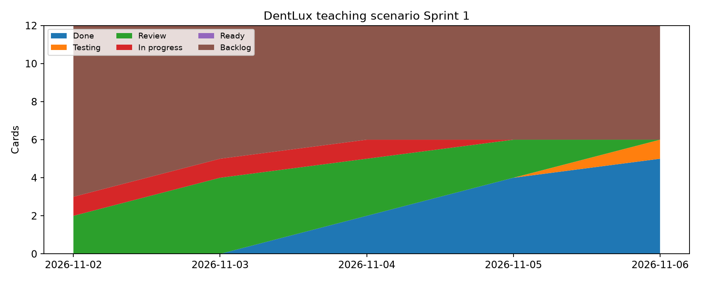
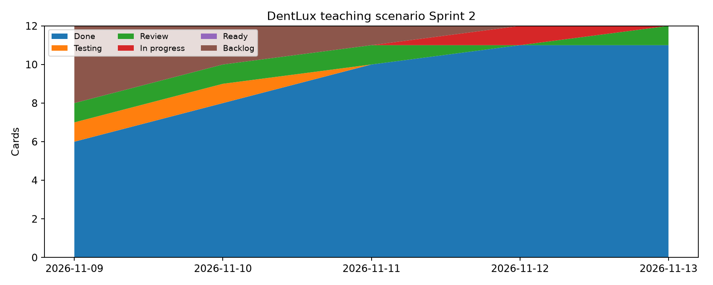

# Лабка 9 Жұмыс процесі және екі спринттің оқу моделі

> Дерек мәртебесі: екі спринттің толтырылған оқу моделі. Модельдік уақыт белгілері нақты GitHub Projects экспорты ретінде көрсетілмейді.

## 9 ЗЖ Жұмыс процесі және екі спринттің оқу моделі

DentLux Portal · АТ жобаларын басқару · түзетілген нұсқа 10 қараша 2026

### Команда

| Қатысушы | Рөлі |
| --- | --- |
| Ізбасхан Әселхан | Project Manager / Frontend / QA |
| Жандос Арлан | Backend / DevOps |
| Еділ Шыңтас | DB Architecture |

## Дерек мәртебесі

Бұл нұсқа тапсырманың барлық бөлімін толтырылған оқу сценарийімен көрсетеді. Барлық M01–M12 карточкалары мен олардың уақыт белгілері модельденген. Олар GitHub тарихы немесе команданың нақты жұмысы ретінде ұсынылмайды. 10.11.2026 күні екінші спринт аяқталмаған; 13 қараша нәтижелері де модельдік болжам.

Нәтиже: екі спринт үшін throughput, орташа және p85 cycle time, CFD, тар жер талдауы, бір өлшеулі ретроспектива әрекеті және салыстыру берілген. Метрикалар CSV-ден скриптпен есептеледі. Алайда тапсырманың «метрикалар ойдан шығарылмай, құралдан түсірілген» критерийі нақты Projects экспортымен ғана орындалады.

Артефакттар: Дополнения/lab9_model/board.html — күн бойынша жергілікті тақта; model_events.csv — модельдік журнал; sprint1_metrics.json және sprint2_metrics.json — есеп; sprint1_cfd.png және sprint2_cfd.png — диаграммалар. Бұл жергілікті тақта GitHub Projects бапталғанының дәлелі емес.

## 1 Жұмыс процесі және ауысу саясаты

| Кезең | WIP | Шығу шарты |
| --- | --- | --- |
| Backlog | 20 | Мақсат және қабылдау критерийі анықталған |
| Ready | 5 | DoR орындалған және иесі бар |
| In progress | 4 → 3 | PR дайын және өзіндік тексеру өткен |
| Review | 2 | Өзге қатысушы ревьюі өткен |
| Testing | 2 | Қабылдау тесті және регрессия өткен |
| Done | Шексіз | DoD толық орындалған |

Күту Review және Testing бағандарында жеке көрінеді. Шек толса, жаңа тапсырма бастаудың орнына сол кезекті босату қажет. Жалпы белсенді WIP = In progress + Review + Testing. Бір бағанның шегін жалпы WIP-пен салыстыруға болмайды.

## DoR және DoD

DoR: карточканың мақсаты, иесі, өлшенетін қабылдау критерийі, тәуелділігі, бағалауы және бір спринтке сыятын көлемі бар. UI болса, макет қосылады. DoD: басқа қатысушының ревьюі, жасыл CI, функционалдық және регрессиялық тексеру, main-ге біріктіру және дәлелге сілтеме бар. Модельдегі Done осы шарттар орындалды деген жорамалмен қолданылады.

Wiki үшін дайын мәтін: workflow_model.md. Екі спринттің ұзақтығы бес жұмыс күні; бір апталық жоспарлы capacity = 3 × 6 × 0,85 = 15,3 сағат. Карточка саны effort немесе story point-пен теңестірілмейді.

## 2 Бірінші спринттің оқу сценарийі

Кезең 02–06.11.2026. Мақсат: ақпараттық каталогты, дерекқор схемасын және іске қосу ортасын біріктіруге дайындау. Толық брондау бұл спринттің мақсатына кірмейді.

| ID | Жұмыс | Иесі |
| --- | --- | --- |
| M01 | Каталог интерфейсі | Ізбасхан Әселхан |
| M02 | Дәрігерлер API | Жандос Арлан |
| M03 | PostgreSQL схемасы | Еділ Шыңтас |
| M04 | Docker ортасы | Жандос Арлан |
| M05 | Каталог QA | Ізбасхан Әселхан |
| M06 | UI мен API біріктіру | Жандос Арлан |

Модельдік шолу: M01–M05 аяқталды, M06 Testing кезегінде қалды. Throughput = 5; орташа cycle time = 2.58 күн; p85 = 3.17 күн. Бұл көрсеткіштер нақты демо немесе GitHub merge дәлелі емес.

CFD күн соңындағы 12 карточканың күйін көрсетеді. 03.11 күн соңында Review-де төрт карточка бар: 2 лимиті бұзылған. Бұл модельдегі бастапқы процестің ақауы; саясат толық сақталды деп есептелмейді. Review-де ұзақ тұру тар жердің белгісі; бес аяқталған карточкадан алынған p85 тұрақты SLA емес.

## 3 Ретроспектива хаттамасының оқу үлгісі

Модельдік сессия 06.11.2026, 17:00–17:20, UTC+5. Үш қатысушының рөлі көрсетілген сценарий; нақты өткізілген жиналыс немесе келісім ретінде берілмейді.

| Бақылау | Түсіндіру |
| --- | --- |
| Жақсы нәтиже | Бес карточка аяқталды, бір интеграция тапсырмасы Testing-де қалды |
| Кедергі | Review кезегінің ұзақ күтуі жаңа жұмысты бастаумен қатар жүрді |
| Тексерілетін гипотеза | Бір мезетте басталған жұмысты азайту review үшін уақыт босатуы мүмкін |

## Бір өлшеулі әрекет

Оқу сценарийіндегі жалғыз өзгеріс: екінші спринтте In progress WIP шегін 4-тен 3-ке азайту. Иесі — Ізбасхан Әселхан. Күшіне енуі — 09.11.2026; бағалау — 13.11.2026. Review және Testing шектері 2 күйінде қалады. Қосымша күнделікті рәсім немесе екінші әрекет енгізілмейді.

Өлшем: In progress күн соңындағы саны 3-тен аспауы; throughput кемінде 5; p85 cycle time бірінші спринттегі 3.17 күннен аспауы. Мақсатты орындау себептік әсердің дәлелі емес: тапсырмалардың көлемі және M06 carry-over нәтижеге ықпал етеді.

## Өлшеу ережесі

Cycle time — алғашқы In progress-тен алғашқы Done-ға дейінгі күнтізбелік уақыт. p85 — реттелген қатардың ceil(0,85 × n) элементі. Throughput — кезең ішінде алғаш Done болған карточкалар саны. UTC+5 қолданылады; аяқталу күні толық кіреді. Ашық карточкалар cycle time үлгісіне кірмейді, олардың жасы бөлек есептеледі.

## 4 Екінші спринттің оқу сценарийі

Кезең 09–13.11.2026 — модельдік болашақ нәтиже. Мақсат: бос слотты таңдау мен брондау интерфейсін API және дерекқор транзакциясымен біріктіру. M06 carry-over және M07–M12 жаңа жұмыстары қаралады.

| ID | Жұмыс | Иесі |
| --- | --- | --- |
| M07 | Брондау формасы | Ізбасхан Әселхан |
| M08 | Бос слот API | Жандос Арлан |
| M09 | Брондау транзакциясы | Еділ Шыңтас |
| M10 | OTP интерфейсі | Ізбасхан Әселхан |
| M11 | Қайталама бронь QA | Ізбасхан Әселхан |
| M12 | OTP провайдер адаптері | Жандос Арлан |

Модельдік шолу: M06–M11 аяқталды; M12 Review-де ашық. M06 бірінші спринтте басталғандықтан оның толық cycle time-ы екінші спринттің үлгісіне кіреді. Оны қысқартып есептеу нәтижені бұрмалайды.

Бұл CFD-де Done жинақталған сан: алдыңғы спринттің бес Done карточкасы бастапқыда бар. Екінші спринт throughput-ы соңғы Done саны емес, кезеңдегі алғаш аяқталған алты карточка. Демалыста жаңа оқиғалар енгізілмеген.

## 5 Метрикаларды салыстыру және қорытынды

| Көрсеткіш | 1 спринт модель | 2 спринт модель |
| --- | --- | --- |
| Throughput | 5 | 6 |
| Орташа cycle time күн | 2.58 | 1.76 |
| p85 cycle time күн | 3.17 | 5.00 |
| Күн соңындағы ең үлкен жалпы WIP | 5 | 2 |
| Ең үлкен In progress | 1 | 1 |

Throughput 5-тен 6-ға артты, орташа cycle time 2,58-ден 1,76 күнге қысқарды. Бірақ p85 3,17-ден 5 күнге өсті: ұзақ M06 carry-over екінші спринтте ғана аяқталды және шағын үлгіде жоғарғы квантильге қатты әсер етеді. Екінші спринттің барлық оқиғаларында In progress шегі 3-тен аспайды. Модель өзгерістің ықтимал нәтижесін ғана түсіндіреді.

Екінші спринт соңындағы ашық карточканың жасы: M12 = 1.62 күн. Жалпы WIP азаюын жеке әзірлеу бағанының шегімен шатастырмау керек. Күн соңындағы CFD күн ішіндегі қысқа WIP асып кетуін анықтамайды; оқиғаларды жеке тексеру қажет.

## 6 Қайта есептеу және тапсырмаға сәйкестік

Дополнения каталогынан: python -m pip install -r requirements.txt. Одан кейін: python lab9_metrics.py lab9_model/model_events.csv 2026-11-02 2026-11-06 lab9_model/sprint1 және екінші кезең үшін 2026-11-09 2026-11-13 lab9_model/sprint2. board.html браузерде интернетсіз ашылады; күнді таңдау тарихтағы сол күннің соңғы күйін көрсетеді.

Оқу үлгісінде процесс, DoR/DoD, екі мақсат, екі CFD, салыстыру және бір иесі бар өлшеулі әрекет толық берілген. Нақты тапсыру критерийі үшін GitHub Projects-тен шынайы оқиғалар экспортталып, сол скриптпен есептелуі және ретроспектива шынымен өткізілуі қажет. Оқу моделін нақты құрал экспорты деп көрсетуге болмайды.

## Қосымшалар

- [Оқу тақтасы оқиғалар CSV есептеу скрипті және метрикалар](assets/lab9-artifacts.zip)

[Барлық зертханалық жұмыстар](README.md)
